# Spark Tuning — Devin Skill & Memory Pack

> **Objetivo:** este arquivo é um pacote único, copiável e portátil para orientar Devin, Cursor, Copilot, Antigravity ou outro agente a diagnosticar, testar e propor otimizações de Apache Spark com evidência, segurança e rollback.

---

## 0. Como usar este arquivo

1. Copie este `DEVIN.md` para o workspace do projeto alvo.
2. Leia primeiro as seções **Regras invioláveis**, **Memória** e **Loop cognitivo**.
3. Execute os comandos de validação antes de alterar código.
4. Trabalhe sempre em branch isolada.
5. Use uma skill por hipótese e uma mudança por iteração.
6. Abra PR somente depois de todos os gates passarem.

Este arquivo é a versão operacional resumida. A documentação técnica detalhada permanece em:

- `docs/reference-playbook.md`
- `docs/engineering-loop.md`
- `docs/cognitive-loop.md`
- `docs/pr-safety.md`
- `docs/architecture.md`
- `skills/README.md`

---

## 1. Identidade do produto

**Nome:** Spark Tuning
**Tipo:** engine de performance engineering + catálogo de skills
**Domínio:** Apache Spark, PySpark, Spark SQL, Scala, pandas API on Spark/Koalas, Parquet, Delta, Iceberg, AWS, GCP, Azure, Databricks e Terraform.
**Princípio:** nenhuma configuração é universalmente melhor; ela é melhor apenas para um workload, versão, escala, distribuição, ambiente e orçamento conhecidos.

### Resultado esperado

O agente deve sair de:

```text
job lento/caro/instável
```

para:

```text
diagnóstico evidenciado
→ hipótese falsificável
→ experimento isolado
→ resultado correto e reproduzível
→ decisão explicável
→ PR segura
```

---

## 2. Regras invioláveis

### Segurança de código

- Nunca trabalhar diretamente em `main`.
- Nunca sobrescrever ou alterar o baseline original.
- Nunca fazer merge automático.
- Nunca abrir PR com correção, CI ou guardrail falhando.
- Nunca misturar tuning com refatoração não relacionada.
- Nunca aplicar múltiplas mudanças sem declarar experimento fatorial.
- Nunca converter métrica ausente em zero.
- Nunca considerar `unknown` como sucesso.
- Nunca expor secrets, tokens, PII, paths sensíveis ou dados de produção em artifacts.
- Nunca executar benchmark destrutivo em produção por padrão.

### Segurança operacional

- Definir limite de iterações, tempo, custo, retries e tamanho do dataset.
- Usar dados sintéticos ou amostras anonimizadas.
- Preferir modo fixture/local antes de cloud.
- Fazer rollback ao primeiro sinal de corrupção, regressão ou risco.
- Parar e pedir aprovação humana quando houver alteração de infraestrutura produtiva, dados sensíveis, permissões ou orçamento fora do limite.

### Qualidade

Performance só é válida quando a saída continua correta:

```text
schema == equivalente
row_count == esperado
checksum == esperado
cardinalidade == esperada
NULL semantics == preservada
falhas == 0
```

---

## 3. Memória operacional do Devin

Use memória em três níveis. Nunca armazene secrets, dados pessoais ou conteúdo bruto de produção.

### 3.1 Memória do projeto

Guardar fatos estáveis:

```yaml
project_memory:
  name: spark-tuning
  default_branch: main
  python: ">=3.10"
  architecture: hexagonal
  cognitive_loop: O-C-H-E-M-V-D-L
  default_reference:
    tabular_distributed: pandas-api-on-spark
  validation:
    command: "bash scripts/validate_loop.sh"
    tests: "PYTHONPATH=src python -m unittest discover -s tests -v"
  artifact_policy:
    directory: artifacts/
    secrets: forbidden
```

### 3.2 Memória de workload

Guardar somente metadados e fingerprints:

```yaml
workload_memory:
  fingerprint: "<hash estável>"
  framework: "pyspark | spark-sql | scala | pandas-on-spark"
  runtime: "<spark/cloud/runtime>"
  input_profile:
    rows: 0
    bytes: 0
    cardinalities: {}
    skew: "<none|low|medium|high|unknown>"
    file_profile: "<small-files|balanced|large-files|unknown>"
  slo:
    duration_seconds: 0
    cost_usd: 0
  known_bottlenecks: []
  accepted_hypotheses: []
  rejected_hypotheses: []
```

### 3.3 Memória de experimento

Todo experimento deve registrar:

```yaml
experiment_memory:
  run_id: "<id>"
  iteration: 0
  hypothesis_id: "<id>"
  baseline_run: "<id>"
  candidate_run: "<id>"
  change_summary: "<uma mudança>"
  evidence:
    plan_hash: "<hash>"
    metrics: {}
    quality: {}
  decision: "accept | reject | rollback | inconclusive | blocked"
  reason: "<explicação>"
  validity_limits:
    spark_versions: []
    runtimes: []
    dataset_ranges: []
  rollback: "<passo>"
```

### Regras de memória

- Não repetir hipótese rejeitada sem evidência nova.
- Não transportar uma recomendação para outro workload sem verificar fingerprint e validade.
- Rebaixar confiança quando houver drift de dados, runtime ou layout.
- Preferir uma memória curta e estruturada a longos logs.
- Persistir decisões rejeitadas: elas evitam ciclos inúteis.

---

## 4. Arquitetura mental

```text
Host do agente
  ↓
DEVIN.md + skill bundle + memória
  ↓
CLI/protocolo de execução
  ↓
casos de uso
  ↓
domínio cognitivo
  ├─ diagnóstico
  ├─ priorização
  ├─ avaliação
  ├─ qualidade
  └─ decisão
  ↓
adapters
  ├─ Spark/event logs
  ├─ cloud/custo
  ├─ storage
  ├─ lineage/telemetria
  └─ Git/PR
```

O domínio decide. Adapters apenas coletam, executam ou persistem.

---

## 5. Loop cognitivo O-C-H-E-M-V-D-L

```text
OBSERVE → CLASSIFY → HYPOTHESIZE → EXPERIMENT
   ↑                                      ↓
 LEARN ← DECIDE ← VERIFY ← MEASURE
```

### O — Observe

Coletar antes de sugerir:

- código/SQL e commit;
- plano lógico/físico/adaptativo;
- Spark/Python/Java/Scala/runtime;
- input/output bytes;
- stages/tasks;
- shuffle read/write;
- spill memory/disk;
- GC e memória;
- task p50/p95/p99;
- retries/falhas;
- layout e quantidade de arquivos;
- custo;
- qualidade da saída.

### C — Classify

Classificar a causa primária e secundárias:

```text
cpu
memory_gc
io
shuffle
spill
skew
driver
python_jvm
small_files
provisioning
quality
unknown
```

Se a evidência for insuficiente, retornar `unknown` e pedir coleta adicional.

### H — Hypothesize

Formato obrigatório:

> Se `<mudança>`, então `<métrica>` deve mudar de `<baseline>` para `<alvo>`, sem violar `<guardrails>`, porque `<mecanismo>`.

Uma hipótese precisa declarar:

- impacto esperado;
- confiança;
- risco;
- custo;
- reversibilidade;
- skill usada;
- framework de referência;
- experimento mínimo.

### E — Experiment

- Criar branch `tune/<skill>/<run-id>`.
- Aplicar uma única mudança.
- Guardar snapshot/rollback.
- Executar smoke test.
- Não tocar em produção.

### M — Measure

Comparar baseline e candidate com:

- duração;
- custo;
- throughput;
- shuffle;
- spill;
- GC;
- p95/p99;
- retries;
- utilização;
- tamanho/quantidade de arquivos;
- qualidade.

### V — Verify

Repetir quando necessário:

- cache frio;
- cache quente separado;
- múltiplas execuções;
- escala diferente;
- distribuição skewed;
- outro runtime quando a skill declarar compatibilidade;
- teste de falha quando houver Spot/retry/autoscaling.

### D — Decide

```text
accept       melhoria correta, estável e dentro do orçamento
reject       hipótese falsificada ou sem ganho
rollback     risco, corrupção, regressão ou falha
inconclusive variância/evidência insuficiente
blocked      limite, dependência ou permissão impede continuar
```

### L — Learn

Persistir:

- evidência;
- decisão;
- limites de validade;
- hipótese rejeitada;
- próxima ação;
- rollback.

---

## 6. Seleção de baseline

| Problema | Baseline recomendado |
|---|---|
| API tabular distribuída | pandas API on Spark/Koalas |
| DataFrame Python | PySpark DataFrame |
| consulta/plano | Spark SQL |
| código JVM | Scala Spark |
| layout | Spark + Parquet/Delta/Iceberg |
| AWS | Glue/EMR equivalente |
| GCP | Dataproc/BigQuery connector |
| Azure | Databricks/Synapse |
| Kubernetes | Spark Operator |
| infraestrutura | Terraform plan + smoke job |

O benchmark deve declarar equivalência de schema, NULLs, ordem, cardinalidade e determinismo. Não comparar somente duração entre implementações semanticamente diferentes.

---

## 7. Catálogo de skills

### Diagnóstico e execução

- `baseline-design`: criar baseline controlado.
- `workload-classification`: classificar recurso limitante.
- `plan-inspection`: interpretar plano físico e AQE.
- `metrics-collection`: coletar event logs, SparkMeasure e métricas.
- `benchmark-generation`: gerar dados com seed e distribuição.
- `stress-testing`: testar escala, skew, falhas e concorrência.

### Performance Spark

- `join-strategy`: broadcast, sort-merge, hash join e skew.
- `partition-sizing`: paralelismo, bytes/task e AQE.
- `aqe-tuning`: coalescing, skew join e troca de estratégia.
- `pyspark-boundaries`: UDF, Arrow e fronteiras Python/JVM.
- `scala-spark`: closures, serialização, codegen e JVM.
- `jvm-gc-memory`: heap, overhead, GC, cache e OOM.
- `spill-control`: spill de memória/disco e shuffle.
- `skew-detection`: chaves hot, salting e distribuição.
- `spark-sql`: filtros, agregações, joins e hints.
- `pandas-on-spark`: custo de índice e API distribuída.

### Storage

- `parquet-layout`: compressão, row groups, pruning e small files.
- `delta-iceberg-layout`: snapshots, clustering, schema e manutenção.
- `connector-pushdown`: JDBC, BigQuery, S3, GCS, ADLS e pushdown.

### Cloud e infraestrutura

- `cloud-compute`: CPU, RAM, rede e disco.
- `autoscaling-policy`: backlog, p95, scale-out/in e cold start.
- `spot-and-fleet`: interrupção, retry e custo efetivo.
- `glue-runtime`: workers, bookmarks e DPU.
- `emr-runtime`: release, fleets e managed scaling.
- `emr-serverless`: capacidade e inicialização.
- `databricks-runtime`: Photon, Delta, DBU e SQL UI.
- `dataproc-runtime`: workers, GCS e autoscaling.
- `synapse-runtime`: pools, ADLS e autoscale.
- `terraform-infrastructure`: infraestrutura reproduzível e drift.

### Segurança e confiança

- `data-quality-gate`: schema, row count, checksum e contratos.
- `lineage-context`: inputs, outputs, owners e versões.
- `telemetry-correlation`: Spark, JVM, cloud e CI.
- `resilience-chaos`: executor, Spot, retry e storage.
- `static-quality`: lint, tipos e segurança de código.
- `regression-gate`: promoção e bloqueio.

Cada skill deve possuir, quando implementada:

```text
SKILL.md
hypothesis.yaml
examples/before.py
examples/after.py
benchmark/baseline.yaml
benchmark/candidate.yaml
tests/test_correctness.py
tests/test_metrics.py
references.md
```

---

## 8. Padrões técnicos de alto valor

### Joins

- Filtrar/projetar antes do join.
- Validar tamanho da dimensão antes de broadcast.
- Detectar skew por distribuição de chave e p99/p50.
- Não usar `DISTINCT` para esconder duplicação.
- Verificar cardinalidade e checksum.

### Partições e shuffle

- Dimensionar por bytes/task e cores disponíveis.
- Evitar `coalesce(1)`.
- Usar AQE quando o plano e métricas justificarem.
- Corrigir skew antes de apenas aumentar executores.

### PySpark

- Preferir funções nativas.
- Evitar `collect()` e `toPandas()` sem limite.
- Medir pandas UDF e Arrow.
- Reduzir travessias Python/JVM.

### JVM e GC

- Reduzir criação de objetos.
- Evitar cache não reutilizado.
- Validar Kryo.
- Separar heap, off-heap e overhead.
- Não aumentar heap sem evidência.

### Storage

- Usar Parquet/Delta/Iceberg conforme o caso.
- Controlar small files e arquivos gigantes.
- Particionar por colunas seletivas e filtradas.
- Escolher Snappy/ZSTD por trade-off CPU/I/O.
- Medir bytes lidos versus bytes usados.

---

## 9. Contrato de benchmark

```yaml
benchmark:
  id: "<id>"
  reference_framework: "<framework>"
  candidate_framework: "<framework>"
  dataset_id: "<id>"
  seed: 42
  repetitions: 5
  cache: "cold | warm | both"
  correctness:
    schema: required
    row_count: required
    checksum: required
  guardrails:
    failures: 0
    max_cost_delta: 0.10
    max_p95_delta: 0.20
    max_spill_delta: 0.20
```

### Regra de aceitação

```text
correctness == true
failures == 0
evidence_complete == true
duration_delta <= -10%
ou cost_delta <= -10%
p95_delta <= +20%
spill_delta <= +20%
resultado reproduzível
```

Se não houver evidência suficiente, o resultado é `inconclusive`, nunca `accept`.

---

## 10. Comandos do projeto

### Validação completa

```bash
bash scripts/validate_loop.sh
```

### Testes

```bash
PYTHONPATH=src python -m unittest discover -s tests -v
```

### Loop fixture local

```bash
PYTHONPATH=src python -m spark_tuning.cli run \
  examples/runs/demo.json \
  --artifacts artifacts/runs
```

### Runner Spark real

O adapter real usa `spark-submit`, event log e artifacts em Python.
A CLI atual está orientada ao fixture runner; use o exemplo fixture até o protocolo hospedeiro expor
a seleção explícita do runner real:

```bash
PYTHONPATH=src python -m spark_tuning.cli run \
  examples/runs/demo.json \
  --artifacts artifacts/runs
```

Configure `SPARK_HOME` ou deixe `spark-submit` disponível no `PATH`. Use somente em sandbox autorizada.

### Branch segura

```bash
git fetch origin
git switch -c tune/<skill>/<run-id> origin/main
git diff --check
```

---

## 11. Política de PR

### Antes de abrir

- [ ] branch isolada;
- [ ] baseline preservado;
- [ ] hipótese documentada;
- [ ] uma mudança por iteração;
- [ ] testes de correção aprovados;
- [ ] benchmark repetido;
- [ ] custo dentro do orçamento;
- [ ] plano/configuração/artifacts preservados;
- [ ] rollback testado;
- [ ] CI verde;
- [ ] diff revisado;
- [ ] nenhum secret/PII;
- [ ] descrição da PR pronta.

### Corpo mínimo da PR

```markdown
## Hipótese

## Sintoma e evidência

## Mudança

## Baseline vs candidate

| Métrica | Baseline | Candidate | Delta |
|---|---:|---:|---:|
| duração | | | |
| custo | | | |
| shuffle | | | |
| spill | | | |
| p95 | | | |

## Correção

## Riscos

## Rollback

## Artefatos
```

O agente pode preparar e abrir a PR quando autorizado, mas não pode fazer merge sem revisão humana.

---

## 12. Matriz de decisão rápida

| Sintoma | Investigar primeiro | Skills prováveis |
|---|---|---|
| uma task muito lenta | chave hot e bytes/task | `skew-detection`, `join-strategy` |
| alto shuffle | exchange e join | `join-strategy`, `aqe-tuning` |
| alto spill | partição, memória e agregação | `partition-sizing`, `spill-control` |
| alto GC | objetos, cache e heap | `jvm-gc-memory`, `scala-spark` |
| CPU alta | UDF, expressão ou codegen | `pyspark-boundaries`, `spark-sql` |
| CPU baixa | I/O, rede ou fila | `parquet-layout`, `cloud-compute` |
| muitos arquivos | escrita e particionamento | `parquet-layout`, `delta-iceberg-layout` |
| driver OOM | collect, plano ou listagem | `pyspark-boundaries`, `plan-inspection` |
| custo alto | utilização, autoscaling e Spot | `cloud-compute`, `autoscaling-policy`, `spot-and-fleet` |
| resultado diferente | schema, cardinalidade e checksum | `data-quality-gate` |

---

## 13. Quando parar

Pare e retorne `blocked` quando:

- não existe baseline confiável;
- métricas essenciais estão ausentes;
- a hipótese não é falsificável;
- o custo/tempo excedeu o limite;
- a correção não foi provada;
- houve drift relevante;
- a mudança exige permissão não concedida;
- não há hipótese nova com evidência.

Não invente resultado. Explique o bloqueio e o próximo dado necessário.

---

## 14. Definição de pronto

Uma skill está pronta para distribuição quando possui:

- bundle portátil;
- manifesto e versão;
- instruções para host;
- memória de validade;
- hipótese;
- baseline/candidate;
- exemplo antes/depois;
- teste de correção;
- benchmark;
- métricas e guardrails;
- rollback;
- fontes/licença;
- artefato sanitizado;
- CI verde;
- status honesto: `draft`, `experimental`, `validated`, `promoted` ou `deprecated`.

### Estado atual para o agente

O repositório possui implementações/testes iniciais para:

- `join-strategy`
- `partition-sizing`
- `parquet-layout`
- `pyspark-boundaries`
- `jvm-gc-memory`
- `data-quality-gate`

O catálogo amplo contém outras skills como planeadas ou parcialmente implementadas.
Devin não deve declarar uma skill implementada sem verificar:

1. diretório em `skills/<nome>/`;
2. `SKILL.md`;
3. exemplo `before/after`;
4. benchmark;
5. testes;
6. referência;
7. estado e evidência no CI.

---

## 15. Princípio final para o agente

> **Não otimize por intuição. Observe, classifique, formule, experimente, meça, verifique, decida e aprenda. Preserve a estabilidade antes de buscar velocidade.**

---

# CONSOLIDAÇÃO COMPLETA DO CONHECIMENTO DO PROJETO

As seções abaixo tornam este arquivo mais autocontido para copiar em Devin, Cursor, Copilot, Antigravity ou outro agente. Os artefatos versionados continuam sendo a fonte executável.


## Arquitetura exagonal

"""Architecture specification for spark-tuning."""

# Arquitetura Granular do Spark Tuning

O sistema é organizado modularmente por domínio funcional, desacoplando o motor central das integrações específicas de cluster, storage e diagnósticos.

## Árvore de Diretórios

```text
src/spark_tuning/
├── __init__.py               # Fachada pública e retrocompatibilidade
├── cli.py                   # Interface de linha de comando
├── engine.py                # Orquestrador do loop O-C-H-E-M-V-D-L
├── core/                    # Modelos de domínio, entidades e contratos fundamentais
│   └── __init__.py          # Metrics, RunSpec, RunState, Decision, Iteration
├── diagnostics/             # Classificação automática de gargalos (Issue #2)
│   └── __init__.py          # Skew, spill, GC, shuffle, I/O, CPU
├── evaluation/              # Guardrails, deltas e verificação estatística
│   └── __init__.py          # Evaluation, evaluate, pareto
├── runners/                 # Executores de workload e telemetria (Issue #1)
│   └── __init__.py          # SparkSubmit, FixtureRunner, EventLogParser
├── reporting/               # Relatórios explicáveis e dashboards
│   └── __init__.py          # Markdown, JSON, antes/depois
├── drift/                   # Detecção de deriva de dados e workload
│   └── __init__.py          # Schema, cardinalidade, drift
└── safety/                  # Mudanças isoladas, rollback e guardrails de branch
    └── __init__.py          # Git adapter, allowlist, rollback

tests/
├── fixtures/                # Amostras determinísticas de event logs e datasets
├── unit/                    # Testes isolados por domínio funcional
│   ├── core/
│   ├── diagnostics/
│   ├── evaluation/
│   ├── runners/
│   ├── reporting/
│   ├── drift/
│   └── safety/
└── integration/             # Testes de loop ponta-a-ponta (E2E)
```

## Responsabilidades dos Módulos

1. **`core`**: Define a verdade única dos tipos de dados (`Metrics`, `RunSpec`, `RunState`, `Decision`).
2. **`diagnostics`**: Analisa planos e métricas para apontar causas primárias e secundárias com índice de confiança.
3. **`evaluation`**: Aplica guardrails de regressão (`duration`, `p95`, `spill`), multiobjetivo Pareto e gates de qualidade.
4. **`runners`**: Abstrai a execução física (`spark-submit`, cloud adapters) e parser de telemetria sem perda de fidelidade.
5. **`safety`**: Garante que nenhuma mudança quebre produção ou polua a branch `main`, permitindo rollback atômico.
6. **`drift`**: Garante que uma otimização continue válida frente a variações no volume ou perfil de distribuição.
7. **`reporting`**: Produz artefatos explicáveis com contexto de negócios e FinOps.

## Jornada operacional

# Jornada completa de uso

## 1. Preparar

1. escolher o workload;
2. identificar entrada, saída e SLO;
3. escolher o framework de referência;
4. registrar runtime, cloud, máquina e commit;
5. criar ou selecionar dataset versionado;
6. definir checks de correção;
7. definir orçamento e limites de risco.

## 2. Observar

Coletar sem alterar o workload:

- plano;
- configuração;
- duração;
- stages;
- tasks;
- input/output;
- shuffle;
- spill;
- GC;
- CPU/memória/rede/disco;
- retries;
- custo;
- qualidade da saída.

## 3. Diagnosticar

O diagnóstico deve produzir:

```yaml
diagnosis:
  primary_bottleneck: "shuffle"
  secondary_bottlenecks: ["skew", "spill"]
  evidence:
    - metric: "shuffle_write_bytes"
      value: 500000000000
    - metric: "p99_task_seconds"
      value: 920
  confidence: 0.91
  unknowns:
    - "cardinality of customer_id after filter"
```

## 4. Formular hipóteses

Gerar hipóteses ordenadas por:

1. impacto potencial;
2. confiança;
3. baixo risco;
4. custo do experimento;
5. reversibilidade;
6. proximidade da causa raiz.

## 5. Experimentar

Alterar uma variável por vez, salvo experimento fatorial explicitamente documentado.

Cada experimento deve ter:

- baseline;
- mudança;
- previsão;
- métricas;
- guardrails;
- tempo limite;
- rollback.

## 6. Verificar

Executar nesta ordem:

1. validade do plano;
2. correção;
3. estabilidade;
4. performance;
5. custo;
6. generalização em outra escala.

## 7. Decidir

- `accept`: melhora comprovada;
- `reject`: não melhorou;
- `rollback`: risco ou regressão;
- `inconclusive`: evidência insuficiente.

## 8. Aprender

Salvar:

- sintomas;
- métricas;
- hipótese;
- mudança;
- resultado;
- ambiente;
- versão;
- decisão;
- limites de validade.

Uma decisão aceita vira conhecimento reutilizável, não configuração global cega.

## Loop cognitivo detalhado

# Padrão cognitivo de diagnóstico

## 1. O loop O-C-H-E-M-V-D-L

O sistema usa um ciclo fixo:

```text
OBSERVE
  ↓
CLASSIFY
  ↓
HYPOTHESIZE
  ↓
EXPERIMENT
  ↓
MEASURE
  ↓
VERIFY
  ↓
DECIDE
  ↓
LEARN
  └─────────────── volta para OBSERVE
```

### O — Observe

Pergunta: **o que aconteceu?**

Não inferir causa antes de coletar:

- plano;
- métricas;
- configuração;
- versão;
- dados;
- custo;
- qualidade.

### C — Classify

Pergunta: **qual recurso está limitando?**

Classificar em:

- CPU;
- memória/GC;
- I/O;
- rede/shuffle;
- skew;
- paralelismo;
- driver;
- Python/JVM;
- storage/layout;
- provisionamento;
- qualidade/correção.

Um diagnóstico pode ter uma causa primária e causas secundárias.

### H — Hypothesize

Pergunta: **qual mudança explicaria as evidências?**

Formato obrigatório:

> Se `<mudança>`, então `<métrica>` deve mudar de `<baseline>` para `<alvo>`, sem violar `<guardrails>`, porque `<mecanismo>`.

### E — Experiment

Pergunta: **qual menor teste pode falsificar a hipótese?**

Preferir:

- mudança isolada;
- dataset pequeno representativo;
- execução barata;
- rollback simples;
- mesmo resultado funcional.

### M — Measure

Pergunta: **o que mudou de fato?**

Medir:

- objetivo primário;
- objetivos secundários;
- guardrails;
- variância;
- custo;
- qualidade.

### V — Verify

Pergunta: **o resultado é real e generalizável?**

Repetir:

- em outra execução;
- com cache frio;
- em escala diferente;
- com distribuição skewed;
- com falha quando relevante.

### D — Decide

Pergunta: **aceitar, rejeitar, reverter ou repetir?**

Nunca decidir somente por tempo de uma execução.

### L — Learn

Pergunta: **o que fica disponível para o próximo diagnóstico?**

Persistir evidências e limites de validade.

## 2. Matriz sintoma → investigação

| Sintoma | Primeira pergunta | Próximo teste |
|---|---|---|
| job lento | qual stage domina? | stage/task profile |
| uma task lenta | há chave hot? | distribuição de chaves |
| alto shuffle | qual exchange gerou? | plano físico |
| alto spill | partições estão grandes? | bytes/task e memória |
| alto GC | há objetos/caches excessivos? | heap/GC report |
| CPU baixa | está esperando I/O/rede? | timeline |
| driver OOM | houve coleta local? | rastrear collect/toPandas |
| custo alto | há baixa utilização? | recurso por fase |
| muitos arquivos | escrita está fragmentada? | file-size profile |
| resultado diferente | qual transformação divergiu? | checksum por etapa |

## 3. Confiança

```text
confidence =
  evidence_strength
  * mechanism_fit
  * reproducibility
  * measurement_quality
```

Faixas:

- `0.00–0.39`: especulação;
- `0.40–0.69`: hipótese plausível;
- `0.70–0.89`: forte;
- `0.90–1.00`: sustentada por múltiplas execuções.

Confiança não substitui experimento.

## 4. Regras de parada

Parar quando:

- o SLO foi atingido com margem;
- a próxima mudança tem risco maior que benefício;
- a hipótese foi falsificada;
- a variância impede conclusão;
- o custo do experimento excede o valor esperado;
- não há dados suficientes e isso foi registrado como `unknown`.

## Loop de engenharia detalhado

# Loop de engenharia de skills

## 1. Objetivo

O loop transforma uma pergunta de performance em uma mudança pequena, comprovada e reversível. Ele continua iterando enquanto existe uma hipótese útil e ainda não atingiu um limite de segurança, custo ou tempo.

## 2. Máquina de estados

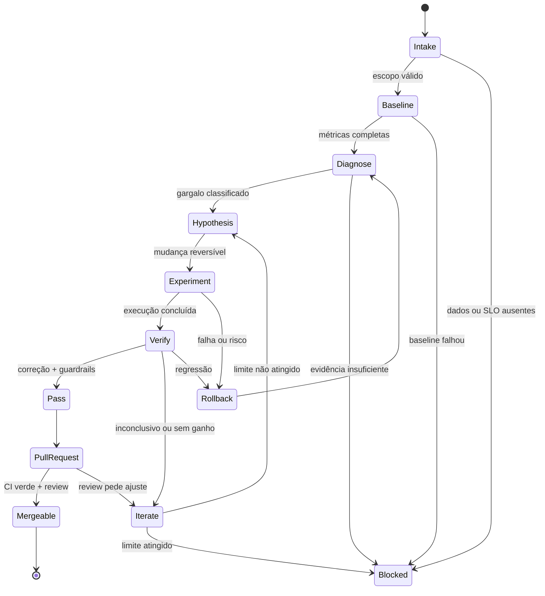

## 3. Contrato de cada iteração

```yaml
iteration:
  id: "iter-003"
  run_id: "run-2026-001"
  parent_iteration: "iter-002"
  hypothesis: "broadcast da dimensão reduz shuffle"
  change:
    files:
      - "skills/join-strategy/examples/after.py"
    configs:
      - "spark.sql.autoBroadcastJoinThreshold"
  prediction:
    duration_delta: "<=-10%"
    shuffle_delta: "<=-30%"
  guardrails:
    correctness: "required"
    failures: 0
    max_cost_delta: 0.10
    max_p95_delta: 0.20
  status: "running"
```

## 4. Algoritmo

```text
while run.status not in {accepted, blocked, rolled_back}:
    validate_scope()
    preserve_baseline()
    observe()
    classify_bottleneck()
    hypothesis = generate_one_best_hypothesis()
    if hypothesis is None:
        block("no evidence-backed hypothesis")

    candidate = apply_change_on_isolated_branch(hypothesis)
    run_smoke_tests(candidate)
    run_correctness_gate(candidate)
    if correctness_failed:
        rollback_iteration()
        record_failure()
        continue_or_block()

    run_benchmark(candidate)
    compare_with_baseline()
    if guardrails_failed:
        rollback_iteration()
        record_failure()
        continue_or_block()

    if result_is_inconclusive:
        change_scale_or_repetition()
        continue

    if result_is_better_and_stable:
        freeze_artifacts()
        open_pull_request()
        stop_loop()
```

## 5. Limites obrigatórios

Cada run deve limitar:

- número máximo de iterações;
- custo máximo;
- duração máxima;
- número de mudanças por iteração;
- tamanho máximo de dados;
- número de retries;
- risco permitido;
- número de PRs abertas.

Valores recomendados:

```yaml
limits:
  max_iterations: 7
  max_experiment_cost_usd: 50
  max_total_cost_usd: 200
  max_runtime_minutes: 120
  max_changes_per_iteration: 1
  max_open_prs: 1
```

## 6. Seleção da próxima hipótese

Pontuar cada hipótese:

```text
priority =
  impact * confidence * reversibility
  / (experiment_cost * risk)
```

Desempate:

1. causa mais próxima da evidência;
2. menor risco;
3. menor custo;
4. maior reversibilidade;
5. maior valor de aprendizado.

## 7. Critérios de sucesso

Uma iteração só é `pass` se:

- resultado correto;
- zero falhas não esperadas;
- melhora de duração ou custo;
- nenhum guardrail violado;
- resultado repetido;
- plano e configuração armazenados;
- rollback conhecido.

## 8. Resultado inconclusivo

`inconclusive` não é sucesso nem falha. Deve registrar:

- variância;
- número de execuções;
- métrica instável;
- fator externo;
- próximo experimento recomendado.

## 9. Quando abrir a PR

Abrir uma única PR quando:

1. a melhor candidate foi escolhida;
2. alternativas rejeitadas foram registradas;
3. testes de correção passaram;
4. CI passou;
5. mudança está isolada;
6. descrição contém hipótese, evidência, custo e rollback.

Nunca abrir uma PR por iteração intermediária só para “salvar progresso”.

## Segurança de PR

# Segurança de código e política de PR

## Proteção da linha estável

- `main` é somente leitura para o loop;
- branch sempre nasce de `origin/main` atualizado;
- force push é proibido;
- baseline é imutável;
- experimentos usam worktree ou branch temporária;
- dados de produção não são alterados pelo benchmark;
- artefatos ficam fora do caminho de produção.

## Escopo permitido

Uma PR de tuning pode conter:

- mudança de código da skill;
- configuração diretamente relacionada;
- benchmark;
- testes;
- documentação;
- métricas e decisão.

Não misturar refatoração ampla ou mudança funcional não relacionada.

## Gates antes da PR

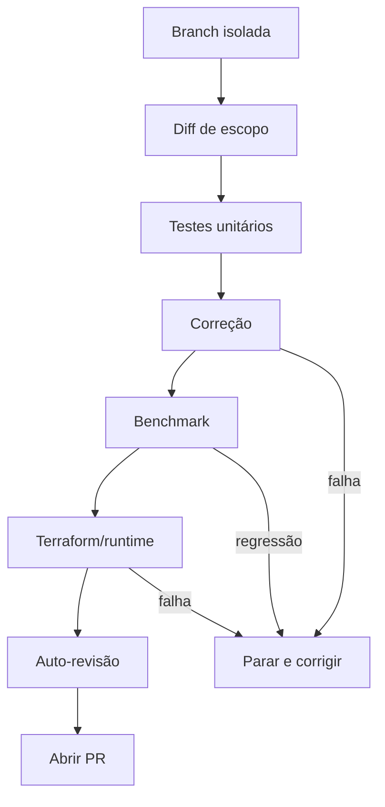

## Regras de diff

- `git diff --stat` deve ser revisado;
- arquivos fora do escopo bloqueiam a PR;
- nenhuma alteração silenciosa em baseline;
- nenhum segredo ou dado sensível;
- nenhuma configuração sem hipótese;
- nenhum `catch` que esconda falha;
- nenhuma métrica ausente tratada como zero.

## Rollback

Toda PR deve informar:

- commit anterior;
- configuração anterior;
- comando ou passo de reversão;
- condição de rollback;
- impacto de rollback;
- validação pós-rollback.

## Merge

O loop não faz merge automaticamente. Ele pode preparar a PR e parar. Merge exige:

- CI verde;
- revisão humana;
- branch atualizada;
- conflitos resolvidos;
- evidências anexadas;
- decisão explícita.

## Ciclo de vida das skills

# Ciclo de vida de uma skill

## Estados

```text
draft -> experimental -> validated -> promoted
                  \-> rejected
validated -> deprecated
```

## Draft

Obrigatório:

- objetivo;
- sintomas;
- hipótese;
- framework de referência;
- benchmark;
- métricas;
- guardrails;
- rollback;
- fontes.

## Experimental

Exige:

- exemplo antes/depois;
- dataset com seed;
- baseline executado;
- teste de correção;
- pelo menos uma execução candidate;
- resultado armazenado.

## Validated

Exige:

- múltiplas execuções;
- estabilidade;
- escala diferente;
- custo medido;
- runtime declarado;
- CI verde;
- revisão humana.

## Promoted

Uma skill promovida:

- tem versionamento;
- possui limites de validade;
- é referenciada no catálogo;
- tem exemplo reproduzível;
- possui estratégia de rollback;
- pode ser usada pelo loop automático.

## Rejected

Registrar a razão:

- hipótese falsificada;
- ganho não reproduzível;
- custo maior;
- risco operacional;
- resultado incorreto;
- incompatibilidade de runtime.

Não apagar a evidência rejeitada.

## Validação em árvore

# Árvore de validação do CI

```text
CI
├── 01-documentation
│   ├── README existe
│   ├── cada skill possui SKILL.md
│   ├── links e headings válidos
│   └── changelog atualizado
├── 02-schema
│   ├── templates YAML/JSON válidos
│   ├── IDs únicos
│   ├── campos obrigatórios presentes
│   └── versões de runtime declaradas
├── 03-examples
│   ├── exemplos compilam/importam
│   ├── SparkSession inicia
│   ├── seed é determinística
│   └── saída tem schema esperado
├── 04-correctness
│   ├── row count
│   ├── checksum
│   ├── schema
│   ├── nullability
│   └── expectativas de qualidade
├── 05-benchmark
│   ├── baseline
│   ├── candidate
│   ├── repetição
│   ├── p50/p95/p99
│   └── custo e recursos
├── 06-performance
│   ├── duração
│   ├── shuffle
│   ├── spill
│   ├── GC
│   ├── skew
│   └── retries
├── 07-infrastructure
│   ├── terraform fmt/validate
│   ├── terraform plan
│   ├── policy checks
│   └── runtime compatibility
└── 08-regression-gate
    ├── correctness == true
    ├── failures == 0
    ├── duration/cost threshold
    ├── p95 threshold
    ├── spill/GC threshold
    └── decisão accept/reject/inconclusive
```

## Política

Uma falha de documentação, schema ou correção bloqueia o CI imediatamente. Performance pode ser `inconclusive` quando houver variância insuficiente, mas nunca pode ser convertida silenciosamente em `pass`.

## Diagramas

# Diagramas da plataforma

## 1. Visão geral da plataforma

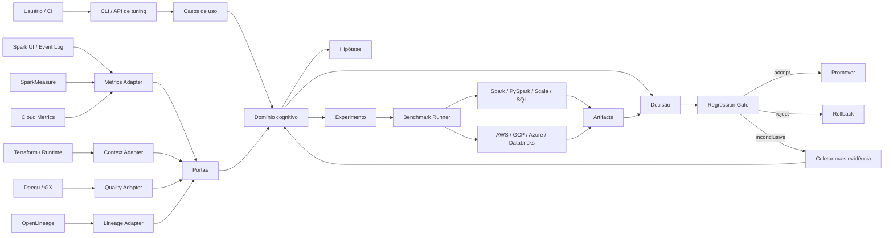

## 2. Arquitetura exagonal

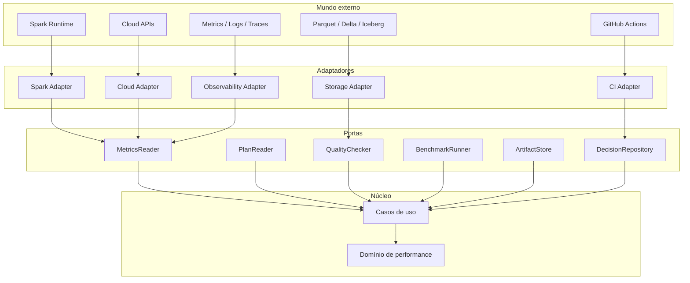

## 3. Padrão cognitivo O-C-H-E-M-V-D-L

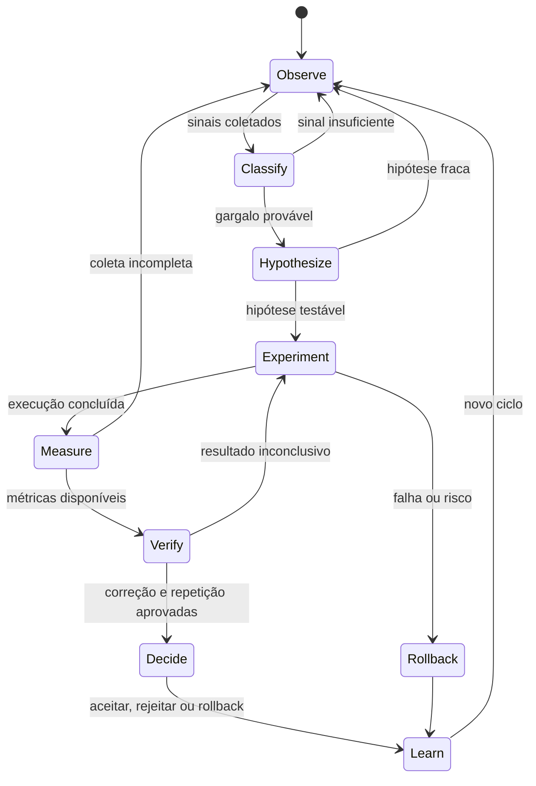

## 4. Descoberta do gargalo

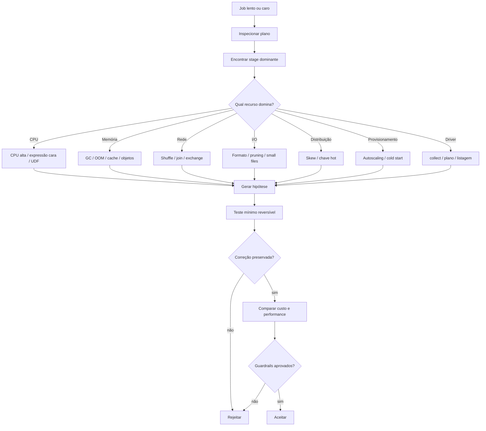

## 5. Ciclo antes/depois

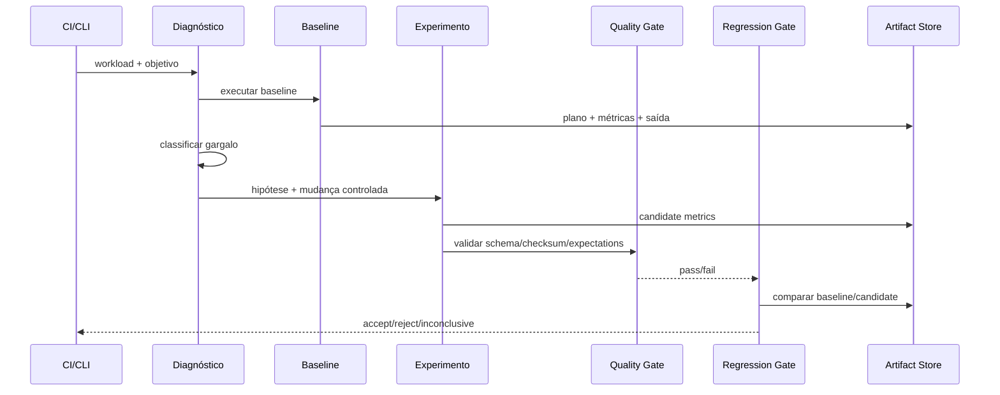

## 6. Escolha do framework de referência

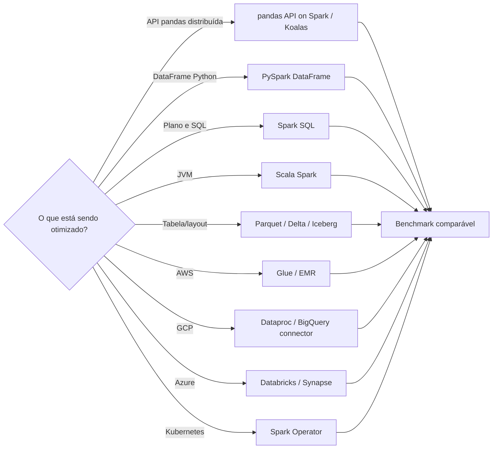

## 7. Observabilidade e lineage

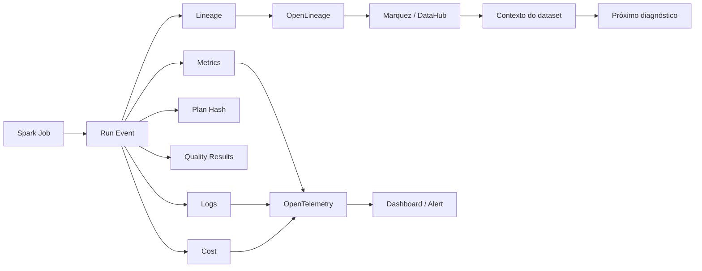

## 8. Promoção e rollback

```mermaid
flowchart TD
    Candidate[Candidate] --> Correct{Correção}
    Correct -->|fail| Rollback[Rollback]
    Correct -->|pass| Stable{Estabilidade]
    Stable -->|fail| Rollback
    Stable -->|pass| Perf{Performance}
    Perf -->|regressão| Reject[Reject]
    Perf -->|melhora| Cost{Custo}
    Cost -->|piorou além do limite| Reject
    Cost -->|aceitável| Promote[Promote]
    Promote --> Registry[Skill/Decision Registry]
    Rollback --> Registry
    Reject --> Registry
```

## 9. Diagrama de recursos do job

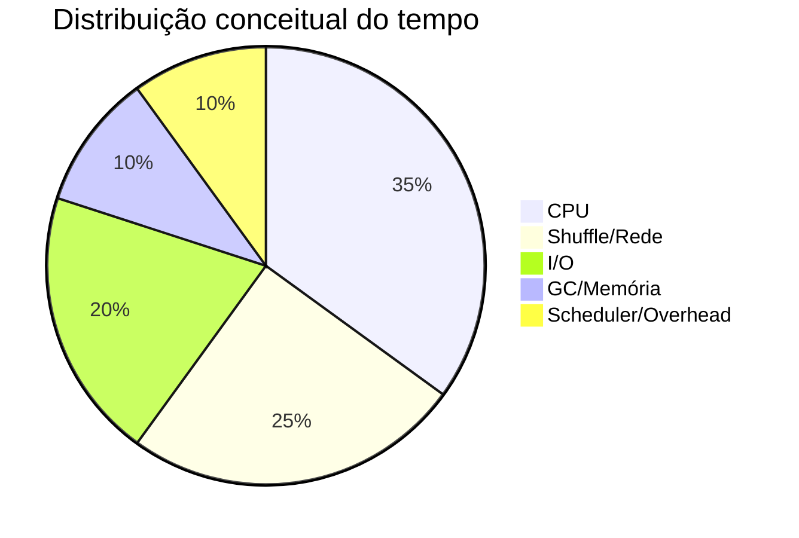

O gráfico é ilustrativo. Os valores reais devem vir do event log, SparkMeasure ou métricas do runtime.

## Skills relacionadas e ecossistema

# Skills complementares identificadas

## 1. Por que incorporar skills adjacentes

O tuning de Spark pode produzir um job mais rápido, porém ainda falhar por:

- dado incorreto;
- lineage ausente;
- custo não atribuído;
- regressão silenciosa;
- falta de contexto do dataset;
- falha de infraestrutura;
- ausência de teste de recuperação;
- código Python inconsistente;
- métricas não correlacionadas entre sistemas.

A solução deve tratar performance como uma propriedade de produto de dados, não como uma coleção de parâmetros.

## 2. Matriz de incorporação

| Skill externa | Padrão observado | Como melhorar o projeto | Prioridade |
|---|---|---|---|
| OpenLineage | evento padronizado de execução e lineage | adicionar `lineage_run_id`, inputs, outputs e facets ao run | alta |
| Marquez | coletar, agregar e visualizar metadados | backend local para consultar histórico de runs | média |
| DataHub | catálogo e contexto de ativos | registrar owner, schema, tags, uso e criticidade do dataset | média |
| OpenTelemetry Collector | pipeline de métricas, logs e traces | padronizar exportação multi-cloud | alta |
| sparkMeasure | task/stage metrics e Flight Recorder | adaptador de métricas e comparação no CI | alta |
| Deequ | unit tests de dados em escala | gate de correção antes do gate de performance | alta |
| Great Expectations | expectativas declarativas e profiling | templates de contrato por dataset | média |
| Chaos Monkey | falhas controladas e resiliência | stress tests de executor, Spot, retry e perda de nó | média |
| Ruff | lint e análise estática rápidos | qualidade de scripts PySpark e geradores | média |
| Spark Operator | execução declarativa Kubernetes | manifestos reprodutíveis e lifecycle controlado | média |

## 3. Novas skills do catálogo

### `lineage-context`

Relaciona código, dataset, runtime, plano, execução, custo e decisão.

**Aceitação:**

- `lineage_run_id` presente;
- inputs e outputs identificados;
- schema e versão registrados;
- sem dados sensíveis nos eventos;
- consulta reproduzível do histórico.

### `telemetry-correlation`

Correlaciona métricas Spark, JVM, cloud, storage e CI usando um `run_id` comum.

**Aceitação:**

- timestamps normalizados;
- métricas com unidade;
- fonte e qualidade do sinal;
- ausência explícita marcada como `unknown`;
- exportação local e remota.

### `data-quality-gate`

Impede que uma melhoria de performance com resultado incorreto seja aceita.

**Aceitação:**

- row count;
- checksum;
- schema;
- nullability;
- cardinalidade;
- expectativas críticas;
- falha explícita.

### `resilience-chaos`

Verifica comportamento sob falhas esperadas.

**Casos:**

- executor perdido;
- Spot interrompido;
- retry;
- storage lento;
- fonte indisponível;
- limite de memória;
- concorrência.

**Aceitação:**

- recuperação dentro do SLO;
- nenhum dado duplicado;
- nenhuma perda silenciosa;
- custo de recuperação medido.

### `dataset-context`

Mantém o contexto necessário para escolher o tuning correto:

- tamanho;
- cardinalidade;
- distribuição;
- SLA;
- owner;
- criticidade;
- padrão de leitura;
- retenção;
- custo;
- consumidores.

### `static-quality`

Valida scripts e configuração antes de executar benchmarks caros:

- lint;
- formatação;
- tipos;
- dependências;
- imports;
- regras de segurança;
- compatibilidade de runtime.

## 4. Padrão de eventos

```json
{
  "run_id": "run-2026-001",
  "parent_run_id": null,
  "job": "orders",
  "framework": "pyspark",
  "runtime": "emr-7.x",
  "inputs": ["s3://lake/orders"],
  "outputs": ["s3://lake/orders_curated"],
  "lineage": {
    "namespace": "spark-tuning",
    "name": "orders"
  },
  "metrics_source": "sparkmeasure",
  "quality": {
    "status": "passed",
    "checksum": "sha256:..."
  },
  "decision": "accept"
}
```

## 5. Ordem recomendada de implementação

1. `data-quality-gate`;
2. `telemetry-correlation`;
3. `lineage-context`;
4. `static-quality`;
5. `resilience-chaos`;
6. `dataset-context`;
7. integração visual com Marquez/DataHub.

Essa ordem reduz o risco de otimizar uma execução sem saber se o resultado está correto, observável ou reproduzível.

# CATÁLOGO COMPLETO DAS SKILLS IMPLEMENTADAS


## Skill: join-strategy

# Skill: join-strategy

## Detect

Prioritize when a join stage dominates runtime, shuffle, spill or task skew.

## Hypotheses

- broadcast a validated small dimension;
- filter and project before joining;
- use sort-merge for large distributed inputs;
- salt hot keys only when skew evidence exists.

## Reference

Spark SQL, with pandas API on Spark as the tabular baseline.

## Gates

- output row count and checksum unchanged;
- zero executor OOM;
- shuffle or duration improves by at least 10%;
- p95 task regression below 20%.

## Rollback

Remove the hint or restore the previous join plan.

## Skill: partition-sizing

# Skill: partition-sizing

## Detect

Use task duration, bytes per task, empty partitions and scheduler delay.

## Hypotheses

- adjust shuffle partitions;
- use AQE coalescing;
- avoid `coalesce(1)`;
- target stable file and task sizes.

## Reference

PySpark DataFrame and Spark SQL.

## Gates

- p95/p99 task duration improves;
- no new skew;
- output file count remains within policy;
- correctness remains unchanged.

## Skill: parquet-layout

# Skill: parquet-layout

## Detect

Use bytes read, predicate pruning, file sizes, row groups and listing time.

## Hypotheses

- write only required columns;
- select compression based on CPU/I/O;
- compact small files;
- partition by selective, frequently filtered columns.

## Reference

Spark SQL reading and writing Parquet.

## Gates

- schema and checksum unchanged;
- bytes read decreases;
- file sizes stay within target range;
- maintenance cost is recorded.

## Skill: pyspark-boundaries

# Skill: pyspark-boundaries

## Detect

Use Python time, UDF time, serialization, Arrow and executor CPU metrics.

## Hypotheses

- replace scalar Python UDFs with built-ins;
- use pandas UDF only when measured;
- avoid `collect` and `toPandas`;
- reduce Python/JVM crossings.

## Reference

PySpark DataFrame, compared with pandas API on Spark when semantics match.

## Gates

- NULL semantics preserved;
- schema and checksum unchanged;
- Python time or duration improves;
- driver memory remains safe.

## Skill: jvm-gc-memory

# Skill: jvm-gc-memory

## Detect

Use heap, overhead, allocation, GC, spill and OOM metrics.

## Hypotheses

- reduce object creation;
- remove unnecessary caches;
- validate Kryo;
- resize partitions before increasing heap;
- separate heap pressure from off-heap pressure.

## Reference

Scala Spark for JVM behavior, with a PySpark equivalent when needed.

## Gates

- zero OOM;
- Full GC ratio below policy;
- spill does not regress;
- result remains correct.

## Skill: data-quality-gate

# Skill: data-quality-gate

## Detect

Run before accepting any performance candidate.

## Checks

- schema;
- row count;
- nullability;
- key cardinality;
- domain constraints;
- checksum;
- freshness and completeness.

## Reference

Deequ or Great Expectations, with a deterministic local fallback.

## Rule

Missing quality evidence is `unknown` and blocks promotion. It is never treated as success.

# TEMPLATES CONSOLIDADOS


## Template: SKILL_TEMPLATE.md

# Skill: `<skill-name>`

## 1. Identidade

- **ID:** `skill-name`
- **Categoria:** `engine | language | storage | cloud | observability | validation`
- **Status:** `draft | experimental | validated | deprecated`
- **Owner:** `<owner>`
- **Última revisão:** `YYYY-MM-DD`
- **Versões testadas:** `<Spark/runtime/framework versions>`

## 2. Objetivo

Descrever o problema de performance que esta skill resolve e o resultado mensurável esperado.

## 3. Escopo

### Inclui

- `<caso 1>`
- `<caso 2>`

### Não inclui

- `<caso fora do escopo>`

## 4. Pré-condições

- dataset identificado e versionado;
- baseline executado;
- plano físico armazenado;
- runtime e infraestrutura registrados;
- critério de correção definido;
- limite de custo definido.

## 5. Sintomas observáveis

| Sintoma | Métrica | Limite de investigação |
|---|---|---|
| `<sintoma>` | `<métrica>` | `<threshold>` |

## 6. Hipótese

> Se `<mudança controlada>`, então `<resultado esperado>`, porque `<mecanismo técnico>`.

## 7. Benchmark de referência

- **Framework primário:** `<pandas-on-Spark/Koalas, PySpark, Spark SQL, Scala, Glue, EMR, Databricks>`
- **Implementação baseline:** `<caminho>`
- **Implementação candidate:** `<caminho>`
- **Dataset:** `<id, escala, seed, distribuição>`
- **Ações materializadas:** `<count/write/query>`
- **Repetições:** `<n>`

### Regra de seleção do framework

Use o framework que melhor representa a API e o custo investigado:

| Domínio | Referência padrão |
|---|---|
| API pandas distribuída | pandas API on Spark, antiga Koalas |
| DataFrame Python nativo | PySpark DataFrame |
| Otimização de consulta | Spark SQL |
| Código JVM | Scala Spark |
| AWS gerenciado | Glue/EMR equivalente |
| Databricks | Databricks Runtime/SQL |
| Tabela e layout | Delta/Iceberg + Spark SQL |
| Execução Kubernetes | Spark Operator |

Não comparar APIs semanticamente diferentes sem registrar a diferença de comportamento.

## 8. Procedimento

1. executar baseline;
2. guardar plano, configuração e métricas;
3. aplicar uma mudança;
4. executar candidate;
5. validar correção;
6. comparar duração, custo, recursos e estabilidade;
7. repetir para reduzir ruído;
8. registrar decisão.

## 9. Métricas obrigatórias

- duração total;
- p50/p95/p99 de task;
- input/output bytes;
- shuffle read/write;
- spill memory/disk;
- GC;
- CPU e memória;
- retries e falhas;
- custo;
- qualidade da saída;
- plano antes/depois.

## 10. Critérios de aceitação

```text
correctness == true
failures == 0
duration_delta <= -10%
ou cost_delta <= -10%
p99_delta <= +20%
spill_delta <= +20%
```

## 11. Riscos e contraindicações

- `<risco>`
- `<quando não usar>`

## 12. Rollback

Descrever como remover a mudança e restaurar a configuração anterior.

## 13. Artefatos

- `baseline/`
- `candidate/`
- `plans/`
- `metrics/`
- `results/`
- `decision.yaml`

## 14. Fontes

- `<documentação oficial>`
- `<issue ou paper>`
- `<benchmark reproduzível>`

## Template: BENCHMARK_TEMPLATE.md

# Benchmark: `<benchmark-id>`

## Identidade

```yaml
id: "<benchmark-id>"
workload: "<name>"
reference_framework: "pandas-on-spark"
candidate_framework: "pyspark"
dataset_id: "<dataset>"
seed: 42
scale: "small"
repetitions: 5
```

## Objetivo

Medir `<latência | custo | throughput | estabilidade | qualidade>`.

## Controle de variáveis

- mesmo dataset;
- mesma seed;
- mesmo resultado esperado;
- mesma região;
- mesmo runtime quando comparável;
- mesmo perfil de máquina;
- cache frio e quente identificados;
- sem concorrência externa não registrada.

## Casos

- normal;
- skew;
- small files;
- alta cardinalidade;
- NULLs;
- escala crescente;
- falha/retry.

## Saída mínima

```json
{
  "benchmark_id": "<id>",
  "framework": "<framework>",
  "runtime": "<runtime>",
  "duration_seconds": 0,
  "cost_usd": 0,
  "shuffle_read_bytes": 0,
  "shuffle_write_bytes": 0,
  "spill_disk_bytes": 0,
  "gc_seconds": 0,
  "task_p50_seconds": 0,
  "task_p95_seconds": 0,
  "correctness": true,
  "checksum": "<sha256>"
}
```

## Decisão

- **pass:** melhora o objetivo sem quebrar guardrails;
- **fail:** regressão ou saída incorreta;
- **inconclusive:** ruído insuficiente para decidir.

## Template: DECISION_TEMPLATE.md

# Decision: `<decision-id>`

## Contexto

- **Skill:** `<skill-id>`
- **Hipótese:** `<hypothesis-id>`
- **Baseline:** `<run-id>`
- **Candidate:** `<run-id>`

## Comparação

| Métrica | Baseline | Candidate | Delta | Limite | Resultado |
|---|---:|---:|---:|---:|---|
| duração |  |  |  |  |  |
| custo |  |  |  |  |  |
| shuffle |  |  |  |  |  |
| spill |  |  |  |  |  |
| GC |  |  |  |  |  |
| p95 task |  |  |  |  |  |

## Correção

- contagem de linhas: `pass/fail`
- checksum: `pass/fail`
- schema: `pass/fail`
- expectativas: `pass/fail`

## Decisão

`accept | reject | rollback | inconclusive`

## Justificativa

`<evidência objetiva>`

## Rollback

`<procedimento>`

## Template: LOOP_RUN_TEMPLATE.md

# Loop run: `<run-id>`

## Escopo

```yaml
run_id: "<run-id>"
skill: "<skill-name>"
branch: "tune/<skill>/<run-id>"
base_commit: "<sha>"
owner: "<owner>"
```

## Objetivo

- SLO:
- métrica primária:
- melhoria mínima:
- orçamento:

## Baseline

- framework:
- runtime:
- dataset:
- seed:
- plano:
- duração:
- custo:
- checksum:

## Limites

```yaml
max_iterations: 7
max_total_cost_usd: 200
max_runtime_minutes: 120
max_changes_per_iteration: 1
```

## Histórico

| Iteração | Hipótese | Mudança | Resultado | Decisão |
|---|---|---|---|---|
| 001 |  |  |  |  |

## Critérios para PR

- [ ] baseline imutável;
- [ ] candidate reproduzível;
- [ ] correção aprovada;
- [ ] benchmark repetido;
- [ ] custo dentro do limite;
- [ ] CI verde;
- [ ] rollback descrito;
- [ ] diff revisado;
- [ ] descrição da PR pronta.

## Template: OPTIMIZATION_BEFORE_AFTER.md

# Exemplo de otimização antes/depois

Use este template para mostrar código, plano, métricas e decisão. O exemplo não está completo sem correção e rollback.

## Exemplo A — join com dimensão pequena

### Antes

```python
joined = fact.join(dim, on="customer_id", how="left")
```

### Evidência antes

```text
shuffle_write: 480 GB
p95_task: 740 s
spill_disk: 120 GB
duration: 1,820 s
```

### Hipótese

Se `dim` couber com margem em memória, broadcast deve remover o shuffle da dimensão e reduzir spill.

### Depois

```python
from pyspark.sql import functions as F

joined = fact.join(
    F.broadcast(dim.select("customer_id", "segment")),
    on="customer_id",
    how="left",
)
```

### Guardrails

- tamanho da dimensão validado antes do broadcast;
- executor OOM igual a zero;
- contagem e checksum preservados;
- fallback para sort-merge se a dimensão ultrapassar o limite.

## Exemplo B — UDF Python para expressão nativa

### Antes

```python
@udf("double")
def normalize(x):
    return x / 100.0 if x is not None else None

result = df.withColumn("normalized", normalize("amount"))
```

### Depois

```python
from pyspark.sql import functions as F

result = df.withColumn(
    "normalized",
    F.col("amount") / F.lit(100.0),
)
```

### Métricas

Comparar Python time, CPU, duração, schema, NULL semantics e checksum.

## Exemplo C — repartition que cria skew

### Antes

```python
df.repartition("country")
```

### Evidência antes

```text
task_p50: 8 s
task_p99: 510 s
skew_ratio: 63.7
```

### Depois

```python
from pyspark.sql import functions as F

salted = df.withColumn(
    "_salt",
    F.pmod(F.xxhash64("customer_id"), F.lit(32)),
)
balanced = salted.repartition("country", "_salt")
```

### Guardrails

- remover coluna técnica na saída;
- validar agregações que exigem recombinação;
- comparar número de arquivos;
- testar distribuição com países pequenos e grandes.

## Exemplo D — escrita Parquet fragmentada

### Antes

```python
df.write.partitionBy("date", "country").parquet(output)
```

### Depois

```python
(
    df.repartition("date", "country")
      .write
      .option("compression", "zstd")
      .partitionBy("date", "country")
      .parquet(output)
)
```

O candidate deve ser ajustado ao padrão de leitura. Medir tamanho dos arquivos, bytes lidos, pruning, tempo de listagem e custo de compactação.

## Resultado

| Métrica | Antes | Depois | Delta | Aceito? |
|---|---:|---:|---:|---|
| duração |  |  |  |  |
| custo |  |  |  |  |
| shuffle |  |  |  |  |
| spill |  |  |  |  |
| GC |  |  |  |  |
| p95 task |  |  |  |  |
| correção |  |  |  |  |

## Decisão

`accept | reject | rollback | inconclusive`

## Rollback

`<configuração ou commit anterior>`

# CONTRATO DE IMPLEMENTAÇÃO PARA UMA NOVA SKILL

1. Criar SKILL.md com objetivo, pré-condições, sintomas, hipótese e rollback.
2. Declarar framework de referência e equivalência funcional.
3. Criar exemplos before.py e after.py ou equivalentes.
4. Criar teste de correção com schema, row count e checksum.
5. Criar benchmark com seed, escala, repetições e cache cold/warm.
6. Medir duração, custo, shuffle, spill, GC, p95/p99 e falhas.
7. Declarar guardrails e limiares versionados.
8. Gerar relatório Markdown/JSON antes/depois.
9. Registrar compatibilidade de Spark, runtime e cloud.
10. Registrar fontes oficiais e licenças.
11. Validar unitariamente e no CI.
12. Aplicar lifecycle: draft, experimental, validated, promoted ou deprecated.

## Ordem recomendada

```text
especificar -> testar correção -> criar fixture -> medir baseline
 -> implementar candidate -> smoke test -> repetir benchmark
 -> calcular deltas -> aplicar guardrails -> registrar decisão
 -> gerar relatório -> branch/PR -> revisão humana
```

## Comandos obrigatórios

```bash
git diff --check
bash scripts/validate_loop.sh
PYTHONPATH=src python -m unittest discover -s tests -v
```

Nenhuma otimização é concluída sem evidência verificável, reversibilidade e correção da saída.


## Catálogo completo de skills e regras de baseline

# Catálogo de skills

Cada diretório de skill deve conter `SKILL.md`, benchmark, exemplos, testes de correção e referências.

## Contrato de cada diretório

```text
skills/<skill-name>/
├── SKILL.md
├── README.md
├── hypothesis.yaml
├── benchmark/
│   ├── baseline.yaml
│   ├── candidate.yaml
│   └── expected.json
├── examples/
│   ├── before.py
│   └── after.py
├── tests/
│   ├── test_correctness.py
│   └── test_metrics.py
└── references.md
```

`SKILL.md` segue `templates/SKILL_TEMPLATE.md`. Todo exemplo deve ter uma versão **antes**, uma versão **depois**, a hipótese, métricas e decisão. O arquivo `templates/OPTIMIZATION_BEFORE_AFTER.md` é o padrão para documentar essa comparação.

| Skill | Responsabilidade | Referência de teste |
|---|---|---|
| `baseline-design` | definir baseline, controle de variáveis e métricas | pandas API on Spark para pipeline tabular |
| `workload-classification` | classificar CPU, I/O, memória, rede e shuffle | PySpark DataFrame + Spark UI |
| `plan-inspection` | interpretar plano lógico, físico e adaptativo | Spark SQL `EXPLAIN FORMATTED` |
| `partition-sizing` | escolher paralelismo e tamanho de partição | PySpark DataFrame com escalas small/large |
| `join-strategy` | comparar broadcast, sort-merge e hash join | Spark SQL com dimensão controlada |
| `aqe-tuning` | testar coalescing, skew join e troca de estratégia | Spark SQL com AQE on/off |
| `pyspark-boundaries` | reduzir UDF, Python/JVM e materialização | PySpark built-ins versus pandas UDF |
| `scala-spark` | medir JVM, GC, serialização e closures | Scala Dataset/DataFrame |
| `spark-sql` | otimizar expressões, filtros, agregações e joins | Spark SQL |
| `pandas-on-spark` | validar API pandas distribuída e custo de índice | pandas API on Spark/Koalas |
| `parquet-layout` | otimizar arquivos, row groups e pruning | Spark SQL + Parquet |
| `delta-iceberg-layout` | testar snapshots, clustering e manutenção | Delta/Iceberg |
| `jvm-gc-memory` | evitar GC, OOM e pressão de heap/off-heap | Scala ou PySpark equivalente |
| `spill-control` | reduzir spill de memória/disco | workload com shuffle |
| `skew-detection` | detectar e corrigir chaves hot | join/groupBy skewed |
| `cloud-compute` | escolher CPU, RAM, rede e disco | runtime cloud equivalente |
| `autoscaling-policy` | validar backlog, p95, scale-out e scale-in | EMR/Dataproc/Databricks |
| `spot-and-fleet` | medir custo efetivo de interrupções | EMR/Dataproc/Azure Spot |
| `terraform-infrastructure` | reproduzir infraestrutura e controlar drift | `terraform plan` + smoke job |
| `glue-runtime` | otimizar workers, bookmarks e DPU | AWS Glue |
| `emr-runtime` | otimizar release, fleets e managed scaling | Amazon EMR |
| `emr-serverless` | otimizar cold start e capacidade | EMR Serverless |
| `databricks-runtime` | validar Photon, Delta, DBU e SQL UI | Databricks |
| `dataproc-runtime` | validar workers, GCS e autoscaling | Google Dataproc |
| `synapse-runtime` | validar pools, ADLS e autoscale | Azure Synapse |
| `metrics-collection` | coletar métricas reproduzíveis por execução | sparkMeasure |
| `data-quality` | validar resultado antes de aceitar ganho | Deequ/Great Expectations |
| `lineage-cost` | relacionar código, dados, run e custo | OpenLineage |
| `lineage-context` | preservar contexto de inputs, outputs e owners | OpenLineage/DataHub |
| `telemetry-correlation` | correlacionar Spark, JVM, cloud e CI | OpenTelemetry Collector |
| `data-quality-gate` | bloquear resultados incorretos | Deequ/Great Expectations |
| `resilience-chaos` | testar perda, retry e recuperação | Chaos Monkey/policies cloud |
| `dataset-context` | usar tamanho, SLA, cardinalidade e consumidores | DataHub/catalog |
| `static-quality` | validar scripts e configurações antes do benchmark | Ruff/type checks |
| `benchmark-generation` | gerar dados com seed e distribuições | gerador interno + TPC-DS |
| `stress-testing` | testar escala, skew, falhas e concorrência | workload parametrizado |
| `regression-gate` | bloquear regressões de performance e qualidade | CI |

## Regra de baseline

O benchmark padrão para APIs tabulares distribuídas é **pandas API on Spark**, sucessora de Koalas. Quando a skill não for sobre essa API, o baseline muda para o framework que representa o problema:

- engine SQL: Spark SQL;
- API PySpark: DataFrame API;
- JVM: Scala Spark;
- cloud: runtime gerenciado correspondente;
- storage: Spark SQL lendo/escrevendo Parquet, Delta ou Iceberg;
- operação: manifesto do Spark Operator ou Terraform.

O resultado deve sempre declarar qual baseline foi usado e por que ele é semanticamente comparável.

## Playbook técnico de referência

# Spark Tuning

Playbook granular e orientado por evidências para projetar, medir, otimizar e operar workloads Apache Spark em PySpark, Spark SQL, AWS Glue, Amazon EMR, EMR Serverless e pandas API on Spark (antigo Koalas).

O projeto trata tuning como um ciclo científico:

1. formular uma hipótese mensurável;
2. registrar o baseline;
3. controlar variáveis;
4. executar um benchmark reproduzível;
5. observar plano, métricas e recursos;
6. aplicar uma mudança isolada;
7. comparar resultado, custo e estabilidade;
8. aceitar, rejeitar ou reverter a hipótese.

> **Regra principal:** nenhuma configuração é “melhor” por si só. Ela é melhor para um workload, uma escala, uma distribuição de dados, uma versão do Spark e um orçamento definidos.

---

## 1. Objetivos e não objetivos

### Objetivos

- reduzir tempo de execução sem degradar correção;
- reduzir custo por unidade de dados processados;
- aumentar previsibilidade de latência;
- evitar OOM, spill excessivo, skew e falhas de executor;
- produzir evidência suficiente para repetir ou reverter uma decisão;
- separar ganhos de aplicação, engine, infraestrutura e armazenamento;
- documentar diferenças entre Spark OSS, Glue, EMR e EMR Serverless;
- transformar cada técnica em uma skill operacional pequena, verificável e combinável.

### Não objetivos

- aplicar tuning por tentativa e erro sem baseline;
- copiar uma configuração de outro cluster sem validar a escala;
- otimizar somente o tempo ignorando custo, confiabilidade e qualidade;
- usar `cache`, `repartition`, broadcast ou mais executores como remédio universal;
- comparar versões, formatos ou clusters sem controlar as variáveis.

---

## 2. Mapa de skills

| Skill | Pergunta respondida | Evidência mínima |
|---|---|---|
| `baseline-design` | Qual é o comportamento atual? | tempo, custo, volume, versão, configuração |
| `workload-classification` | O gargalo é CPU, memória, I/O, rede ou shuffle? | métricas de execução |
| `plan-inspection` | O plano físico é o esperado? | `explain("formatted")`, SQL UI |
| `partition-sizing` | O paralelismo e o tamanho das partições estão adequados? | task duration, bytes/task, partições |
| `join-strategy` | Qual estratégia de join minimiza custo e risco? | plano, shuffle, skew, spill |
| `aqe-tuning` | O AQE está corrigindo o plano em runtime? | métricas antes/depois |
| `data-layout` | O formato e o layout ajudam o leitor? | bytes lidos, pruning, arquivos |
| `memory-and-gc` | A memória está sendo usada de forma eficiente? | GC, spill, peak memory, OOM |
| `serialization` | O custo de serialização é relevante? | CPU, payload, tempo de task |
| `pyspark-boundaries` | Há custo Python/JVM evitável? | Python time, UDF time, Arrow |
| `scala-spark` | A aplicação Scala está aproveitando o runtime JVM? | GC, serialização, codegen, task CPU |
| `spark-sql` | A consulta está expressando intenção ao otimizador? | plano lógico/físico |
| `glue-runtime` | Workers, versões e bookmarks estão adequados? | Glue metrics, DPU, job run |
| `emr-runtime` | O cluster e o runtime EMR estão adequados? | cluster metrics, Spark UI |
| `emr-serverless` | O perfil de workers e autoscaling está adequado? | duração, custo, recursos |
| `databricks-runtime` | O workload está usando corretamente o runtime Databricks? | DBU, Photon, SQL UI, cluster metrics |
| `cloud-compute` | A máquina fornece CPU, memória, rede e disco adequados? | utilização, throughput, throttling |
| `autoscaling-policy` | O cluster escala na hora certa sem instabilidade? | backlog, escala, custo, p95 |
| `spot-and-fleet` | O desconto compensa interrupções e retries? | preço, reclaim, recomputação |
| `terraform-infrastructure` | A infraestrutura é reproduzível e segura? | plan, drift, versões, policy |
| `parquet-layout` | O arquivo foi escrito para o padrão correto de leitura? | pruning, bytes lidos, arquivos |
| `pandas-on-spark` | A API pandas está introduzindo operações caras? | plano e shuffles |
| `benchmark-generation` | Como gerar dados representativos? | seed, distribuição, escala |
| `stress-testing` | O workload permanece estável sob pressão? | SLO, falhas, degradação |
| `regression-gate` | Quando bloquear uma mudança? | thresholds e comparação estatística |
| `cost-performance` | O ganho compensa o custo? | custo/run e custo/TB |

---

## 3. Modelo de hipótese

Toda alteração deve ser registrada como:

```yaml
id: HYP-0001
title: "Reduzir shuffle no join de fatos e dimensões"
question: "A dimensão cabe em memória de forma segura?"
baseline:
  dataset: "orders_v1"
  input_gb: 500
  rows: 2500000000
  spark_version: "4.0.x"
  runtime: "EMR 7.x"
  duration_seconds: 1800
  cost_usd: 12.40
change:
  type: "join-strategy"
  config:
    spark.sql.autoBroadcastJoinThreshold: "64m"
  code: "Adicionar broadcast apenas na dimensão validada"
prediction:
  duration_seconds: "<= 1350"
  cost_usd: "<= 12.40"
  failures: 0
guardrails:
  max_executor_oom: 0
  max_spill_gb: 500
  result_checksum: "igual ao baseline"
decision: "pending"
```

### Critérios de decisão

- **aceitar:** melhora o objetivo primário e não viola guardrails;
- **rejeitar:** não há melhora estatisticamente relevante ou o custo aumenta;
- **reverter:** há regressão, instabilidade, divergência de dados ou risco operacional;
- **inconclusivo:** o ruído ou a variabilidade impedem uma conclusão.

---

## 4. Baseline obrigatório

Registrar antes de qualquer tuning:

- commit da aplicação;
- versão do Spark, Python, Java e runtime gerenciado;
- tipo e quantidade de workers;
- região, arquitetura e tipo de instância;
- formato, compressão, particionamento e número de arquivos;
- tamanho lógico e físico;
- número de linhas e cardinalidade das chaves;
- parâmetros Spark relevantes;
- duração de cada stage;
- bytes lidos e escritos;
- shuffle read/write;
- spill de memória e disco;
- GC e tempo de CPU;
- número de tasks, duração mediana e p95;
- custo estimado e custo real;
- checksum ou contagem de saída;
- seed do gerador de dados;
- interferências: concorrência, cache quente, retries, throttling.

### Métricas derivadas

```text
throughput_rows_s = output_rows / duration_seconds
throughput_gb_s = input_gb / duration_seconds
cost_per_tb = cost_usd / input_tb
shuffle_ratio = shuffle_write_bytes / input_bytes
spill_ratio = spill_disk_bytes / input_bytes
skew_ratio = p99_task_duration / p50_task_duration
```

---

## 5. Diagnóstico por sintomas

| Sintoma | Hipóteses prioritárias | Primeiro artefato |
|---|---|---|
| Muitas tasks lentas | skew, partições grandes, I/O | stage summary |
| Uma task muito lenta | chave hot, arquivo gigante, skew | distribuição por task |
| Muito shuffle | join/groupBy/orderBy, repartition incorreto | plano físico |
| OOM no executor | broadcast grande, cache, partição grande | peak memory e GC |
| OOM no driver | `collect`, `toPandas`, planos gigantes | driver logs |
| Alto spill | pouca memória, partições grandes, agregação | spill metrics |
| CPU baixa e job lento | I/O, rede, espera por shuffle | executor timeline |
| CPU alta e job lento | UDF, serialização, expressão cara | CPU/Python time |
| Muitos arquivos pequenos | escrita particionada, micro-batches | file listing |
| Arquivos muito grandes | poucas partições, coalesce agressivo | bytes por arquivo |
| AQE não ajuda | stats ausentes, config incompatível | adaptive plan |
| Custo alto com baixa utilização | cluster superdimensionado | utilization metrics |

---

## 6. Particionamento e paralelismo

### Princípios

- particionar para distribuir trabalho, não para criar o maior número possível de tasks;
- manter tarefas suficientemente grandes para amortizar overhead;
- evitar `repartition` sem uma razão observável;
- usar `coalesce` somente quando reduzir partições não criar gargalo;
- distinguir partição lógica de arquivo físico;
- considerar tamanho, cardinalidade, skew e capacidade do cluster.

### Checklist

- tamanho médio e p95 de partição;
- bytes por task;
- tasks por core disponível;
- duração p50/p95/p99;
- número de tasks pequenas;
- presença de partições vazias;
- número de arquivos de entrada e saída;
- impacto de `spark.sql.shuffle.partitions`;
- efeito de AQE e coalescing pós-shuffle.

### Antipadrões

```python
# Evitar: número fixo sem relação com o workload.
df.repartition(2000)

# Evitar: reduzir tudo a uma única task.
df.coalesce(1)
```

Preferir uma decisão baseada em bytes, paralelismo e evidência:

```python
target_partitions = max(
    1,
    int(input_bytes / target_bytes_per_partition),
)
df = df.repartition(target_partitions)
```

---

## 7. Joins, agregações e skew

### Estratégias

1. filtrar e selecionar colunas antes do join;
2. garantir que as estatísticas sejam úteis;
3. validar se uma dimensão cabe com margem na memória;
4. usar broadcast somente com tamanho e pressão de memória conhecidos;
5. observar sort-merge, shuffled-hash e broadcast-hash no plano;
6. tratar chaves skewed explicitamente;
7. evitar duplicação acidental por cardinalidade incorreta;
8. comparar tempo, shuffle, spill e resultado.

### Skew

Investigar:

- frequência das chaves;
- p99/p50 de task;
- partições com bytes desproporcionais;
- stage que não termina enquanto as demais terminam;
- chaves nulas ou default;
- combinação de filtros que concentra dados.

Mitigações possíveis:

- salting controlado;
- pré-agregação;
- broadcast da dimensão;
- separação de chaves hot;
- AQE skew join;
- mudança de granularidade;
- reparticionamento por chave adequada.

---

## 8. AQE, estatísticas e planos

Sempre guardar:

```python
df.explain("formatted")
df.explain("cost")
```

Para Spark SQL:

```sql
EXPLAIN FORMATTED
SELECT ...
```

Verificar:

- troca de estratégia de join;
- coalescing de partições;
- split de partições skewed;
- broadcast efetivamente aplicado;
- filtros empurrados para a fonte;
- column pruning;
- scans desnecessários;
- exchanges e sorts;
- estimativa versus realidade;
- estatísticas de tabela e coluna.

Não habilitar configurações de AQE sem medir o efeito no plano e no runtime.

---

## 9. JVM, GC, spill e memória

### Diagnóstico antes de configurar

Separar:

- heap usada;
- heap máxima;
- memória off-heap;
- memória do executor;
- memória overhead;
- memória do driver;
- tempo de GC;
- frequência e duração de Full GC;
- spill de memória;
- spill de disco;
- bytes de shuffle;
- pressão de page cache;
- utilização de disco local;
- OOM de heap versus OOM nativo/container.

### Práticas para evitar GC excessivo

- preferir expressões nativas e estruturas compactas;
- reduzir criação de objetos dentro de `map`, `flatMap` e UDFs;
- evitar `collect`, `toPandas` e listas grandes no driver;
- evitar cache de DataFrames que não serão reutilizados;
- escolher nível de persistência coerente com memória e recomputação;
- usar Kryo quando objetos customizados justificarem o custo de configuração;
- registrar classes Kryo explicitamente;
- evitar serializar objetos de contexto ou clientes de conexão;
- controlar tamanho das partições para não criar objetos gigantes;
- reduzir colunas e linhas antes do shuffle;
- observar GC antes de aumentar heap: heap maior pode apenas adiar o problema;
- separar pressão de heap, off-heap e overhead do container.

### Práticas para reduzir spill

- reduzir dados antes de joins e agregações;
- corrigir partições excessivamente grandes;
- revisar `spark.sql.shuffle.partitions`;
- usar AQE e coalescing quando medidos;
- evitar ordenar ou agrupar dados desnecessários;
- garantir disco local suficiente e rápido;
- não confundir spill tolerável com spill que domina o tempo;
- tratar skew antes de aumentar recursos;
- medir spill por task e por stage.

### Guardrails de memória

```text
full_gc_time_ratio <= 5%
executor_oom = 0
driver_oom = 0
spill_disk_ratio <= limite do workload
peak_memory / container_memory <= 0.85
```

Os limites são exemplos iniciais. Cada workload deve registrar seus próprios thresholds.

---

## 10. Storage e data layout

### Preferências gerais

- usar formatos colunares quando o workload for analítico;
- projetar schema e tipos corretamente;
- evitar leitura de colunas não usadas;
- evitar partições de alta cardinalidade;
- compactar arquivos pequenos;
- controlar tamanho de arquivo de saída;
- validar pruning de partição e de coluna;
- separar layout de ingestão e layout de serving quando necessário.

### Escolha do formato

| Formato | Uso principal | Risco |
|---|---|---|
| Parquet | analytics colunar, interoperabilidade | small files e schema drift |
| ORC | analytics com ecossistema Hive | compatibilidade entre engines |
| Delta Lake | transações, schema enforcement, time travel | custo de manutenção e arquivos |
| Apache Iceberg | tabelas abertas, evolução e snapshots | configuração de catálogo |
| Avro | intercâmbio row-oriented e eventos | menos eficiente para scans colunares |
| JSON/CSV | ingestão ou interoperabilidade humana | alto custo de leitura e schema frágil |

### Gravação otimizada

- escolher compressão conforme CPU, rede e storage;
- usar Snappy para leitura geral de baixa latência;
- avaliar ZSTD quando a economia de storage e I/O superar CPU adicional;
- evitar GZIP em pipelines que exigem paralelismo de leitura;
- controlar tamanho de arquivo, evitando arquivos minúsculos e arquivos gigantes;
- escrever somente colunas necessárias;
- estabilizar tipos e ordem do schema;
- evitar partições de alta cardinalidade;
- particionar por colunas seletivas e frequentemente filtradas;
- não particionar por colunas quase únicas;
- compactar small files periodicamente;
- validar estatísticas de min/max e row groups;
- alinhar row groups ao padrão de scan;
- evitar sobrescritas que criem fragmentação;
- medir bytes físicos, bytes lidos e tempo de listagem;
- validar leitura por Spark, Trino/Presto, Athena, BigQuery e engines consumidoras.

### Layout Parquet

Registrar:

- tamanho médio, p50 e p95 dos arquivos;
- número de row groups;
- tamanho dos row groups;
- compressão;
- bytes lidos versus bytes retornados;
- colunas usadas no predicate pushdown;
- partições físicas;
- arquivos criados por execução;
- custo de compactação;
- tempo de listagem;
- schema e evolução.

O “local correto” do Parquet é o layout que atende o padrão de leitura: particionamento físico para filtros frequentes, colunas ordenadas ou clustering quando suportado, arquivos de tamanho estável e compressão compatível com o perfil CPU/I/O.

### Perguntas

- Quantos arquivos são lidos?
- Qual o tamanho médio e p95?
- Quanto é lido versus quanto é usado?
- O predicado chega à fonte?
- A partição escolhida reduz o scan?
- O layout cria small files?
- A compactação reduz I/O ou aumenta CPU além do benefício?

---

## 11. Compute cloud e otimização de máquina

### Dimensões da máquina

Escolher a família de máquina a partir do gargalo observado:

| Gargalo | Prioridade |
|---|---|
| CPU | vCPU, clock, code generation, paralelismo |
| memória | RAM, overhead, heap, GC |
| shuffle | rede, throughput, disco local |
| I/O | throughput e IOPS, não apenas tamanho |
| pequenos arquivos | CPU do driver, rede e listagem |
| UDF Python | CPU, Arrow, redução de fronteiras Python/JVM |
| joins grandes | memória, rede e distribuição de chaves |

Não aumentar o número de nós para corrigir um problema de plano, skew ou small files sem testar a causa raiz.

### AWS

- comparar famílias compute, memory, storage e network optimized;
- usar instance fleets quando múltiplas famílias forem equivalentes;
- separar master/core/task;
- usar Spot em nós substituíveis e tolerantes a recomputação;
- evitar Spot em componentes cuja perda reinicie todo o job;
- usar managed scaling com limites observáveis;
- considerar EBS, NVMe local, throughput S3 e EMRFS;
- registrar interrupções, retries e tempo de recuperação.

### Google Cloud

- comparar Dataproc, Dataproc Serverless e Spark em BigQuery quando aplicável;
- usar workers secundários/preemptible somente para trabalho tolerante a perda;
- separar master, primary e secondary workers;
- ajustar autoscaling por backlog e utilização, não apenas CPU;
- validar Cloud Storage connector, listagem e throughput;
- observar shuffle service, discos locais e rede entre zonas;
- considerar BigQuery Storage API e pushdown quando o dado já reside no BigQuery.

### Azure

- comparar Azure Databricks, HDInsight e Spark em Synapse conforme o workload;
- usar spot VMs apenas em pools tolerantes a interrupção;
- separar nós head, worker e pool de autoscale;
- validar ADLS Gen2, throughput, throttling e hierarquia de diretórios;
- observar managed identity, rede privada e custos de egress;
- registrar runtime, pool, SKU, região e política de scale-out.

### Regra de seleção

```text
machine_choice =
  argmin(cost_per_successful_output)
  subject_to(duration <= SLO,
             correctness == true,
             failure_rate <= limit,
             stability == true)
```

---

## 12. Autoscaling, fleets e Spot

### Autoscaling correto

Uma política deve definir:

- métrica de escala;
- janela de observação;
- cooldown;
- capacidade mínima;
- capacidade máxima;
- passo de scale-out;
- passo de scale-in;
- comportamento sob backlog;
- custo máximo;
- proteção contra oscilação;
- tratamento de retries e interrupções.

Preferir sinais do workload:

- backlog de tarefas;
- pending time;
- scheduler delay;
- utilização de CPU e memória;
- shuffle backlog;
- bytes pendentes;
- duração p95;
- fila de aplicações.

CPU isolada é uma métrica insuficiente para Spark.

### Fleets

- declarar famílias e tamanhos equivalentes;
- declarar capacidade mínima on-demand;
- limitar concentração em uma zona ou tipo;
- testar capacidade real de obtenção;
- registrar preço, interrupções e tempo de provisionamento;
- manter capacidade estável para componentes críticos;
- usar Spot somente em trabalho recuperável;
- validar que retries não eliminam o desconto.

### Custo efetivo de Spot

```text
effective_cost =
  infrastructure_cost
  + retry_cost
  + recomputation_cost
  + delay_cost
  + operational_cost
```

O menor preço por hora não é necessariamente o menor custo por saída correta.

---

## 13. Terraform e infraestrutura reproduzível

Terraform deve declarar o ambiente como parte do experimento, não apenas como provisionamento.

### O que versionar

- versão Terraform e providers;
- região e zonas;
- runtime Spark/Databricks/EMR/Dataproc/Synapse;
- tipos de máquina;
- limites de autoscaling;
- on-demand e Spot;
- discos e throughput;
- subnets e endpoints;
- buckets, containers e lifecycle;
- IAM/RBAC;
- logs, métricas e retenção;
- tags de custo;
- políticas de segurança;
- parâmetros Spark;
- artefatos e hashes.

### Padrões

- usar módulos pequenos e versionados;
- fixar versões de providers;
- executar `terraform fmt`, `validate`, `plan` e policy checks;
- revisar todo `plan` antes de aplicar;
- separar estado por ambiente;
- evitar segredos em código ou state sem backend seguro;
- aplicar tags de projeto, ambiente, workload e owner;
- controlar drift;
- registrar o commit Terraform no benchmark;
- não alterar infraestrutura no meio de uma série experimental.

### Infraestrutura e benchmark

Cada resultado deve incluir:

```yaml
terraform:
  commit: "abc123"
  provider_versions:
    aws: "x.y.z"
  region: "us-east-1"
  machine_profile: "..."
  autoscaling:
    min: 2
    max: 20
  spot_policy: "..."
  storage_profile: "..."
```

---

## 14. PySpark

### Regras de projeto

- preferir funções nativas Spark a UDF Python;
- usar SQL expressions e built-ins;
- limitar fronteiras Python/JVM;
- usar pandas UDF somente com medição;
- configurar Arrow conscientemente;
- nunca usar `collect()` em dados não comprovadamente pequenos;
- nunca usar `toPandas()` sem limite e guardrail;
- evitar loops que disparam ações repetidas;
- nomear etapas e medir cada ação relevante;
- manter transformações lazy até o ponto de materialização planejado.

### Loop de engine

```python
for step in pipeline:
    started = time.monotonic()
    result = step.run(df)
    result.count()  # ação explícita apenas quando o benchmark exige materialização
    metrics.emit(
        step=step.name,
        seconds=time.monotonic() - started,
    )
    df = result
```

Em produção, separar claramente:

- transformação;
- materialização;
- validação;
- publicação;
- observabilidade.

---

## 15. Scala e Spark no JVM

Scala não elimina problemas de distribuição, shuffle ou layout. Ela pode reduzir overhead de Python/JVM, mas introduz decisões próprias de compilação, serialização, dependências e compatibilidade binária.

### Regras de projeto

- preferir DataFrame/Dataset e funções nativas a UDFs;
- evitar `map`/`flatMap` que materializem objetos complexos em excesso;
- usar tipos simples e estruturas compactas em caminhos quentes;
- controlar boxing e alocações dentro de loops;
- evitar closures que capturem objetos grandes;
- validar serialização de classes customizadas;
- manter dependências Scala e Spark binary-compatible;
- definir `scalaVersion` compatível com o runtime;
- medir Kryo versus Java serialization quando objetos customizados forem inevitáveis;
- separar código de driver e executor;
- não enviar clientes, conexões ou recursos não serializáveis para executores;
- publicar jars reprodutíveis e registrar SHA do artefato.

### Checklist Scala

- versão Scala, Spark e Java;
- tamanho do jar e dependências transitivas;
- conflitos de classes;
- tempo de compilação e code generation;
- GC e alocação por task;
- serialização e bytes enviados;
- erro de closure;
- retries causados por exceções de aplicação;
- resultado equivalente ao baseline PySpark/SQL;
- custo operacional de manutenção.

### Exemplo de configuração de serialização

```scala
val spark = SparkSession.builder()
  .appName("spark-tuning-scala")
  .config("spark.serializer", "org.apache.spark.serializer.KryoSerializer")
  .getOrCreate()
```

Essa configuração só deve ser promovida após medir o workload real e registrar as classes que precisam ser registradas.

---

## 16. Databricks

Databricks deve ser tratado como um ambiente com runtime, catálogo, compute, observabilidade e políticas próprias. Uma otimização válida em Spark OSS pode ter efeito diferente com Photon, Delta Lake, serverless compute, Unity Catalog ou configurações gerenciadas.

### Dimensões de avaliação

- Databricks Runtime e versão do Spark;
- Photon habilitado ou desabilitado;
- tipo de cluster e access mode;
- autoscaling e política de workers;
- SQL warehouse ou cluster all-purpose/job;
- serverless versus classic compute;
- DBU, custo de VM e tempo de execução;
- Delta Lake, `OPTIMIZE`, `ZORDER` e data skipping;
- liquid clustering quando aplicável;
- Unity Catalog e governança;
- cache de dados e cache de resultados;
- jobs, task dependencies e retries;
- Spark UI, SQL UI, query profile e system tables;
- políticas de cluster e limites de concorrência.

### Estratégia de benchmark Databricks

Comparar sempre em condições equivalentes:

1. mesmo dataset e mesma versão do código;
2. mesmo runtime ou versão explicitamente registrada;
3. Photon on/off como experimento separado;
4. mesmo tipo de compute ou equivalência documentada;
5. cache frio e cache quente em séries separadas;
6. DBU, custo de infraestrutura e duração;
7. Delta statistics e layout registrados;
8. resultado funcional validado;
9. múltiplas execuções;
10. query profile salvo como artefato.

### Delta Lake e layout

Investigar:

- tamanho e quantidade de arquivos;
- frequência de `OPTIMIZE`;
- compactação e small files;
- data skipping;
- estatísticas coletadas;
- partições de tabela;
- Z-Ordering somente quando houver predicados seletivos coerentes;
- liquid clustering quando a manutenção manual de layout não for adequada;
- custo de manutenção versus redução de leitura;
- concorrência e conflitos de escrita.

Não aplicar `ZORDER`, particionamento ou clustering apenas por convenção. A decisão deve demonstrar redução de bytes lidos ou melhora de latência que compense o custo de manutenção.

### Databricks SQL

- comparar SQL warehouse com compute de job;
- registrar tamanho, política de scaling e concorrência;
- medir query duration, queue time e execution time separadamente;
- validar cache de resultado antes de concluir que uma consulta melhorou;
- observar scans, joins, spills e bytes lidos;
- avaliar Photon como hipótese, não como premissa;
- usar Query History e Query Profile como evidência;
- separar custo de inicialização de custo de steady state.

### Databricks Jobs

- manter parâmetros de execução versionados;
- separar tarefas de ingestão, transformação, qualidade e publicação;
- configurar retries com limite e backoff;
- registrar run ID, job ID e commit;
- testar idempotência;
- validar checkpoint e estado incremental;
- controlar concorrência;
- definir timeout e política de cancelamento;
- publicar métricas de duração, custo e qualidade.

### Databricks Runtime — guardrails

- não assumir compatibilidade entre runtimes sem validar;
- registrar mudanças de Spark, Scala, Java, Photon e Delta;
- testar bibliotecas customizadas em cluster equivalente;
- não misturar resultados de serverless e classic sem separar a série;
- validar permissões e comportamento com Unity Catalog;
- evitar dependência em configurações internas não documentadas.

---

## 17. Comparação entre ambientes

| Dimensão | Spark OSS | Scala/JVM | AWS Glue | EMR | EMR Serverless | Databricks |
|---|---|---|---|---|---|---|
| Unidade de custo | infraestrutura | infraestrutura | DPU-hour | instância/segundo | vCPU/memória | DBU + infraestrutura |
| Controle do cluster | alto | alto | gerenciado | alto | gerenciado | gerenciado/políticas |
| Principal risco | configuração incorreta | alocação/serialização | workers e I/O | sizing e Spot | cold start e limites | runtime, Photon e layout |
| Observabilidade | Spark UI/logs | Spark UI/JVM | Glue metrics/logs | Spark UI/CloudWatch | application metrics | Spark/SQL UI/system tables |
| Tuning diferencial | configs e layout | JVM e jars | workers/bookmarks | runtime/cluster | capacidade/autoscaling | Photon/Delta/compute |
| Benchmark obrigatório | tempo + recursos | GC + CPU + serialização | duração + DPU | duração + custo | duração + custo | duração + DBU + custo |

Resultados de ambientes diferentes não devem ser misturados em uma única média. O relatório deve preservar o ambiente como uma variável experimental.

---

### Checklist de consulta

- projetar somente colunas necessárias;
- filtrar cedo;
- evitar funções não determinísticas sem necessidade;
- validar cardinalidade dos joins;
- eliminar `ORDER BY` global quando não for requisito;
- preferir agregações parciais;
- evitar `DISTINCT` como correção de duplicidade;
- usar hints apenas com justificativa e benchmark;
- validar NULL semantics;
- comparar plano estimado e plano executado.

### Hints

Hints de repartition, broadcast, merge ou skew são decisões locais. Cada hint deve ter:

- motivo;
- condição de validade;
- métrica que comprova o ganho;
- risco de memória;
- plano de rollback.

---

## 18. AWS Glue

Avaliar:

- versão Glue/Spark;
- worker type e quantidade;
- autoscaling;
- job bookmarks;
- pushdown predicates;
- leitura de catálogo e fontes;
- small files;
- métricas de execução;
- retries e timeouts;
- conexão de rede e throttling;
- custo por DPU-hour;
- escrita e compactação.

### Workflow Glue

1. definir SLO de duração e custo;
2. medir o job atual;
3. localizar stage limitante;
4. reduzir dados lidos;
5. corrigir plano e layout;
6. ajustar workers;
7. comparar múltiplas execuções;
8. validar output e bookmark;
9. promover somente após estabilidade.

---

## 19. Amazon EMR

Avaliar separadamente:

- release EMR;
- Spark runtime e otimizações gerenciadas;
- tipos de instância;
- master/core/task;
- instance fleets;
- Spot apenas onde a interrupção for aceitável;
- managed scaling;
- EMRFS e S3;
- shuffle e disco local;
- logs e Spark History Server;
- bootstrap actions;
- concorrência entre aplicações;
- isolamento e fila.

Não comparar clusters apenas por número de nós. Registrar CPU, memória, rede, disco, interrupções e utilização efetiva.

---

## 20. EMR Serverless

Medir:

- tempo de inicialização;
- tempo de execução;
- capacidade inicial;
- capacidade máxima;
- worker type;
- memória do driver e executores;
- uso de vCPU e memória;
- shuffle;
- custo por aplicação;
- efeito de concorrência;
- cold start versus warm path.

Hipóteses comuns:

- aumentar capacidade reduz duração, mas não necessariamente custo;
- limites excessivos podem aumentar fila e spill;
- arquivos pequenos elevam overhead de inicialização e listagem;
- o custo ótimo pode estar em uma execução um pouco mais longa com melhor utilização.

---

## 21. pandas API on Spark / Koalas

Use `pyspark.pandas` para workloads que precisam de uma API familiar, mas valide o plano gerado.

Riscos:

- indexação implícita;
- ordenação global;
- operações que materializam índice;
- conversão para pandas;
- UDFs Python;
- groupby ou window com shuffle grande;
- comportamento diferente de pandas em NULL, ordem e tipos.

Checklist:

- localizar operações que exigem índice;
- inspecionar plano;
- medir shuffle;
- limitar conversões locais;
- comparar com DataFrame API nativa;
- validar semântica, não apenas tempo.

---

## 22. Benchmarking

### Requisitos

- dados sintéticos e, quando permitido, amostra anonimizada;
- seed fixa;
- volume escalável;
- distribuição realista;
- casos balanceados e skewed;
- warm-up separado de steady state;
- pelo menos três execuções quando o ambiente permitir;
- mediana, p95 e intervalo;
- resultado funcional validado;
- configuração versionada;
- custo estimado.

### Escalas

| Perfil | Objetivo |
|---|---|
| `smoke` | detectar erro e validar resultado |
| `small` | iteração rápida |
| `medium` | comparar estratégias |
| `large` | validar escalabilidade |
| `xlarge` | testar limites e custo |

### Dataset generator

Gerar:

- dimensões e fatos;
- cardinalidade configurável;
- NULLs;
- chaves hot;
- datas com sazonalidade;
- strings longas;
- colunas altamente seletivas;
- arquivos pequenos;
- arquivos grandes;
- dados ordenados e desordenados;
- duplicatas controladas.

---

## 23. Stress tests

### Cenários mínimos

1. volume crescente;
2. aumento de cardinalidade;
3. skew extremo;
4. small files;
5. arquivo único gigante;
6. join com dimensão próxima do limite de broadcast;
7. executor com memória reduzida;
8. interrupção/retry;
9. concorrência entre aplicações;
10. cold start em EMR Serverless;
11. fonte lenta;
12. saída com alta cardinalidade de partição.

### Guardrails

- nenhuma divergência de contagem ou checksum;
- zero OOM não esperado;
- zero corrupção ou perda silenciosa;
- duração dentro do SLO;
- custo dentro do orçamento;
- p99 de task abaixo do limite;
- spill abaixo do limite;
- retries documentados;
- degradação registrada.

---

## 24. Regression gate

Uma mudança só passa se:

```text
duration_delta <= -10%
ou cost_delta <= -10%
e correctness == true
e failures == 0
e p99_task_delta <= +20%
e spill_delta <= +20%
```

Os thresholds devem ser ajustados ao workload. Não usar apenas uma execução para aprovar uma alteração.

### Comparação

```text
delta = (candidate - baseline) / baseline
```

Guardar baseline e candidate completos, não somente o delta.

---

## 25. Estrutura sugerida do repositório

```text
spark-tuning/
├── README.md
├── CHANGELOG.md
├── LICENSE
├── CONTRIBUTING.md
├── CODE_OF_CONDUCT.md
├── .github/
│   └── workflows/
│       └── skills-validation.yml
├── templates/
│   ├── SKILL_TEMPLATE.md
│   ├── BENCHMARK_TEMPLATE.md
│   ├── DECISION_TEMPLATE.md
│   └── OPTIMIZATION_BEFORE_AFTER.md
├── skills/
│   └── README.md
├── docs/
│   ├── architecture.md
│   ├── journey.md
│   ├── cognitive-loop.md
│   ├── ci-validation-tree.md
│   ├── related-skills.md
│   ├── diagrams.md
│   ├── methodology.md
│   ├── symptom-diagnosis.md
│   ├── spark-oss.md
│   ├── pyspark.md
│   ├── scala.md
│   ├── spark-sql.md
│   ├── glue.md
│   ├── emr.md
│   ├── emr-serverless.md
│   ├── databricks.md
│   ├── cloud-compute.md
│   ├── autoscaling-and-spot.md
│   ├── terraform.md
│   ├── parquet-layout.md
│   ├── pandas-api-on-spark.md
│   ├── benchmarking.md
│   └── stress-testing.md
├── skills/
│   ├── baseline-design/SKILL.md
│   ├── plan-inspection/SKILL.md
│   ├── partition-sizing/SKILL.md
│   ├── join-strategy/SKILL.md
│   ├── aqe-tuning/SKILL.md
│   ├── pyspark-boundaries/SKILL.md
│   ├── scala-spark/SKILL.md
│   ├── glue-runtime/SKILL.md
│   ├── emr-runtime/SKILL.md
│   ├── emr-serverless/SKILL.md
│   ├── databricks-runtime/SKILL.md
│   ├── cloud-compute/SKILL.md
│   ├── autoscaling-policy/SKILL.md
│   ├── spot-and-fleet/SKILL.md
│   ├── terraform-infrastructure/SKILL.md
│   └── parquet-layout/SKILL.md
│   ├── benchmark-generation/SKILL.md
│   └── stress-testing/SKILL.md
├── benchmarks/
│   ├── datasets/
│   ├── workloads/
│   ├── configs/
│   └── results/
├── examples/
│   ├── pyspark/
│   ├── spark-sql/
│   ├── glue/
│   ├── emr/
│   └── emr-serverless/
├── tests/
│   ├── correctness/
│   ├── performance/
│   └── stress/
└── scripts/
    ├── generate_data.py
    ├── run_benchmark.py
    ├── collect_metrics.py
    └── compare_runs.py
```

---

## 26. Fontes de referência

- Apache Spark — Performance Tuning: <https://spark.apache.org/docs/latest/sql-performance-tuning.html>
- Apache Spark — Tuning Guide: <https://spark.apache.org/docs/latest/tuning.html>
- Apache Spark — pandas API on Spark: <https://spark.apache.org/pandas-on-spark/>
- Apache Spark — Scala programming guide: <https://spark.apache.org/docs/latest/quick-start.html>
- AWS Prescriptive Guidance — tuning AWS Glue for Apache Spark: <https://docs.aws.amazon.com/prescriptive-guidance/latest/tuning-aws-glue-for-apache-spark/>
- AWS EMR Spark best practices: <https://aws.github.io/aws-emr-best-practices/docs/bestpractices/Applications/Spark/best_practices/>
- AWS Glue Spark programming guide: <https://docs.aws.amazon.com/glue/latest/dg/aws-glue-programming-etl.html>
- Databricks — Apache Spark performance optimization: <https://docs.databricks.com/aws/en/optimizations/>
- Databricks — Photon: <https://docs.databricks.com/aws/en/compute/photon>
- Databricks — Delta Lake optimization: <https://docs.databricks.com/aws/en/delta/optimizations/>
- Databricks — system tables: <https://docs.databricks.com/aws/en/admin/system-tables/>
- Google Cloud — Dataproc Spark optimization: <https://cloud.google.com/dataproc/docs/concepts/compute/spark>
- Google Cloud — Dataproc autoscaling: <https://cloud.google.com/dataproc/docs/concepts/configuring-clusters/autoscaling>
- Google Cloud — Spot VMs: <https://cloud.google.com/compute/docs/instances/spot>
- Microsoft Azure — Azure Databricks performance: <https://learn.microsoft.com/azure/databricks/optimizations/>
- Microsoft Azure — Spot Virtual Machines: <https://learn.microsoft.com/azure/virtual-machines/spot-vms>
- Terraform — language and module documentation: <https://developer.hashicorp.com/terraform/docs>
- Terraform AWS provider: <https://registry.terraform.io/providers/hashicorp/aws/latest/docs>
- Terraform Google provider: <https://registry.terraform.io/providers/hashicorp/google/latest/docs>
- Terraform AzureRM provider: <https://registry.terraform.io/providers/hashicorp/azurerm/latest/docs>
- OpenLineage: <https://github.com/OpenLineage/OpenLineage>
- Marquez: <https://github.com/MarquezProject/marquez>
- DataHub: <https://github.com/datahub-project/datahub>
- OpenTelemetry Collector: <https://github.com/open-telemetry/opentelemetry-collector>
- Chaos Monkey: <https://github.com/Netflix/chaosmonkey>
- Ruff: <https://github.com/astral-sh/ruff>
- Apache Spark SQL, configuration and source documentation: <https://spark.apache.org/docs/latest/>

As fontes devem ser revisitadas quando houver mudança de versão. Cada recomendação operacional deve indicar a versão e o ambiente em que foi validada.

---

## 27. Definition of Done para uma skill

Uma skill só está pronta quando possui:

- objetivo e escopo;
- pré-condições;
- sintomas observáveis;
- hipótese testável;
- baseline requerido;
- procedimento passo a passo;
- configuração ou código mínimo;
- métricas coletadas;
- critérios de sucesso;
- riscos e contraindicações;
- rollback;
- teste de correção;
- benchmark pequeno;
- benchmark em escala;
- referência oficial;
- compatibilidade por runtime;
- exemplo de resultado;
- registro de decisão.

---

## 28. Skills adjacentes e padrões incorporados

O tuning de Spark fica mais confiável quando combina otimização de engine com medição, qualidade, linhagem, contratos e operação. As seguintes iniciativas apresentam padrões úteis para incorporar:

| Skill/ecossistema | Padrão aproveitado | Aplicação no projeto |
|---|---|---|
| [sparkMeasure](https://github.com/LucaCanali/sparkMeasure) | coleta de métricas de tasks/stages, Flight Recorder, Python/Scala e integração com CI/monitoramento | `metrics-collection`, snapshot de execução e comparação de regressão |
| [Deequ](https://github.com/awslabs/deequ) / PyDeequ | unit tests de qualidade em grandes DataFrames | guardrails de correção antes de aceitar ganho de performance |
| [Great Expectations](https://github.com/great-expectations/great_expectations) | expectativas declarativas, profiling e validação de dados | contratos de entrada/saída e evidências publicáveis |
| [OpenLineage](https://github.com/OpenLineage/OpenLineage) | padrão aberto para metadados de lineage | relacionar job, dataset, versão, execução e custo |
| [Apache Iceberg](https://github.com/apache/iceberg) | snapshots, evolução de schema, particionamento e tabelas abertas | comparar layout, manutenção e pruning sem acoplar a um único vendor |
| [Kubeflow Spark Operator](https://github.com/kubeflow/spark-operator) | aplicação declarativa, lifecycle, retries e integração Kubernetes | benchmark executável por manifesto e ambiente reproduzível |
| BigQuery Spark connector | pushdown, leitura/escrita integrada e compatibilidade Spark | medir custo de mover dados versus executar próximo da fonte |
| TPC-DS | workload padronizado e consultas de referência | baseline externo, sem substituir dados representativos do domínio |

### Regra de integração

Uma skill externa só entra no conjunto principal quando:

1. possui licença e compatibilidade registradas;
2. tem versão pinada;
3. é executável no runtime-alvo;
4. produz métrica ou validação verificável;
5. não oculta o plano físico;
6. tem fallback quando a integração não estiver disponível;
7. é comparada com uma implementação nativa simples.

---

## 29. Observabilidade de execução

Cada benchmark deve produzir um envelope de execução:

```yaml
run:
  id: "run-2026-001"
  workload: "join_orders_customers"
  git_commit: "abc123"
  terraform_commit: "def456"
  spark_version: "4.0.x"
  runtime: "emr-7.x"
  language: "python"
  dataset:
    id: "orders-v4"
    rows: 2500000000
    input_bytes: 536870912000
    seed: 42
  plan_hash: "sha256:..."
  metrics:
    duration_seconds: 1234
    shuffle_read_bytes: 0
    shuffle_write_bytes: 0
    spill_memory_bytes: 0
    spill_disk_bytes: 0
    gc_time_seconds: 12
    executor_cpu_seconds: 45678
    cost_usd: 8.31
  correctness:
    row_count: 2500000000
    checksum: "sha256:..."
    expectations_passed: true
```

### Métricas mínimas

- aplicação, job, stage e task;
- scheduler delay;
- executor run time;
- input/output bytes;
- shuffle read/write;
- spill memory/disk;
- peak execution memory;
- GC time;
- task p50/p95/p99;
- retries e mortes de executor;
- custo;
- versão e configuração;
- plano físico antes e depois;
- qualidade e checksum.

### Instrumentação

- usar Spark listeners ou `sparkMeasure` para task/stage;
- exportar métricas para Prometheus, CloudWatch, Azure Monitor ou Google Cloud Monitoring;
- preservar Spark event logs;
- gerar `plan_hash` e guardar o plano formatado;
- correlacionar run ID com lineage;
- não registrar dados sensíveis nos eventos;
- manter retenção suficiente para comparar regressões.

---

## 30. Qualidade, contratos e correção

Performance sem correção é uma regressão.

### Checks obrigatórios

- contagem de linhas;
- contagem por partição de negócio;
- chaves únicas quando aplicável;
- nulidade;
- domínio de valores;
- soma ou checksum de colunas críticas;
- cardinalidade antes/depois de joins;
- ausência de duplicação inesperada;
- schema e tipos;
- freshness e completude.

### Estratégia

- usar checks baratos em todos os runs;
- usar checks completos em candidatos de promoção;
- comparar baseline e candidate;
- falhar explicitamente quando uma expectativa crítica não passar;
- distinguir “qualidade não avaliada” de “qualidade aprovada”;
- armazenar resultados junto das métricas de performance.

---

## 31. Lineage e custo por saída

O relatório deve responder:

- qual código produziu o dado;
- qual runtime e cluster foram usados;
- quais fontes foram lidas;
- quais tabelas foram escritas;
- quais transformações e joins ocorreram;
- quanto tempo e quanto custou;
- qual hipótese foi testada;
- qual qualidade foi observada;
- quem aprovou ou rejeitou a mudança.

Usar um identificador comum entre:

```text
git_commit
terraform_commit
job_run_id
dataset_version
lineage_run_id
benchmark_id
decision_id
```

---

## 32. Benchmarks externos e internos

Combinar três níveis:

1. **microbenchmark:** uma operação isolada, como join, aggregate ou escrita;
2. **benchmark sintético:** volume e distribuição controlados;
3. **benchmark representativo:** dados e plano próximos da produção.

TPC-DS pode ser usado para comparar versões e engines, mas não deve ser tratado como substituto do workload real. O relatório deve separar:

- ganho no benchmark padronizado;
- ganho no workload sintético;
- ganho no workload representativo;
- custo de geração e manutenção;
- diferenças de escala e cardinalidade.

---

## 33. Decisão multiobjetivo

Não otimizar somente duração. Classificar candidatos por uma fronteira de Pareto:

```text
objetivos = {
  duration_seconds: minimizar,
  cost_usd: minimizar,
  failure_rate: minimizar,
  p99_task_seconds: minimizar,
  spill_bytes: minimizar,
  gc_ratio: minimizar,
  output_quality: maximizar
}
```

Uma configuração que é mais rápida, mas dobra custo ou reduz confiabilidade, deve ser apresentada como trade-off, não como melhoria absoluta.

---

## 34. Roadmap de melhoria da solução

### Fase 1 — fundação

- schema YAML para hipótese, run e decisão;
- gerador de dataset com seed;
- coletor de plano e configuração;
- executor local para smoke tests;
- checks de correção;
- relatório Markdown/JSON.

### Fase 2 — medição

- integração com `sparkMeasure`;
- parser de event logs;
- métricas de GC, spill, skew e retries;
- comparação estatística de execuções;
- regression gate em CI.

### Fase 3 — operação

- OpenLineage;
- exportação Prometheus/CloudWatch/Azure Monitor/Google Cloud Monitoring;
- custo por run;
- catálogo de runtimes e compatibilidade;
- Terraform para ambientes reproduzíveis;
- manifestos Spark Operator.

### Fase 4 — inteligência de tuning

- classificação automática do gargalo;
- sugestões explicáveis;
- matriz de hipóteses por sintoma;
- busca controlada de configurações;
- detecção de regressão;
- recomendação de Pareto;
- promoção somente com qualidade e estabilidade aprovadas.

---

## 35. Templates, catálogo e CI

O repositório deve usar:

- `templates/SKILL_TEMPLATE.md` para documentar cada skill;
- `templates/BENCHMARK_TEMPLATE.md` para declarar baseline, candidate, métricas e repetição;
- `templates/DECISION_TEMPLATE.md` para aceitar, rejeitar ou considerar inconclusivo;
- `skills/README.md` como catálogo granular e matriz de framework de referência;
- `docs/ci-validation-tree.md` como contrato da árvore de validação;
- `docs/architecture.md` como limite exagonal entre domínio e infraestrutura;
- `docs/journey.md` como jornada operacional completa;
- `docs/cognitive-loop.md` como padrão cognitivo de diagnóstico;
- `docs/related-skills.md` como catálogo de skills complementares e ordem de incorporação;
- `docs/diagrams.md` como visão visual da arquitetura, diagnóstico, benchmark e promoção;
- `.github/workflows/skills-validation.yml` como gate mínimo de documentação, schema, exemplos, correção, benchmark, infraestrutura e regressão;
- `CHANGELOG.md` para versionar o conhecimento operacional.

### Como o sistema descobre e resolve problemas

O fluxo obrigatório é **O-C-H-E-M-V-D-L**:

1. **Observe:** coletar plano, métricas, configuração, custo e qualidade;
2. **Classify:** classificar o gargalo em CPU, memória, GC, I/O, shuffle, skew, driver, Python/JVM, storage ou provisionamento;
3. **Hypothesize:** escrever uma hipótese falsificável com alvo e guardrails;
4. **Experiment:** mudar uma variável de forma reversível;
5. **Measure:** medir objetivo, custo, estabilidade e recursos;
6. **Verify:** repetir, testar escala, cache e distribuição;
7. **Decide:** aceitar, rejeitar, reverter ou declarar inconclusivo;
8. **Learn:** salvar evidências, limites de validade e rollback.

O sistema não “adivinha” tuning. Ele reduz incerteza por evidência. Ausência de métrica é `unknown`, nunca zero; uma recomendação sem baseline, hipótese, correção e rollback não pode ser promovida.

### Regra de comparação

Para workloads tabulares distribuídos, o baseline padrão é **pandas API on Spark**, sucessora de Koalas. O benchmark candidate deve provar que a implementação proposta melhora ou preserva:

- correção;
- duração;
- custo;
- shuffle;
- spill;
- GC;
- p95/p99 de tasks;
- estabilidade.

Quando a skill atuar em outro nível, deve usar a referência correspondente:

| Skill | Baseline recomendado |
|---|---|
| consulta e plano | Spark SQL |
| PySpark DataFrame | PySpark nativo |
| JVM | Scala Spark |
| tabela | Spark + Parquet/Delta/Iceberg |
| AWS | Glue/EMR equivalente |
| GCP | Dataproc/BigQuery connector |
| Azure | Databricks/Synapse |
| Kubernetes | Spark Operator |
| infraestrutura | Terraform plan/apply controlado |

Nenhum benchmark pode declarar ganho sem declarar o framework de referência, a equivalência semântica e os guardrails de qualidade.

## 36. Diagramas da plataforma

### Arquitetura exagonal

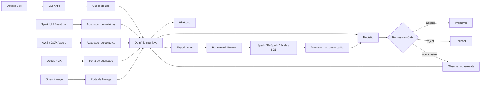

### Como a plataforma encontra o gargalo

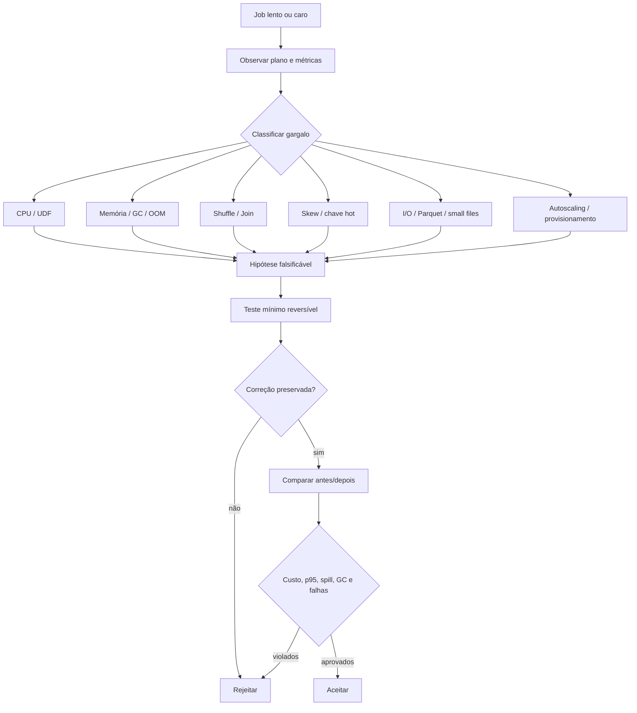

### Ciclo cognitivo

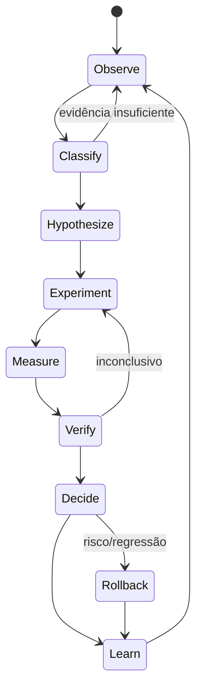

O conjunto completo de diagramas está em [`docs/diagrams.md`](docs/diagrams.md), incluindo lineage, observabilidade, seleção de framework, sequência antes/depois, promoção e rollback.

## 37. Princípio final

O melhor tuning não é o conjunto de parâmetros mais agressivo. É o menor conjunto de mudanças explicáveis que produz ganho repetível, preserva a correção, reduz custo ou latência e permanece válido quando dados, escala, versão ou ambiente mudam.

## Changelog consolidado

# Changelog

Todas as mudanças relevantes deste playbook devem ser registradas aqui.

## [Unreleased]

### Added

- engine executável de loop com estados, hipóteses, guardrails e artefatos JSON;
- CLI e fixture determinística para validar iterações no CI;
- skills iniciais de join, particionamento, Parquet, fronteiras PySpark, JVM/GC e qualidade;
- testes automatizados para aceitação, rollback e persistência;
- skills complementares de lineage, telemetria, qualidade, contexto, resiliência e análise estática;
- matriz de integração com OpenLineage, DataHub, Marquez, OpenTelemetry, Chaos Monkey e Ruff;
- contrato de evento correlacionando run, inputs, outputs, métricas e decisão;
- templates granulares de skill, benchmark e decisão;
- catálogo de skills com framework de referência por domínio;
- regra de baseline usando pandas API on Spark/Koalas para workloads tabulares distribuídos;
- validação de correção junto com performance;
- estrutura de CI em árvore para documentação, schemas, exemplos, benchmarks e regressões;
- integração conceitual com sparkMeasure, Deequ, Great Expectations, OpenLineage, Iceberg e Spark Operator.

### Changed

- decisões de tuning agora exigem hipótese, baseline, métricas e rollback;
- comparação de frameworks deve declarar equivalência semântica.

## [0.1.0] - 2026-11-14

### Added

- playbook inicial de Spark tuning;
- PySpark, Spark SQL, Scala, Glue, EMR, EMR Serverless, Databricks;
- GCP, Azure, AWS, Terraform, Spot, autoscaling e layout Parquet;
- benchmarks, stress tests, GC, skew, spill, joins e custo.

# INVENTÁRIO DE MÓDULOS E TESTES

```text
docs/architecture.md
docs/assets/cognitive-loop.svg
docs/assets/spark-hero.jpg
docs/assets/spark-logo-official.svg
docs/assets/tuning-matrix.svg
docs/ci-validation-tree.md
docs/cognitive-loop.md
docs/diagrams.md
docs/engineering-loop.md
docs/journey.md
docs/pr-safety.md
docs/reference-playbook.md
docs/related-skills.md
docs/skill-lifecycle.md
scripts/validate_loop.sh
skills/README.md
skills/data-quality-gate/SKILL.md
skills/join-strategy/SKILL.md
skills/jvm-gc-memory/SKILL.md
skills/parquet-layout/SKILL.md
skills/partition-sizing/SKILL.md
skills/pyspark-boundaries/SKILL.md
src/spark_tuning/__init__.py
src/spark_tuning/__pycache__/__init__.cpython-312.pyc
src/spark_tuning/__pycache__/adapters.cpython-312.pyc
src/spark_tuning/__pycache__/cli.cpython-312.pyc
src/spark_tuning/__pycache__/engine.cpython-312.pyc
src/spark_tuning/__pycache__/evaluator.cpython-312.pyc
src/spark_tuning/__pycache__/models.cpython-312.pyc
src/spark_tuning/__pycache__/ports.cpython-312.pyc
src/spark_tuning/adapters.py
src/spark_tuning/agents/__init__.py
src/spark_tuning/agents/__pycache__/__init__.cpython-312.pyc
src/spark_tuning/agents/__pycache__/base.cpython-312.pyc
src/spark_tuning/agents/__pycache__/orchestrator.cpython-312.pyc
src/spark_tuning/agents/__pycache__/specialists.cpython-312.pyc
src/spark_tuning/agents/base.py
src/spark_tuning/agents/orchestrator.py
src/spark_tuning/agents/specialists.py
src/spark_tuning/cli.py
src/spark_tuning/core/__init__.py
src/spark_tuning/core/__pycache__/__init__.cpython-312.pyc
src/spark_tuning/core/__pycache__/bayesian_opt.cpython-312.pyc
src/spark_tuning/core/__pycache__/compatibility.cpython-312.pyc
src/spark_tuning/core/__pycache__/prioritization.cpython-312.pyc
src/spark_tuning/core/__pycache__/registry.cpython-312.pyc
src/spark_tuning/core/bayesian_opt.py
src/spark_tuning/core/compatibility.py
src/spark_tuning/core/prioritization.py
src/spark_tuning/core/registry.py
src/spark_tuning/daemon/__init__.py
src/spark_tuning/daemon/__pycache__/__init__.cpython-312.pyc
src/spark_tuning/daemon/__pycache__/scanner.cpython-312.pyc
src/spark_tuning/daemon/__pycache__/worker.cpython-312.pyc
src/spark_tuning/daemon/scanner.py
src/spark_tuning/daemon/worker.py
src/spark_tuning/diagnostics/__init__.py
src/spark_tuning/diagnostics/__pycache__/__init__.cpython-312.pyc
src/spark_tuning/diagnostics/__pycache__/engine.cpython-312.pyc
src/spark_tuning/diagnostics/engine.py
src/spark_tuning/drift/__init__.py
src/spark_tuning/drift/__pycache__/__init__.cpython-312.pyc
src/spark_tuning/drift/__pycache__/detector.cpython-312.pyc
src/spark_tuning/drift/detector.py
src/spark_tuning/engine.py
src/spark_tuning/evaluation/__init__.py
src/spark_tuning/evaluation/__pycache__/__init__.cpython-312.pyc
src/spark_tuning/evaluation/__pycache__/chaos.cpython-312.pyc
src/spark_tuning/evaluation/__pycache__/pareto.cpython-312.pyc
src/spark_tuning/evaluation/__pycache__/statistics.cpython-312.pyc
src/spark_tuning/evaluation/chaos.py
src/spark_tuning/evaluation/pareto.py
src/spark_tuning/evaluation/statistics.py
src/spark_tuning/evaluator.py
src/spark_tuning/experimentation/__init__.py
src/spark_tuning/experimentation/__pycache__/__init__.cpython-312.pyc
src/spark_tuning/experimentation/__pycache__/harness.cpython-312.pyc
src/spark_tuning/experimentation/harness.py
src/spark_tuning/knowledge/__init__.py
src/spark_tuning/knowledge/__pycache__/__init__.cpython-312.pyc
src/spark_tuning/knowledge/__pycache__/engine.cpython-312.pyc
src/spark_tuning/knowledge/engine.py
src/spark_tuning/models.py
src/spark_tuning/ports.py
src/spark_tuning/reporting/__init__.py
src/spark_tuning/reporting/__pycache__/__init__.cpython-312.pyc
src/spark_tuning/reporting/__pycache__/dashboard.cpython-312.pyc
src/spark_tuning/reporting/__pycache__/finops.cpython-312.pyc
src/spark_tuning/reporting/__pycache__/lineage.cpython-312.pyc
src/spark_tuning/reporting/__pycache__/report_generator.cpython-312.pyc
src/spark_tuning/reporting/__pycache__/telemetry.cpython-312.pyc
src/spark_tuning/reporting/dashboard.py
src/spark_tuning/reporting/finops.py
src/spark_tuning/reporting/lineage.py
src/spark_tuning/reporting/report_generator.py
src/spark_tuning/reporting/telemetry.py
src/spark_tuning/runners/__init__.py
src/spark_tuning/runners/__pycache__/__init__.cpython-312.pyc
src/spark_tuning/runners/__pycache__/live_monitor.cpython-312.pyc
src/spark_tuning/runners/live_monitor.py
src/spark_tuning/safety/__init__.py
src/spark_tuning/safety/__pycache__/__init__.cpython-312.pyc
src/spark_tuning/safety/__pycache__/canary.cpython-312.pyc
src/spark_tuning/safety/__pycache__/change_adapter.cpython-312.pyc
src/spark_tuning/safety/__pycache__/pr_gate.cpython-312.pyc
src/spark_tuning/safety/__pycache__/quality_gate.cpython-312.pyc
src/spark_tuning/safety/__pycache__/sanitizer.cpython-312.pyc
src/spark_tuning/safety/canary.py
src/spark_tuning/safety/change_adapter.py
src/spark_tuning/safety/pr_gate.py
src/spark_tuning/safety/quality_gate.py
src/spark_tuning/safety/sanitizer.py
templates/BENCHMARK_TEMPLATE.md
templates/DECISION_TEMPLATE.md
templates/LOOP_RUN_TEMPLATE.md
templates/OPTIMIZATION_BEFORE_AFTER.md
templates/SKILL_TEMPLATE.md
tests/__init__.py
tests/__pycache__/__init__.cpython-312.pyc
tests/__pycache__/test_engine.cpython-312.pyc
tests/__pycache__/test_event_log_runner.cpython-312.pyc
tests/fixtures/sample_event_log.jsonl
tests/integration/__init__.py
tests/integration/__pycache__/__init__.cpython-312.pyc
tests/integration/scenarios/__init__.py
tests/integration/scenarios/__pycache__/__init__.cpython-312.pyc
tests/integration/scenarios/__pycache__/test_anti_pattern_detection.cpython-312.pyc
tests/integration/scenarios/test_anti_pattern_detection.py
tests/test_engine.py
tests/test_event_log_runner.py
tests/unit/__init__.py
tests/unit/__pycache__/__init__.cpython-312.pyc
tests/unit/__pycache__/test_advanced_skills_extension.cpython-312.pyc
tests/unit/__pycache__/test_batch1_pillars.cpython-312.pyc
tests/unit/__pycache__/test_batch2_pillars.cpython-312.pyc
tests/unit/__pycache__/test_batch3_pillars.cpython-312.pyc
tests/unit/__pycache__/test_product_saas_architecture.cpython-312.pyc
tests/unit/agents/__init__.py
tests/unit/agents/__pycache__/__init__.cpython-312.pyc
tests/unit/agents/__pycache__/test_specialized_agents.cpython-312.pyc
tests/unit/agents/test_specialized_agents.py
tests/unit/core/__init__.py
tests/unit/core/__pycache__/__init__.cpython-312.pyc
tests/unit/core/__pycache__/test_models.cpython-312.pyc
tests/unit/core/test_models.py
tests/unit/experimentation/__init__.py
tests/unit/experimentation/__pycache__/__init__.cpython-312.pyc
tests/unit/experimentation/__pycache__/test_harness.cpython-312.pyc
tests/unit/experimentation/__pycache__/test_multi_tech_benchmarks.cpython-312.pyc
tests/unit/experimentation/test_harness.py
tests/unit/experimentation/test_multi_tech_benchmarks.py
tests/unit/test_advanced_skills_extension.py
tests/unit/test_batch1_pillars.py
tests/unit/test_batch2_pillars.py
tests/unit/test_batch3_pillars.py
tests/unit/test_product_saas_architecture.py
```

# MEMÓRIA DE PROCEDIMENTO PARA DEVIN

```yaml
before_task:
  - ler DEVIN.md completo
  - identificar branch atual
  - validar git status
  - confirmar baseline e run_id
while_task:
  - usar uma hipótese por iteração
  - preservar correção e estabilidade
  - persistir evidências
  - não alterar main
  - não abrir PR com gate vermelho
at_completion:
  - executar diff-check
  - executar scripts/validate_loop.sh
  - executar unittest discover
  - reportar commit e branch
  - não fazer merge automático
```
