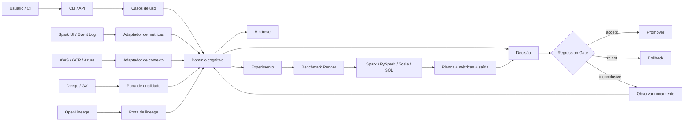
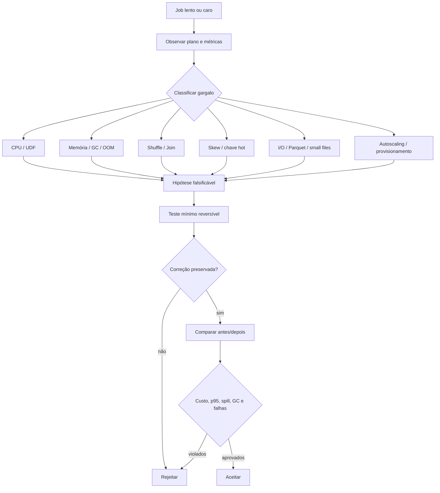
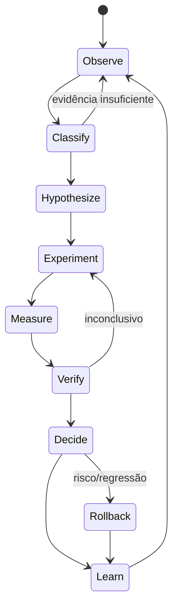

# Spark Tuning

Playbook granular e orientado por evidências para projetar, medir, otimizar e operar workloads Apache Spark em PySpark, Spark SQL, AWS Glue, Amazon EMR, EMR Serverless e pandas API on Spark (antigo Koalas).

O projeto trata tuning como um ciclo científico:

1. formular uma hipótese mensurável;
2. registrar o baseline;
3. controlar variáveis;
4. executar um benchmark reproduzível;
5. observar plano, métricas e recursos;
6. aplicar uma mudança isolada;
7. comparar resultado, custo e estabilidade;
8. aceitar, rejeitar ou reverter a hipótese.

> **Regra principal:** nenhuma configuração é “melhor” por si só. Ela é melhor para um workload, uma escala, uma distribuição de dados, uma versão do Spark e um orçamento definidos.

---

## 1. Objetivos e não objetivos

### Objetivos

- reduzir tempo de execução sem degradar correção;
- reduzir custo por unidade de dados processados;
- aumentar previsibilidade de latência;
- evitar OOM, spill excessivo, skew e falhas de executor;
- produzir evidência suficiente para repetir ou reverter uma decisão;
- separar ganhos de aplicação, engine, infraestrutura e armazenamento;
- documentar diferenças entre Spark OSS, Glue, EMR e EMR Serverless;
- transformar cada técnica em uma skill operacional pequena, verificável e combinável.

### Não objetivos

- aplicar tuning por tentativa e erro sem baseline;
- copiar uma configuração de outro cluster sem validar a escala;
- otimizar somente o tempo ignorando custo, confiabilidade e qualidade;
- usar `cache`, `repartition`, broadcast ou mais executores como remédio universal;
- comparar versões, formatos ou clusters sem controlar as variáveis.

---

## 2. Mapa de skills

| Skill | Pergunta respondida | Evidência mínima |
|---|---|---|
| `baseline-design` | Qual é o comportamento atual? | tempo, custo, volume, versão, configuração |
| `workload-classification` | O gargalo é CPU, memória, I/O, rede ou shuffle? | métricas de execução |
| `plan-inspection` | O plano físico é o esperado? | `explain("formatted")`, SQL UI |
| `partition-sizing` | O paralelismo e o tamanho das partições estão adequados? | task duration, bytes/task, partições |
| `join-strategy` | Qual estratégia de join minimiza custo e risco? | plano, shuffle, skew, spill |
| `aqe-tuning` | O AQE está corrigindo o plano em runtime? | métricas antes/depois |
| `data-layout` | O formato e o layout ajudam o leitor? | bytes lidos, pruning, arquivos |
| `memory-and-gc` | A memória está sendo usada de forma eficiente? | GC, spill, peak memory, OOM |
| `serialization` | O custo de serialização é relevante? | CPU, payload, tempo de task |
| `pyspark-boundaries` | Há custo Python/JVM evitável? | Python time, UDF time, Arrow |
| `scala-spark` | A aplicação Scala está aproveitando o runtime JVM? | GC, serialização, codegen, task CPU |
| `spark-sql` | A consulta está expressando intenção ao otimizador? | plano lógico/físico |
| `glue-runtime` | Workers, versões e bookmarks estão adequados? | Glue metrics, DPU, job run |
| `emr-runtime` | O cluster e o runtime EMR estão adequados? | cluster metrics, Spark UI |
| `emr-serverless` | O perfil de workers e autoscaling está adequado? | duração, custo, recursos |
| `databricks-runtime` | O workload está usando corretamente o runtime Databricks? | DBU, Photon, SQL UI, cluster metrics |
| `cloud-compute` | A máquina fornece CPU, memória, rede e disco adequados? | utilização, throughput, throttling |
| `autoscaling-policy` | O cluster escala na hora certa sem instabilidade? | backlog, escala, custo, p95 |
| `spot-and-fleet` | O desconto compensa interrupções e retries? | preço, reclaim, recomputação |
| `terraform-infrastructure` | A infraestrutura é reproduzível e segura? | plan, drift, versões, policy |
| `parquet-layout` | O arquivo foi escrito para o padrão correto de leitura? | pruning, bytes lidos, arquivos |
| `pandas-on-spark` | A API pandas está introduzindo operações caras? | plano e shuffles |
| `benchmark-generation` | Como gerar dados representativos? | seed, distribuição, escala |
| `stress-testing` | O workload permanece estável sob pressão? | SLO, falhas, degradação |
| `regression-gate` | Quando bloquear uma mudança? | thresholds e comparação estatística |
| `cost-performance` | O ganho compensa o custo? | custo/run e custo/TB |

---

## 3. Modelo de hipótese

Toda alteração deve ser registrada como:

```yaml
id: HYP-0001
title: "Reduzir shuffle no join de fatos e dimensões"
question: "A dimensão cabe em memória de forma segura?"
baseline:
  dataset: "orders_v1"
  input_gb: 500
  rows: 2500000000
  spark_version: "4.0.x"
  runtime: "EMR 7.x"
  duration_seconds: 1800
  cost_usd: 12.40
change:
  type: "join-strategy"
  config:
    spark.sql.autoBroadcastJoinThreshold: "64m"
  code: "Adicionar broadcast apenas na dimensão validada"
prediction:
  duration_seconds: "<= 1350"
  cost_usd: "<= 12.40"
  failures: 0
guardrails:
  max_executor_oom: 0
  max_spill_gb: 500
  result_checksum: "igual ao baseline"
decision: "pending"
```

### Critérios de decisão

- **aceitar:** melhora o objetivo primário e não viola guardrails;
- **rejeitar:** não há melhora estatisticamente relevante ou o custo aumenta;
- **reverter:** há regressão, instabilidade, divergência de dados ou risco operacional;
- **inconclusivo:** o ruído ou a variabilidade impedem uma conclusão.

---

## 4. Baseline obrigatório

Registrar antes de qualquer tuning:

- commit da aplicação;
- versão do Spark, Python, Java e runtime gerenciado;
- tipo e quantidade de workers;
- região, arquitetura e tipo de instância;
- formato, compressão, particionamento e número de arquivos;
- tamanho lógico e físico;
- número de linhas e cardinalidade das chaves;
- parâmetros Spark relevantes;
- duração de cada stage;
- bytes lidos e escritos;
- shuffle read/write;
- spill de memória e disco;
- GC e tempo de CPU;
- número de tasks, duração mediana e p95;
- custo estimado e custo real;
- checksum ou contagem de saída;
- seed do gerador de dados;
- interferências: concorrência, cache quente, retries, throttling.

### Métricas derivadas

```text
throughput_rows_s = output_rows / duration_seconds
throughput_gb_s = input_gb / duration_seconds
cost_per_tb = cost_usd / input_tb
shuffle_ratio = shuffle_write_bytes / input_bytes
spill_ratio = spill_disk_bytes / input_bytes
skew_ratio = p99_task_duration / p50_task_duration
```

---

## 5. Diagnóstico por sintomas

| Sintoma | Hipóteses prioritárias | Primeiro artefato |
|---|---|---|
| Muitas tasks lentas | skew, partições grandes, I/O | stage summary |
| Uma task muito lenta | chave hot, arquivo gigante, skew | distribuição por task |
| Muito shuffle | join/groupBy/orderBy, repartition incorreto | plano físico |
| OOM no executor | broadcast grande, cache, partição grande | peak memory e GC |
| OOM no driver | `collect`, `toPandas`, planos gigantes | driver logs |
| Alto spill | pouca memória, partições grandes, agregação | spill metrics |
| CPU baixa e job lento | I/O, rede, espera por shuffle | executor timeline |
| CPU alta e job lento | UDF, serialização, expressão cara | CPU/Python time |
| Muitos arquivos pequenos | escrita particionada, micro-batches | file listing |
| Arquivos muito grandes | poucas partições, coalesce agressivo | bytes por arquivo |
| AQE não ajuda | stats ausentes, config incompatível | adaptive plan |
| Custo alto com baixa utilização | cluster superdimensionado | utilization metrics |

---

## 6. Particionamento e paralelismo

### Princípios

- particionar para distribuir trabalho, não para criar o maior número possível de tasks;
- manter tarefas suficientemente grandes para amortizar overhead;
- evitar `repartition` sem uma razão observável;
- usar `coalesce` somente quando reduzir partições não criar gargalo;
- distinguir partição lógica de arquivo físico;
- considerar tamanho, cardinalidade, skew e capacidade do cluster.

### Checklist

- tamanho médio e p95 de partição;
- bytes por task;
- tasks por core disponível;
- duração p50/p95/p99;
- número de tasks pequenas;
- presença de partições vazias;
- número de arquivos de entrada e saída;
- impacto de `spark.sql.shuffle.partitions`;
- efeito de AQE e coalescing pós-shuffle.

### Antipadrões

```python
# Evitar: número fixo sem relação com o workload.
df.repartition(2000)

# Evitar: reduzir tudo a uma única task.
df.coalesce(1)
```

Preferir uma decisão baseada em bytes, paralelismo e evidência:

```python
target_partitions = max(
    1,
    int(input_bytes / target_bytes_per_partition),
)
df = df.repartition(target_partitions)
```

---

## 7. Joins, agregações e skew

### Estratégias

1. filtrar e selecionar colunas antes do join;
2. garantir que as estatísticas sejam úteis;
3. validar se uma dimensão cabe com margem na memória;
4. usar broadcast somente com tamanho e pressão de memória conhecidos;
5. observar sort-merge, shuffled-hash e broadcast-hash no plano;
6. tratar chaves skewed explicitamente;
7. evitar duplicação acidental por cardinalidade incorreta;
8. comparar tempo, shuffle, spill e resultado.

### Skew

Investigar:

- frequência das chaves;
- p99/p50 de task;
- partições com bytes desproporcionais;
- stage que não termina enquanto as demais terminam;
- chaves nulas ou default;
- combinação de filtros que concentra dados.

Mitigações possíveis:

- salting controlado;
- pré-agregação;
- broadcast da dimensão;
- separação de chaves hot;
- AQE skew join;
- mudança de granularidade;
- reparticionamento por chave adequada.

---

## 8. AQE, estatísticas e planos

Sempre guardar:

```python
df.explain("formatted")
df.explain("cost")
```

Para Spark SQL:

```sql
EXPLAIN FORMATTED
SELECT ...
```

Verificar:

- troca de estratégia de join;
- coalescing de partições;
- split de partições skewed;
- broadcast efetivamente aplicado;
- filtros empurrados para a fonte;
- column pruning;
- scans desnecessários;
- exchanges e sorts;
- estimativa versus realidade;
- estatísticas de tabela e coluna.

Não habilitar configurações de AQE sem medir o efeito no plano e no runtime.

---

## 9. JVM, GC, spill e memória

### Diagnóstico antes de configurar

Separar:

- heap usada;
- heap máxima;
- memória off-heap;
- memória do executor;
- memória overhead;
- memória do driver;
- tempo de GC;
- frequência e duração de Full GC;
- spill de memória;
- spill de disco;
- bytes de shuffle;
- pressão de page cache;
- utilização de disco local;
- OOM de heap versus OOM nativo/container.

### Práticas para evitar GC excessivo

- preferir expressões nativas e estruturas compactas;
- reduzir criação de objetos dentro de `map`, `flatMap` e UDFs;
- evitar `collect`, `toPandas` e listas grandes no driver;
- evitar cache de DataFrames que não serão reutilizados;
- escolher nível de persistência coerente com memória e recomputação;
- usar Kryo quando objetos customizados justificarem o custo de configuração;
- registrar classes Kryo explicitamente;
- evitar serializar objetos de contexto ou clientes de conexão;
- controlar tamanho das partições para não criar objetos gigantes;
- reduzir colunas e linhas antes do shuffle;
- observar GC antes de aumentar heap: heap maior pode apenas adiar o problema;
- separar pressão de heap, off-heap e overhead do container.

### Práticas para reduzir spill

- reduzir dados antes de joins e agregações;
- corrigir partições excessivamente grandes;
- revisar `spark.sql.shuffle.partitions`;
- usar AQE e coalescing quando medidos;
- evitar ordenar ou agrupar dados desnecessários;
- garantir disco local suficiente e rápido;
- não confundir spill tolerável com spill que domina o tempo;
- tratar skew antes de aumentar recursos;
- medir spill por task e por stage.

### Guardrails de memória

```text
full_gc_time_ratio <= 5%
executor_oom = 0
driver_oom = 0
spill_disk_ratio <= limite do workload
peak_memory / container_memory <= 0.85
```

Os limites são exemplos iniciais. Cada workload deve registrar seus próprios thresholds.

---

## 10. Storage e data layout

### Preferências gerais

- usar formatos colunares quando o workload for analítico;
- projetar schema e tipos corretamente;
- evitar leitura de colunas não usadas;
- evitar partições de alta cardinalidade;
- compactar arquivos pequenos;
- controlar tamanho de arquivo de saída;
- validar pruning de partição e de coluna;
- separar layout de ingestão e layout de serving quando necessário.

### Escolha do formato

| Formato | Uso principal | Risco |
|---|---|---|
| Parquet | analytics colunar, interoperabilidade | small files e schema drift |
| ORC | analytics com ecossistema Hive | compatibilidade entre engines |
| Delta Lake | transações, schema enforcement, time travel | custo de manutenção e arquivos |
| Apache Iceberg | tabelas abertas, evolução e snapshots | configuração de catálogo |
| Avro | intercâmbio row-oriented e eventos | menos eficiente para scans colunares |
| JSON/CSV | ingestão ou interoperabilidade humana | alto custo de leitura e schema frágil |

### Gravação otimizada

- escolher compressão conforme CPU, rede e storage;
- usar Snappy para leitura geral de baixa latência;
- avaliar ZSTD quando a economia de storage e I/O superar CPU adicional;
- evitar GZIP em pipelines que exigem paralelismo de leitura;
- controlar tamanho de arquivo, evitando arquivos minúsculos e arquivos gigantes;
- escrever somente colunas necessárias;
- estabilizar tipos e ordem do schema;
- evitar partições de alta cardinalidade;
- particionar por colunas seletivas e frequentemente filtradas;
- não particionar por colunas quase únicas;
- compactar small files periodicamente;
- validar estatísticas de min/max e row groups;
- alinhar row groups ao padrão de scan;
- evitar sobrescritas que criem fragmentação;
- medir bytes físicos, bytes lidos e tempo de listagem;
- validar leitura por Spark, Trino/Presto, Athena, BigQuery e engines consumidoras.

### Layout Parquet

Registrar:

- tamanho médio, p50 e p95 dos arquivos;
- número de row groups;
- tamanho dos row groups;
- compressão;
- bytes lidos versus bytes retornados;
- colunas usadas no predicate pushdown;
- partições físicas;
- arquivos criados por execução;
- custo de compactação;
- tempo de listagem;
- schema e evolução.

O “local correto” do Parquet é o layout que atende o padrão de leitura: particionamento físico para filtros frequentes, colunas ordenadas ou clustering quando suportado, arquivos de tamanho estável e compressão compatível com o perfil CPU/I/O.

### Perguntas

- Quantos arquivos são lidos?
- Qual o tamanho médio e p95?
- Quanto é lido versus quanto é usado?
- O predicado chega à fonte?
- A partição escolhida reduz o scan?
- O layout cria small files?
- A compactação reduz I/O ou aumenta CPU além do benefício?

---

## 11. Compute cloud e otimização de máquina

### Dimensões da máquina

Escolher a família de máquina a partir do gargalo observado:

| Gargalo | Prioridade |
|---|---|
| CPU | vCPU, clock, code generation, paralelismo |
| memória | RAM, overhead, heap, GC |
| shuffle | rede, throughput, disco local |
| I/O | throughput e IOPS, não apenas tamanho |
| pequenos arquivos | CPU do driver, rede e listagem |
| UDF Python | CPU, Arrow, redução de fronteiras Python/JVM |
| joins grandes | memória, rede e distribuição de chaves |

Não aumentar o número de nós para corrigir um problema de plano, skew ou small files sem testar a causa raiz.

### AWS

- comparar famílias compute, memory, storage e network optimized;
- usar instance fleets quando múltiplas famílias forem equivalentes;
- separar master/core/task;
- usar Spot em nós substituíveis e tolerantes a recomputação;
- evitar Spot em componentes cuja perda reinicie todo o job;
- usar managed scaling com limites observáveis;
- considerar EBS, NVMe local, throughput S3 e EMRFS;
- registrar interrupções, retries e tempo de recuperação.

### Google Cloud

- comparar Dataproc, Dataproc Serverless e Spark em BigQuery quando aplicável;
- usar workers secundários/preemptible somente para trabalho tolerante a perda;
- separar master, primary e secondary workers;
- ajustar autoscaling por backlog e utilização, não apenas CPU;
- validar Cloud Storage connector, listagem e throughput;
- observar shuffle service, discos locais e rede entre zonas;
- considerar BigQuery Storage API e pushdown quando o dado já reside no BigQuery.

### Azure

- comparar Azure Databricks, HDInsight e Spark em Synapse conforme o workload;
- usar spot VMs apenas em pools tolerantes a interrupção;
- separar nós head, worker e pool de autoscale;
- validar ADLS Gen2, throughput, throttling e hierarquia de diretórios;
- observar managed identity, rede privada e custos de egress;
- registrar runtime, pool, SKU, região e política de scale-out.

### Regra de seleção

```text
machine_choice =
  argmin(cost_per_successful_output)
  subject_to(duration <= SLO,
             correctness == true,
             failure_rate <= limit,
             stability == true)
```

---

## 12. Autoscaling, fleets e Spot

### Autoscaling correto

Uma política deve definir:

- métrica de escala;
- janela de observação;
- cooldown;
- capacidade mínima;
- capacidade máxima;
- passo de scale-out;
- passo de scale-in;
- comportamento sob backlog;
- custo máximo;
- proteção contra oscilação;
- tratamento de retries e interrupções.

Preferir sinais do workload:

- backlog de tarefas;
- pending time;
- scheduler delay;
- utilização de CPU e memória;
- shuffle backlog;
- bytes pendentes;
- duração p95;
- fila de aplicações.

CPU isolada é uma métrica insuficiente para Spark.

### Fleets

- declarar famílias e tamanhos equivalentes;
- declarar capacidade mínima on-demand;
- limitar concentração em uma zona ou tipo;
- testar capacidade real de obtenção;
- registrar preço, interrupções e tempo de provisionamento;
- manter capacidade estável para componentes críticos;
- usar Spot somente em trabalho recuperável;
- validar que retries não eliminam o desconto.

### Custo efetivo de Spot

```text
effective_cost =
  infrastructure_cost
  + retry_cost
  + recomputation_cost
  + delay_cost
  + operational_cost
```

O menor preço por hora não é necessariamente o menor custo por saída correta.

---

## 13. Terraform e infraestrutura reproduzível

Terraform deve declarar o ambiente como parte do experimento, não apenas como provisionamento.

### O que versionar

- versão Terraform e providers;
- região e zonas;
- runtime Spark/Databricks/EMR/Dataproc/Synapse;
- tipos de máquina;
- limites de autoscaling;
- on-demand e Spot;
- discos e throughput;
- subnets e endpoints;
- buckets, containers e lifecycle;
- IAM/RBAC;
- logs, métricas e retenção;
- tags de custo;
- políticas de segurança;
- parâmetros Spark;
- artefatos e hashes.

### Padrões

- usar módulos pequenos e versionados;
- fixar versões de providers;
- executar `terraform fmt`, `validate`, `plan` e policy checks;
- revisar todo `plan` antes de aplicar;
- separar estado por ambiente;
- evitar segredos em código ou state sem backend seguro;
- aplicar tags de projeto, ambiente, workload e owner;
- controlar drift;
- registrar o commit Terraform no benchmark;
- não alterar infraestrutura no meio de uma série experimental.

### Infraestrutura e benchmark

Cada resultado deve incluir:

```yaml
terraform:
  commit: "abc123"
  provider_versions:
    aws: "x.y.z"
  region: "us-east-1"
  machine_profile: "..."
  autoscaling:
    min: 2
    max: 20
  spot_policy: "..."
  storage_profile: "..."
```

---

## 14. PySpark

### Regras de projeto

- preferir funções nativas Spark a UDF Python;
- usar SQL expressions e built-ins;
- limitar fronteiras Python/JVM;
- usar pandas UDF somente com medição;
- configurar Arrow conscientemente;
- nunca usar `collect()` em dados não comprovadamente pequenos;
- nunca usar `toPandas()` sem limite e guardrail;
- evitar loops que disparam ações repetidas;
- nomear etapas e medir cada ação relevante;
- manter transformações lazy até o ponto de materialização planejado.

### Loop de engine

```python
for step in pipeline:
    started = time.monotonic()
    result = step.run(df)
    result.count()  # ação explícita apenas quando o benchmark exige materialização
    metrics.emit(
        step=step.name,
        seconds=time.monotonic() - started,
    )
    df = result
```

Em produção, separar claramente:

- transformação;
- materialização;
- validação;
- publicação;
- observabilidade.

---

## 15. Scala e Spark no JVM

Scala não elimina problemas de distribuição, shuffle ou layout. Ela pode reduzir overhead de Python/JVM, mas introduz decisões próprias de compilação, serialização, dependências e compatibilidade binária.

### Regras de projeto

- preferir DataFrame/Dataset e funções nativas a UDFs;
- evitar `map`/`flatMap` que materializem objetos complexos em excesso;
- usar tipos simples e estruturas compactas em caminhos quentes;
- controlar boxing e alocações dentro de loops;
- evitar closures que capturem objetos grandes;
- validar serialização de classes customizadas;
- manter dependências Scala e Spark binary-compatible;
- definir `scalaVersion` compatível com o runtime;
- medir Kryo versus Java serialization quando objetos customizados forem inevitáveis;
- separar código de driver e executor;
- não enviar clientes, conexões ou recursos não serializáveis para executores;
- publicar jars reprodutíveis e registrar SHA do artefato.

### Checklist Scala

- versão Scala, Spark e Java;
- tamanho do jar e dependências transitivas;
- conflitos de classes;
- tempo de compilação e code generation;
- GC e alocação por task;
- serialização e bytes enviados;
- erro de closure;
- retries causados por exceções de aplicação;
- resultado equivalente ao baseline PySpark/SQL;
- custo operacional de manutenção.

### Exemplo de configuração de serialização

```scala
val spark = SparkSession.builder()
  .appName("spark-tuning-scala")
  .config("spark.serializer", "org.apache.spark.serializer.KryoSerializer")
  .getOrCreate()
```

Essa configuração só deve ser promovida após medir o workload real e registrar as classes que precisam ser registradas.

---

## 16. Databricks

Databricks deve ser tratado como um ambiente com runtime, catálogo, compute, observabilidade e políticas próprias. Uma otimização válida em Spark OSS pode ter efeito diferente com Photon, Delta Lake, serverless compute, Unity Catalog ou configurações gerenciadas.

### Dimensões de avaliação

- Databricks Runtime e versão do Spark;
- Photon habilitado ou desabilitado;
- tipo de cluster e access mode;
- autoscaling e política de workers;
- SQL warehouse ou cluster all-purpose/job;
- serverless versus classic compute;
- DBU, custo de VM e tempo de execução;
- Delta Lake, `OPTIMIZE`, `ZORDER` e data skipping;
- liquid clustering quando aplicável;
- Unity Catalog e governança;
- cache de dados e cache de resultados;
- jobs, task dependencies e retries;
- Spark UI, SQL UI, query profile e system tables;
- políticas de cluster e limites de concorrência.

### Estratégia de benchmark Databricks

Comparar sempre em condições equivalentes:

1. mesmo dataset e mesma versão do código;
2. mesmo runtime ou versão explicitamente registrada;
3. Photon on/off como experimento separado;
4. mesmo tipo de compute ou equivalência documentada;
5. cache frio e cache quente em séries separadas;
6. DBU, custo de infraestrutura e duração;
7. Delta statistics e layout registrados;
8. resultado funcional validado;
9. múltiplas execuções;
10. query profile salvo como artefato.

### Delta Lake e layout

Investigar:

- tamanho e quantidade de arquivos;
- frequência de `OPTIMIZE`;
- compactação e small files;
- data skipping;
- estatísticas coletadas;
- partições de tabela;
- Z-Ordering somente quando houver predicados seletivos coerentes;
- liquid clustering quando a manutenção manual de layout não for adequada;
- custo de manutenção versus redução de leitura;
- concorrência e conflitos de escrita.

Não aplicar `ZORDER`, particionamento ou clustering apenas por convenção. A decisão deve demonstrar redução de bytes lidos ou melhora de latência que compense o custo de manutenção.

### Databricks SQL

- comparar SQL warehouse com compute de job;
- registrar tamanho, política de scaling e concorrência;
- medir query duration, queue time e execution time separadamente;
- validar cache de resultado antes de concluir que uma consulta melhorou;
- observar scans, joins, spills e bytes lidos;
- avaliar Photon como hipótese, não como premissa;
- usar Query History e Query Profile como evidência;
- separar custo de inicialização de custo de steady state.

### Databricks Jobs

- manter parâmetros de execução versionados;
- separar tarefas de ingestão, transformação, qualidade e publicação;
- configurar retries com limite e backoff;
- registrar run ID, job ID e commit;
- testar idempotência;
- validar checkpoint e estado incremental;
- controlar concorrência;
- definir timeout e política de cancelamento;
- publicar métricas de duração, custo e qualidade.

### Databricks Runtime — guardrails

- não assumir compatibilidade entre runtimes sem validar;
- registrar mudanças de Spark, Scala, Java, Photon e Delta;
- testar bibliotecas customizadas em cluster equivalente;
- não misturar resultados de serverless e classic sem separar a série;
- validar permissões e comportamento com Unity Catalog;
- evitar dependência em configurações internas não documentadas.

---

## 17. Comparação entre ambientes

| Dimensão | Spark OSS | Scala/JVM | AWS Glue | EMR | EMR Serverless | Databricks |
|---|---|---|---|---|---|---|
| Unidade de custo | infraestrutura | infraestrutura | DPU-hour | instância/segundo | vCPU/memória | DBU + infraestrutura |
| Controle do cluster | alto | alto | gerenciado | alto | gerenciado | gerenciado/políticas |
| Principal risco | configuração incorreta | alocação/serialização | workers e I/O | sizing e Spot | cold start e limites | runtime, Photon e layout |
| Observabilidade | Spark UI/logs | Spark UI/JVM | Glue metrics/logs | Spark UI/CloudWatch | application metrics | Spark/SQL UI/system tables |
| Tuning diferencial | configs e layout | JVM e jars | workers/bookmarks | runtime/cluster | capacidade/autoscaling | Photon/Delta/compute |
| Benchmark obrigatório | tempo + recursos | GC + CPU + serialização | duração + DPU | duração + custo | duração + custo | duração + DBU + custo |

Resultados de ambientes diferentes não devem ser misturados em uma única média. O relatório deve preservar o ambiente como uma variável experimental.

---

### Checklist de consulta

- projetar somente colunas necessárias;
- filtrar cedo;
- evitar funções não determinísticas sem necessidade;
- validar cardinalidade dos joins;
- eliminar `ORDER BY` global quando não for requisito;
- preferir agregações parciais;
- evitar `DISTINCT` como correção de duplicidade;
- usar hints apenas com justificativa e benchmark;
- validar NULL semantics;
- comparar plano estimado e plano executado.

### Hints

Hints de repartition, broadcast, merge ou skew são decisões locais. Cada hint deve ter:

- motivo;
- condição de validade;
- métrica que comprova o ganho;
- risco de memória;
- plano de rollback.

---

## 18. AWS Glue

Avaliar:

- versão Glue/Spark;
- worker type e quantidade;
- autoscaling;
- job bookmarks;
- pushdown predicates;
- leitura de catálogo e fontes;
- small files;
- métricas de execução;
- retries e timeouts;
- conexão de rede e throttling;
- custo por DPU-hour;
- escrita e compactação.

### Workflow Glue

1. definir SLO de duração e custo;
2. medir o job atual;
3. localizar stage limitante;
4. reduzir dados lidos;
5. corrigir plano e layout;
6. ajustar workers;
7. comparar múltiplas execuções;
8. validar output e bookmark;
9. promover somente após estabilidade.

---

## 19. Amazon EMR

Avaliar separadamente:

- release EMR;
- Spark runtime e otimizações gerenciadas;
- tipos de instância;
- master/core/task;
- instance fleets;
- Spot apenas onde a interrupção for aceitável;
- managed scaling;
- EMRFS e S3;
- shuffle e disco local;
- logs e Spark History Server;
- bootstrap actions;
- concorrência entre aplicações;
- isolamento e fila.

Não comparar clusters apenas por número de nós. Registrar CPU, memória, rede, disco, interrupções e utilização efetiva.

---

## 20. EMR Serverless

Medir:

- tempo de inicialização;
- tempo de execução;
- capacidade inicial;
- capacidade máxima;
- worker type;
- memória do driver e executores;
- uso de vCPU e memória;
- shuffle;
- custo por aplicação;
- efeito de concorrência;
- cold start versus warm path.

Hipóteses comuns:

- aumentar capacidade reduz duração, mas não necessariamente custo;
- limites excessivos podem aumentar fila e spill;
- arquivos pequenos elevam overhead de inicialização e listagem;
- o custo ótimo pode estar em uma execução um pouco mais longa com melhor utilização.

---

## 21. pandas API on Spark / Koalas

Use `pyspark.pandas` para workloads que precisam de uma API familiar, mas valide o plano gerado.

Riscos:

- indexação implícita;
- ordenação global;
- operações que materializam índice;
- conversão para pandas;
- UDFs Python;
- groupby ou window com shuffle grande;
- comportamento diferente de pandas em NULL, ordem e tipos.

Checklist:

- localizar operações que exigem índice;
- inspecionar plano;
- medir shuffle;
- limitar conversões locais;
- comparar com DataFrame API nativa;
- validar semântica, não apenas tempo.

---

## 22. Benchmarking

### Requisitos

- dados sintéticos e, quando permitido, amostra anonimizada;
- seed fixa;
- volume escalável;
- distribuição realista;
- casos balanceados e skewed;
- warm-up separado de steady state;
- pelo menos três execuções quando o ambiente permitir;
- mediana, p95 e intervalo;
- resultado funcional validado;
- configuração versionada;
- custo estimado.

### Escalas

| Perfil | Objetivo |
|---|---|
| `smoke` | detectar erro e validar resultado |
| `small` | iteração rápida |
| `medium` | comparar estratégias |
| `large` | validar escalabilidade |
| `xlarge` | testar limites e custo |

### Dataset generator

Gerar:

- dimensões e fatos;
- cardinalidade configurável;
- NULLs;
- chaves hot;
- datas com sazonalidade;
- strings longas;
- colunas altamente seletivas;
- arquivos pequenos;
- arquivos grandes;
- dados ordenados e desordenados;
- duplicatas controladas.

---

## 23. Stress tests

### Cenários mínimos

1. volume crescente;
2. aumento de cardinalidade;
3. skew extremo;
4. small files;
5. arquivo único gigante;
6. join com dimensão próxima do limite de broadcast;
7. executor com memória reduzida;
8. interrupção/retry;
9. concorrência entre aplicações;
10. cold start em EMR Serverless;
11. fonte lenta;
12. saída com alta cardinalidade de partição.

### Guardrails

- nenhuma divergência de contagem ou checksum;
- zero OOM não esperado;
- zero corrupção ou perda silenciosa;
- duração dentro do SLO;
- custo dentro do orçamento;
- p99 de task abaixo do limite;
- spill abaixo do limite;
- retries documentados;
- degradação registrada.

---

## 24. Regression gate

Uma mudança só passa se:

```text
duration_delta <= -10%
ou cost_delta <= -10%
e correctness == true
e failures == 0
e p99_task_delta <= +20%
e spill_delta <= +20%
```

Os thresholds devem ser ajustados ao workload. Não usar apenas uma execução para aprovar uma alteração.

### Comparação

```text
delta = (candidate - baseline) / baseline
```

Guardar baseline e candidate completos, não somente o delta.

---

## 25. Estrutura sugerida do repositório

```text
spark-tuning/
├── README.md
├── CHANGELOG.md
├── LICENSE
├── CONTRIBUTING.md
├── CODE_OF_CONDUCT.md
├── .github/
│   └── workflows/
│       └── skills-validation.yml
├── templates/
│   ├── SKILL_TEMPLATE.md
│   ├── BENCHMARK_TEMPLATE.md
│   ├── DECISION_TEMPLATE.md
│   └── OPTIMIZATION_BEFORE_AFTER.md
├── skills/
│   └── README.md
├── docs/
│   ├── architecture.md
│   ├── journey.md
│   ├── cognitive-loop.md
│   ├── ci-validation-tree.md
│   ├── related-skills.md
│   ├── diagrams.md
│   ├── methodology.md
│   ├── symptom-diagnosis.md
│   ├── spark-oss.md
│   ├── pyspark.md
│   ├── scala.md
│   ├── spark-sql.md
│   ├── glue.md
│   ├── emr.md
│   ├── emr-serverless.md
│   ├── databricks.md
│   ├── cloud-compute.md
│   ├── autoscaling-and-spot.md
│   ├── terraform.md
│   ├── parquet-layout.md
│   ├── pandas-api-on-spark.md
│   ├── benchmarking.md
│   └── stress-testing.md
├── skills/
│   ├── baseline-design/SKILL.md
│   ├── plan-inspection/SKILL.md
│   ├── partition-sizing/SKILL.md
│   ├── join-strategy/SKILL.md
│   ├── aqe-tuning/SKILL.md
│   ├── pyspark-boundaries/SKILL.md
│   ├── scala-spark/SKILL.md
│   ├── glue-runtime/SKILL.md
│   ├── emr-runtime/SKILL.md
│   ├── emr-serverless/SKILL.md
│   ├── databricks-runtime/SKILL.md
│   ├── cloud-compute/SKILL.md
│   ├── autoscaling-policy/SKILL.md
│   ├── spot-and-fleet/SKILL.md
│   ├── terraform-infrastructure/SKILL.md
│   └── parquet-layout/SKILL.md
│   ├── benchmark-generation/SKILL.md
│   └── stress-testing/SKILL.md
├── benchmarks/
│   ├── datasets/
│   ├── workloads/
│   ├── configs/
│   └── results/
├── examples/
│   ├── pyspark/
│   ├── spark-sql/
│   ├── glue/
│   ├── emr/
│   └── emr-serverless/
├── tests/
│   ├── correctness/
│   ├── performance/
│   └── stress/
└── scripts/
    ├── generate_data.py
    ├── run_benchmark.py
    ├── collect_metrics.py
    └── compare_runs.py
```

---

## 26. Fontes de referência

- Apache Spark — Performance Tuning: <https://spark.apache.org/docs/latest/sql-performance-tuning.html>
- Apache Spark — Tuning Guide: <https://spark.apache.org/docs/latest/tuning.html>
- Apache Spark — pandas API on Spark: <https://spark.apache.org/pandas-on-spark/>
- Apache Spark — Scala programming guide: <https://spark.apache.org/docs/latest/quick-start.html>
- AWS Prescriptive Guidance — tuning AWS Glue for Apache Spark: <https://docs.aws.amazon.com/prescriptive-guidance/latest/tuning-aws-glue-for-apache-spark/>
- AWS EMR Spark best practices: <https://aws.github.io/aws-emr-best-practices/docs/bestpractices/Applications/Spark/best_practices/>
- AWS Glue Spark programming guide: <https://docs.aws.amazon.com/glue/latest/dg/aws-glue-programming-etl.html>
- Databricks — Apache Spark performance optimization: <https://docs.databricks.com/aws/en/optimizations/>
- Databricks — Photon: <https://docs.databricks.com/aws/en/compute/photon>
- Databricks — Delta Lake optimization: <https://docs.databricks.com/aws/en/delta/optimizations/>
- Databricks — system tables: <https://docs.databricks.com/aws/en/admin/system-tables/>
- Google Cloud — Dataproc Spark optimization: <https://cloud.google.com/dataproc/docs/concepts/compute/spark>
- Google Cloud — Dataproc autoscaling: <https://cloud.google.com/dataproc/docs/concepts/configuring-clusters/autoscaling>
- Google Cloud — Spot VMs: <https://cloud.google.com/compute/docs/instances/spot>
- Microsoft Azure — Azure Databricks performance: <https://learn.microsoft.com/azure/databricks/optimizations/>
- Microsoft Azure — Spot Virtual Machines: <https://learn.microsoft.com/azure/virtual-machines/spot-vms>
- Terraform — language and module documentation: <https://developer.hashicorp.com/terraform/docs>
- Terraform AWS provider: <https://registry.terraform.io/providers/hashicorp/aws/latest/docs>
- Terraform Google provider: <https://registry.terraform.io/providers/hashicorp/google/latest/docs>
- Terraform AzureRM provider: <https://registry.terraform.io/providers/hashicorp/azurerm/latest/docs>
- OpenLineage: <https://github.com/OpenLineage/OpenLineage>
- Marquez: <https://github.com/MarquezProject/marquez>
- DataHub: <https://github.com/datahub-project/datahub>
- OpenTelemetry Collector: <https://github.com/open-telemetry/opentelemetry-collector>
- Chaos Monkey: <https://github.com/Netflix/chaosmonkey>
- Ruff: <https://github.com/astral-sh/ruff>
- Apache Spark SQL, configuration and source documentation: <https://spark.apache.org/docs/latest/>

As fontes devem ser revisitadas quando houver mudança de versão. Cada recomendação operacional deve indicar a versão e o ambiente em que foi validada.

---

## 27. Definition of Done para uma skill

Uma skill só está pronta quando possui:

- objetivo e escopo;
- pré-condições;
- sintomas observáveis;
- hipótese testável;
- baseline requerido;
- procedimento passo a passo;
- configuração ou código mínimo;
- métricas coletadas;
- critérios de sucesso;
- riscos e contraindicações;
- rollback;
- teste de correção;
- benchmark pequeno;
- benchmark em escala;
- referência oficial;
- compatibilidade por runtime;
- exemplo de resultado;
- registro de decisão.

---

## 28. Skills adjacentes e padrões incorporados

O tuning de Spark fica mais confiável quando combina otimização de engine com medição, qualidade, linhagem, contratos e operação. As seguintes iniciativas apresentam padrões úteis para incorporar:

| Skill/ecossistema | Padrão aproveitado | Aplicação no projeto |
|---|---|---|
| [sparkMeasure](https://github.com/LucaCanali/sparkMeasure) | coleta de métricas de tasks/stages, Flight Recorder, Python/Scala e integração com CI/monitoramento | `metrics-collection`, snapshot de execução e comparação de regressão |
| [Deequ](https://github.com/awslabs/deequ) / PyDeequ | unit tests de qualidade em grandes DataFrames | guardrails de correção antes de aceitar ganho de performance |
| [Great Expectations](https://github.com/great-expectations/great_expectations) | expectativas declarativas, profiling e validação de dados | contratos de entrada/saída e evidências publicáveis |
| [OpenLineage](https://github.com/OpenLineage/OpenLineage) | padrão aberto para metadados de lineage | relacionar job, dataset, versão, execução e custo |
| [Apache Iceberg](https://github.com/apache/iceberg) | snapshots, evolução de schema, particionamento e tabelas abertas | comparar layout, manutenção e pruning sem acoplar a um único vendor |
| [Kubeflow Spark Operator](https://github.com/kubeflow/spark-operator) | aplicação declarativa, lifecycle, retries e integração Kubernetes | benchmark executável por manifesto e ambiente reproduzível |
| BigQuery Spark connector | pushdown, leitura/escrita integrada e compatibilidade Spark | medir custo de mover dados versus executar próximo da fonte |
| TPC-DS | workload padronizado e consultas de referência | baseline externo, sem substituir dados representativos do domínio |

### Regra de integração

Uma skill externa só entra no conjunto principal quando:

1. possui licença e compatibilidade registradas;
2. tem versão pinada;
3. é executável no runtime-alvo;
4. produz métrica ou validação verificável;
5. não oculta o plano físico;
6. tem fallback quando a integração não estiver disponível;
7. é comparada com uma implementação nativa simples.

---

## 29. Observabilidade de execução

Cada benchmark deve produzir um envelope de execução:

```yaml
run:
  id: "run-2026-001"
  workload: "join_orders_customers"
  git_commit: "abc123"
  terraform_commit: "def456"
  spark_version: "4.0.x"
  runtime: "emr-7.x"
  language: "python"
  dataset:
    id: "orders-v4"
    rows: 2500000000
    input_bytes: 536870912000
    seed: 42
  plan_hash: "sha256:..."
  metrics:
    duration_seconds: 1234
    shuffle_read_bytes: 0
    shuffle_write_bytes: 0
    spill_memory_bytes: 0
    spill_disk_bytes: 0
    gc_time_seconds: 12
    executor_cpu_seconds: 45678
    cost_usd: 8.31
  correctness:
    row_count: 2500000000
    checksum: "sha256:..."
    expectations_passed: true
```

### Métricas mínimas

- aplicação, job, stage e task;
- scheduler delay;
- executor run time;
- input/output bytes;
- shuffle read/write;
- spill memory/disk;
- peak execution memory;
- GC time;
- task p50/p95/p99;
- retries e mortes de executor;
- custo;
- versão e configuração;
- plano físico antes e depois;
- qualidade e checksum.

### Instrumentação

- usar Spark listeners ou `sparkMeasure` para task/stage;
- exportar métricas para Prometheus, CloudWatch, Azure Monitor ou Google Cloud Monitoring;
- preservar Spark event logs;
- gerar `plan_hash` e guardar o plano formatado;
- correlacionar run ID com lineage;
- não registrar dados sensíveis nos eventos;
- manter retenção suficiente para comparar regressões.

---

## 30. Qualidade, contratos e correção

Performance sem correção é uma regressão.

### Checks obrigatórios

- contagem de linhas;
- contagem por partição de negócio;
- chaves únicas quando aplicável;
- nulidade;
- domínio de valores;
- soma ou checksum de colunas críticas;
- cardinalidade antes/depois de joins;
- ausência de duplicação inesperada;
- schema e tipos;
- freshness e completude.

### Estratégia

- usar checks baratos em todos os runs;
- usar checks completos em candidatos de promoção;
- comparar baseline e candidate;
- falhar explicitamente quando uma expectativa crítica não passar;
- distinguir “qualidade não avaliada” de “qualidade aprovada”;
- armazenar resultados junto das métricas de performance.

---

## 31. Lineage e custo por saída

O relatório deve responder:

- qual código produziu o dado;
- qual runtime e cluster foram usados;
- quais fontes foram lidas;
- quais tabelas foram escritas;
- quais transformações e joins ocorreram;
- quanto tempo e quanto custou;
- qual hipótese foi testada;
- qual qualidade foi observada;
- quem aprovou ou rejeitou a mudança.

Usar um identificador comum entre:

```text
git_commit
terraform_commit
job_run_id
dataset_version
lineage_run_id
benchmark_id
decision_id
```

---

## 32. Benchmarks externos e internos

Combinar três níveis:

1. **microbenchmark:** uma operação isolada, como join, aggregate ou escrita;
2. **benchmark sintético:** volume e distribuição controlados;
3. **benchmark representativo:** dados e plano próximos da produção.

TPC-DS pode ser usado para comparar versões e engines, mas não deve ser tratado como substituto do workload real. O relatório deve separar:

- ganho no benchmark padronizado;
- ganho no workload sintético;
- ganho no workload representativo;
- custo de geração e manutenção;
- diferenças de escala e cardinalidade.

---

## 33. Decisão multiobjetivo

Não otimizar somente duração. Classificar candidatos por uma fronteira de Pareto:

```text
objetivos = {
  duration_seconds: minimizar,
  cost_usd: minimizar,
  failure_rate: minimizar,
  p99_task_seconds: minimizar,
  spill_bytes: minimizar,
  gc_ratio: minimizar,
  output_quality: maximizar
}
```

Uma configuração que é mais rápida, mas dobra custo ou reduz confiabilidade, deve ser apresentada como trade-off, não como melhoria absoluta.

---

## 34. Roadmap de melhoria da solução

### Fase 1 — fundação

- schema YAML para hipótese, run e decisão;
- gerador de dataset com seed;
- coletor de plano e configuração;
- executor local para smoke tests;
- checks de correção;
- relatório Markdown/JSON.

### Fase 2 — medição

- integração com `sparkMeasure`;
- parser de event logs;
- métricas de GC, spill, skew e retries;
- comparação estatística de execuções;
- regression gate em CI.

### Fase 3 — operação

- OpenLineage;
- exportação Prometheus/CloudWatch/Azure Monitor/Google Cloud Monitoring;
- custo por run;
- catálogo de runtimes e compatibilidade;
- Terraform para ambientes reproduzíveis;
- manifestos Spark Operator.

### Fase 4 — inteligência de tuning

- classificação automática do gargalo;
- sugestões explicáveis;
- matriz de hipóteses por sintoma;
- busca controlada de configurações;
- detecção de regressão;
- recomendação de Pareto;
- promoção somente com qualidade e estabilidade aprovadas.

---

## 35. Templates, catálogo e CI

O repositório deve usar:

- `templates/SKILL_TEMPLATE.md` para documentar cada skill;
- `templates/BENCHMARK_TEMPLATE.md` para declarar baseline, candidate, métricas e repetição;
- `templates/DECISION_TEMPLATE.md` para aceitar, rejeitar ou considerar inconclusivo;
- `skills/README.md` como catálogo granular e matriz de framework de referência;
- `docs/ci-validation-tree.md` como contrato da árvore de validação;
- `docs/architecture.md` como limite exagonal entre domínio e infraestrutura;
- `docs/journey.md` como jornada operacional completa;
- `docs/cognitive-loop.md` como padrão cognitivo de diagnóstico;
- `docs/related-skills.md` como catálogo de skills complementares e ordem de incorporação;
- `docs/diagrams.md` como visão visual da arquitetura, diagnóstico, benchmark e promoção;
- `.github/workflows/skills-validation.yml` como gate mínimo de documentação, schema, exemplos, correção, benchmark, infraestrutura e regressão;
- `CHANGELOG.md` para versionar o conhecimento operacional.

### Como o sistema descobre e resolve problemas

O fluxo obrigatório é **O-C-H-E-M-V-D-L**:

1. **Observe:** coletar plano, métricas, configuração, custo e qualidade;
2. **Classify:** classificar o gargalo em CPU, memória, GC, I/O, shuffle, skew, driver, Python/JVM, storage ou provisionamento;
3. **Hypothesize:** escrever uma hipótese falsificável com alvo e guardrails;
4. **Experiment:** mudar uma variável de forma reversível;
5. **Measure:** medir objetivo, custo, estabilidade e recursos;
6. **Verify:** repetir, testar escala, cache e distribuição;
7. **Decide:** aceitar, rejeitar, reverter ou declarar inconclusivo;
8. **Learn:** salvar evidências, limites de validade e rollback.

O sistema não “adivinha” tuning. Ele reduz incerteza por evidência. Ausência de métrica é `unknown`, nunca zero; uma recomendação sem baseline, hipótese, correção e rollback não pode ser promovida.

### Regra de comparação

Para workloads tabulares distribuídos, o baseline padrão é **pandas API on Spark**, sucessora de Koalas. O benchmark candidate deve provar que a implementação proposta melhora ou preserva:

- correção;
- duração;
- custo;
- shuffle;
- spill;
- GC;
- p95/p99 de tasks;
- estabilidade.

Quando a skill atuar em outro nível, deve usar a referência correspondente:

| Skill | Baseline recomendado |
|---|---|
| consulta e plano | Spark SQL |
| PySpark DataFrame | PySpark nativo |
| JVM | Scala Spark |
| tabela | Spark + Parquet/Delta/Iceberg |
| AWS | Glue/EMR equivalente |
| GCP | Dataproc/BigQuery connector |
| Azure | Databricks/Synapse |
| Kubernetes | Spark Operator |
| infraestrutura | Terraform plan/apply controlado |

Nenhum benchmark pode declarar ganho sem declarar o framework de referência, a equivalência semântica e os guardrails de qualidade.

## 36. Diagramas da plataforma

### Arquitetura exagonal



### Como a plataforma encontra o gargalo



### Ciclo cognitivo



O conjunto completo de diagramas está em [`docs/diagrams.md`](docs/diagrams.md), incluindo lineage, observabilidade, seleção de framework, sequência antes/depois, promoção e rollback.

## 37. Princípio final

O melhor tuning não é o conjunto de parâmetros mais agressivo. É o menor conjunto de mudanças explicáveis que produz ganho repetível, preserva a correção, reduz custo ou latência e permanece válido quando dados, escala, versão ou ambiente mudam.
