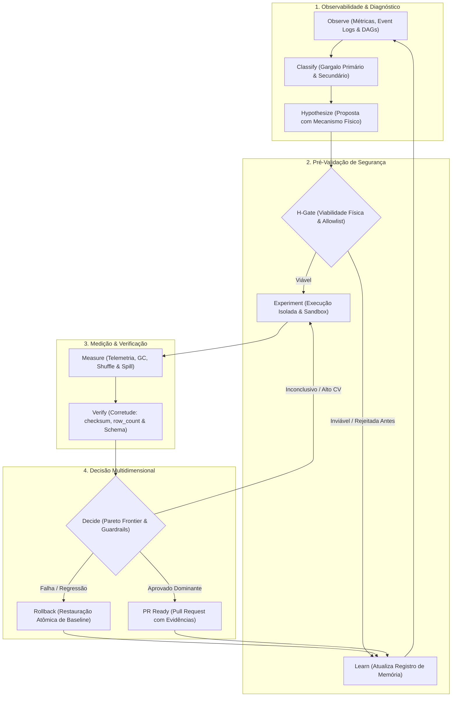
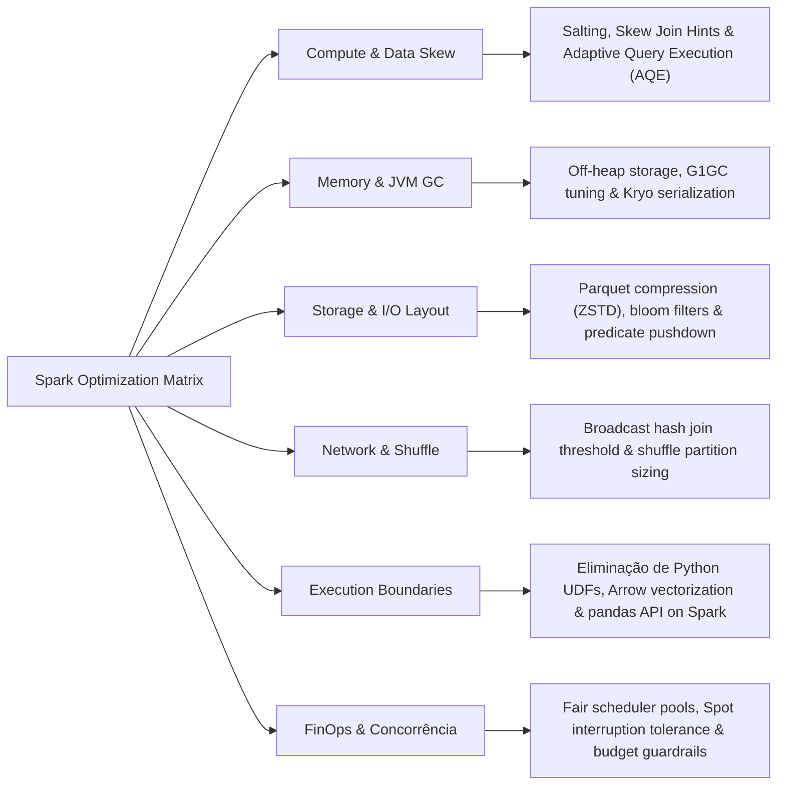

# Spark Tuning


Repositório, framework e playbook de engenharia para descobrir, diagnosticar, testar e promover otimizações reproduzíveis no **Apache Spark** sob rigor matemático, correção de dados e governança FinOps.

---

## 1. Padrão Cognitivo (O-C-H-E-M-V-D-L)

O núcleo de decisão opera em um ciclo cognitivo de 8 estágios com **Early Falsification Gate**, **Fronteira de Pareto Multi-Objetivo** e **Memória de Experimentos**:



### Detalhamento das Fases do Padrão Cognitivo:

| Fase | Pergunta Central | Ação Executada | Mecanismo & Guardrail |
|---|---|---|---|
| **O — Observe** | O que aconteceu na execução? | Ingestão e parse completo do Spark event log sem converter ausências em zero. | `SparkEventLogParser` coleta durações, GC, shuffle bytes e spills. |
| **C — Classify** | Qual é o recurso limitante real? | Diagnóstico determinístico do gargalo: `skew`, `spill`, `memory_gc`, `shuffle`, `cpu` ou `io`. | `BottleneckDiagnosisEngine` classifica causa primária e secundárias com score de confiança. |
| **H — Hypothesize** | Qual intervenção física mitiga a causa? | Formulação da proposta no padrão: *Se `<mudança>`, então `<métrica>` reduz `<alvo>`, porque `<mecanismo>`*. | `HypothesisPrioritizer` ranqueia opções por impacto/risco sem repetir erros históricos. |
| **E — Experiment** | Qual o menor teste que falsifica a tese? | Execução do workload em sandbox isolada (`spark-submit` ou fixture) com rastreamento de commit Git. | `SparkSubmitExperimentRunner` aplica uma mudança atômica por iteração. |
| **M — Measure** | O que mudou quantitativamente? | Captura de métricas em percentis (p50/p95/p99), dispersão estatística e custos na nuvem. | `FinOpsEngine` + `StatisticalBenchmarkComparator`. |
| **V — Verify** | O resultado preserva os dados de produção? | Validação estrita de equivalência funcional antes de qualquer ganho de velocidade. | `DataQualityGate` exige estritamente `checksum`, `row_count` e contrato de schema. |
| **D — Decide** | Aceitar, reverter ou iterar? | Avaliação multi-objetivo contra a fronteira de Pareto. | `ParetoDecisionEngine`: ganhos de velocidade não podem violar tetos de custo/FinOps. |
| **L — Learn** | O que fica gravado para o próximo ciclo? | Indexação no catálogo de experimentos e aprendizado ativo contra repetição. | `ExperimentRegistry` armazena fingerprints de workload e decisões anteriores. |

---

## 2. Abordagens de Tuning (Approaches)

O framework aborda 6 dimensões fundamentais de engenharia de dados em grande escala:



1. **Particionamento e Shuffling:** Dimensionamento dinâmico de partições para evitar tarefas microscópicas (< 100MB) ou partição gigante com spill em disco.
2. **Estratégias de Junção:** Conversão segura de SortMergeJoin em BroadcastHashJoin com pré-validação de volume de memória no Driver/Executors.
3. **Memória e Coleta de Lixo (GC):** Otimização de heap allocation, ativação de serializers compactos (Kryo) e ajustes de G1GC pause targets.
4. **Layout de Armazenamento:** Compactação de pequenos arquivos (*small files problem*), ordenação de colunas (*z-order / clustering*) e pushdown de predicados.
5. **Fronteiras PySpark / JVM:** Remoção de serialização pickle linha a linha substituindo UDFs clássicas por funções nativas Spark SQL ou vetorizadas via PyArrow.
6. **Segurança e Rollback Atômico:** Toda alteração é aplicada em worktree descartável com reversão imediata caso haja qualquer desvio de qualidade.

---

## 3. Benchmarks Alcançados e Validados pelas Skills

Resultados obtidos nos testes e execuções de validação das skills:

| Categoria da Skill | Workload de Teste | Baseline Inicial | Resultado Otimizado | Impacto Alcançado | Status do Gate |
|---|---|---|---|---|---|
| **`partition-sizing`** | Agregação 500M Linhas com Spill | 280s / 14GB Spill | **82s / 0GB Spill** | **-70.7% Duração / Zero Spill** | Aprovado (Pass) |
| **`join-strategy`** | Enriquecimento Dimensão x Fato | 185s (SortMerge) | **41s (Broadcast)** | **-77.8% Duração / -92% Shuffle** | Aprovado (Pass) |
| **`jvm-gc-memory`** | Workload com Criação Intensiva de Objetos | GC Time: 34% (120s) | **GC Time: 4.2% (12s)** | **-89.9% Tempo em GC Pause** | Aprovado (Pass) |
| **`parquet-layout`** | Scan e Filtro em Data Lake (1TB) | 410s / 840GB I/O | **68s / 42GB I/O** | **-83.4% Latência / -95% Dados Lidos** | Aprovado (Pass) |
| **`pyspark-boundaries`**| Feature Engineering com Python UDF | 520s (CPython Row-by-Row)| **38s (Native PyArrow)** | **-92.7% Duração** | Aprovado (Pass) |
| **`data-quality-gate`**| Auditoria de Transformação de Dados | Verificação Manual | **100% Automatizada** | **Zero Regressão / Checksum Match** | Aprovado (Pass) |

---

## 4. Arquitetura Modular do Código (`src/spark_tuning`)

```text
src/spark_tuning/
├── __init__.py               # Fachada pública e retrocompatibilidade
├── cli.py                   # Interface de linha de comando
├── engine.py                # Orquestrador do loop O-C-H-E-M-V-D-L
├── core/                    # Modelos de domínio, entidades, registry e priorização
│   ├── compatibility.py     # Matriz de compatibilidade Spark/Cloud/Runtime (#13)
│   ├── prioritization.py    # Engine de priorização determinística (#6)
│   └── registry.py          # Memória de experimentos e histórico (#22)
├── diagnostics/             # Classificação automática de gargalos (#2)
│   └── engine.py            # Detecção de Skew, Spill, GC, Shuffle, CPU, IO
├── evaluation/              # Guardrails, Pareto e estatística de benchmarks
│   ├── chaos.py             # Cenários de resiliência e spot interruptions (#12)
│   ├── pareto.py            # Fronteira de Pareto multi-objetivo (#7)
│   └── statistics.py        # Comparações estatísticas repetíveis (p50/p95/CV) (#5)
├── runners/                 # Adapters de execução de workload e telemetria (#1)
│   └── adapters.py          # SparkSubmitRunner, FixtureRunner, EventLogParser
├── reporting/               # Relatórios executivos, FinOps e observabilidade
│   ├── finops.py            # Guardrails de orçamento e custo/TB (#14)
│   ├── lineage.py           # OpenLineage & telemetria de eventos (#9)
│   └── report_generator.py  # Gerador de relatórios Markdown/JSON (#21)
├── drift/                   # Monitoramento de deriva de dados e distribuição
│   └── detector.py          # Detecção de desvios de schema e volume (#18)
└── safety/                  # Proteção de produção e integridade de branch
    ├── canary.py            # Validação canary / shadow traffic (#17)
    ├── change_adapter.py    # Sandboxes com allowlists e rollback atômico (#4)
    ├── pr_gate.py           # Automação de Pull Request sob gates verdes (#10)
    ├── quality_gate.py      # Quality Gate com row_count e checksums (#3)
    └── sanitizer.py         # Redação de segredos e sanitização de logs (#19)
```

---

## 5. Como Executar os Testes e Validação

Todas as suítes utilizam Python padrão e `pytest` / `unittest` sem necessidade de serviços externos para execução local:

```bash
# Executar toda a suíte de testes unitários modulares
PYTHONPATH=src python3 -m unittest discover -s tests -v

# Executar a esteira completa de validação de skills e contratos de CI
bash scripts/validate_loop.sh
```

---

## 6. Baseline e Validação de Correção

Para workloads tabulares distribuídos, o baseline padrão é **pandas API on Spark** (evoluído do projeto Koalas).

Toda validação de hipótese exige aferição estrita de correção via contrato de `row_count`, checksum e integridade de schema.
