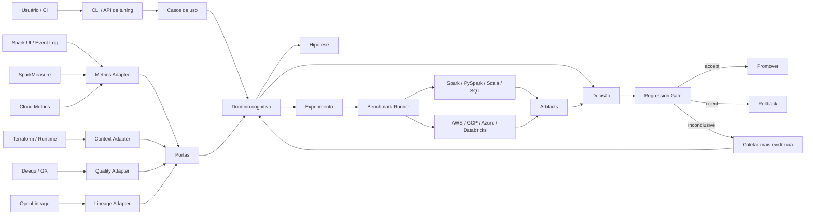
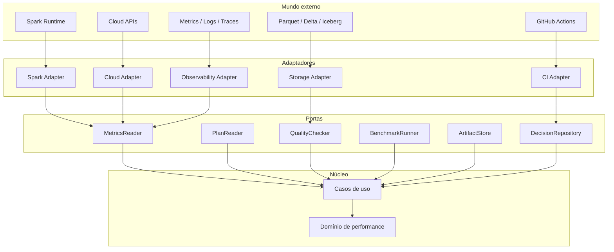
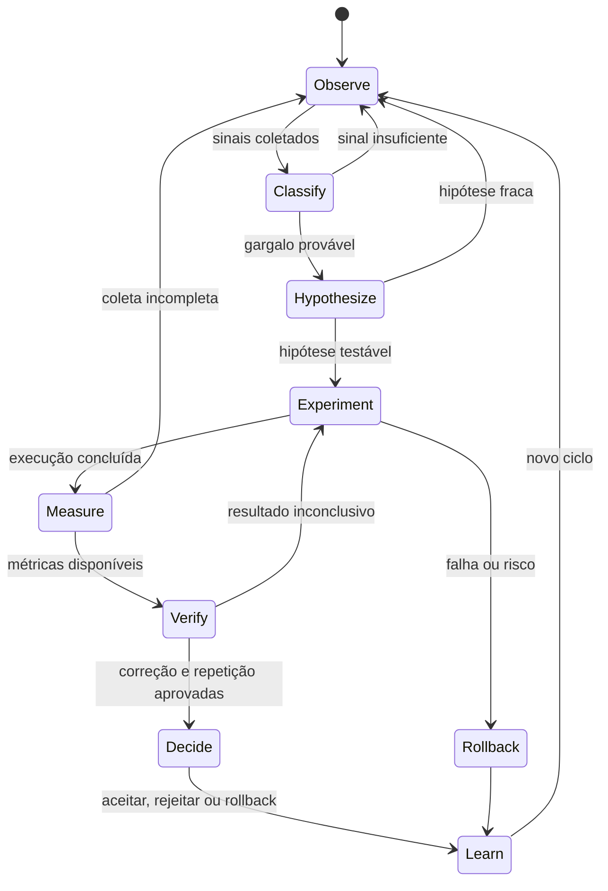
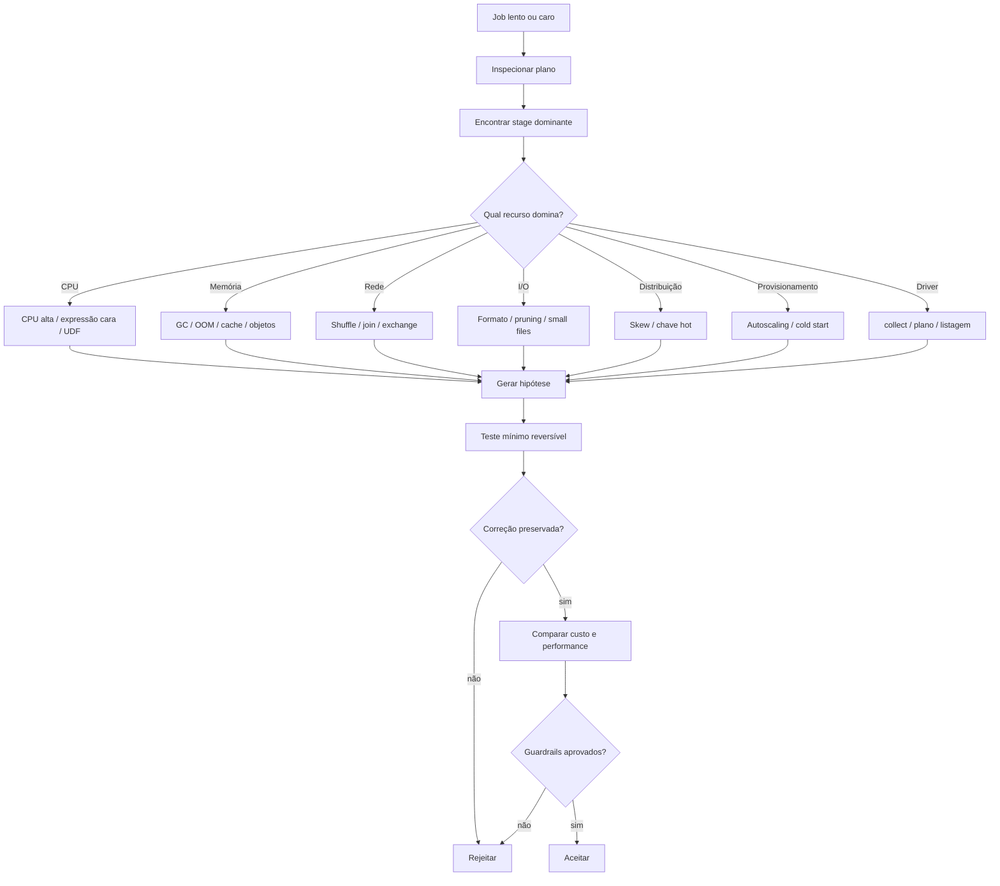
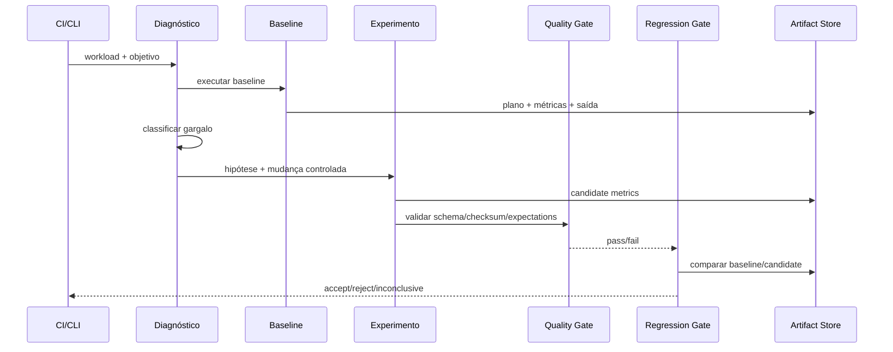
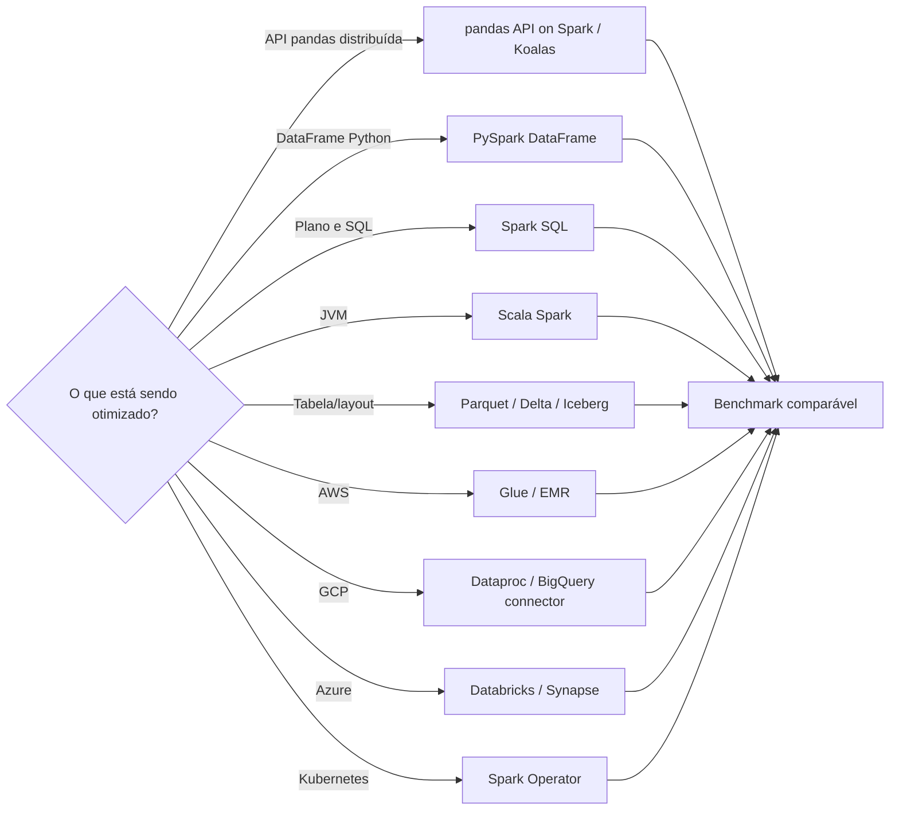
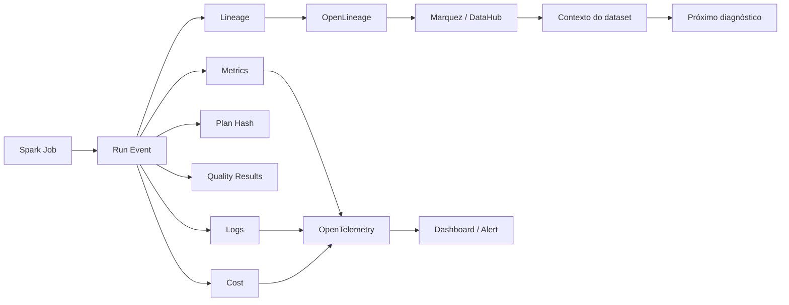
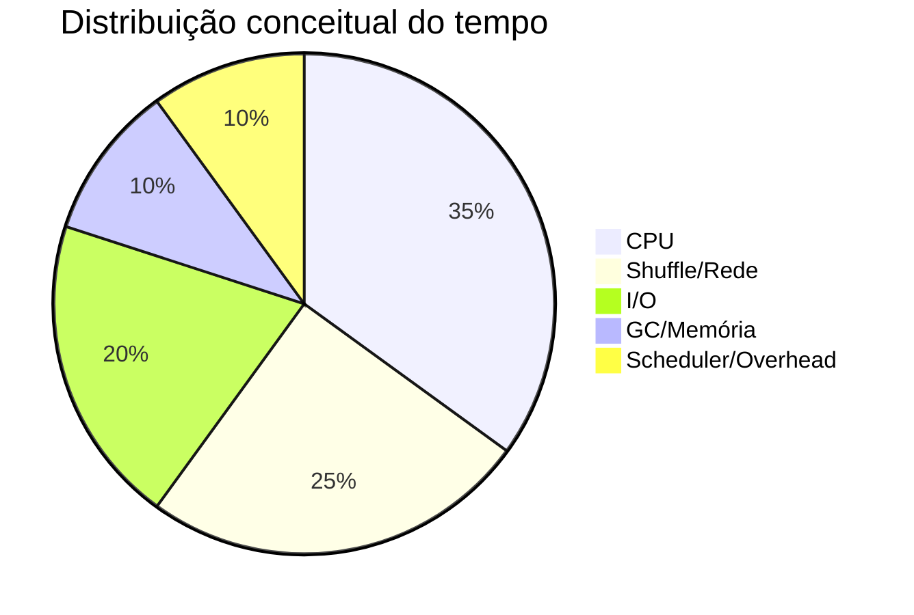

# Diagramas da plataforma

## 1. Visão geral da plataforma



## 2. Arquitetura exagonal



## 3. Padrão cognitivo O-C-H-E-M-V-D-L



## 4. Descoberta do gargalo



## 5. Ciclo antes/depois



## 6. Escolha do framework de referência



## 7. Observabilidade e lineage



## 8. Promoção e rollback

```mermaid
flowchart TD
    Candidate[Candidate] --> Correct{Correção}
    Correct -->|fail| Rollback[Rollback]
    Correct -->|pass| Stable{Estabilidade]
    Stable -->|fail| Rollback
    Stable -->|pass| Perf{Performance}
    Perf -->|regressão| Reject[Reject]
    Perf -->|melhora| Cost{Custo}
    Cost -->|piorou além do limite| Reject
    Cost -->|aceitável| Promote[Promote]
    Promote --> Registry[Skill/Decision Registry]
    Rollback --> Registry
    Reject --> Registry
```

## 9. Diagrama de recursos do job



O gráfico é ilustrativo. Os valores reais devem vir do event log, SparkMeasure ou métricas do runtime.
