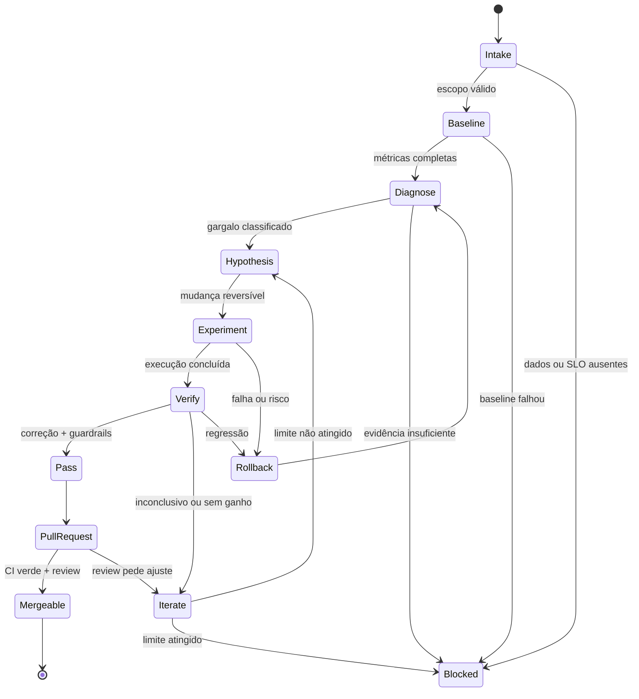

# Loop de engenharia de skills

## 1. Objetivo

O loop transforma uma pergunta de performance em uma mudança pequena, comprovada e reversível. Ele continua iterando enquanto existe uma hipótese útil e ainda não atingiu um limite de segurança, custo ou tempo.

## 2. Máquina de estados



## 3. Contrato de cada iteração

```yaml
iteration:
  id: "iter-003"
  run_id: "run-2026-001"
  parent_iteration: "iter-002"
  hypothesis: "broadcast da dimensão reduz shuffle"
  change:
    files:
      - "skills/join-strategy/examples/after.py"
    configs:
      - "spark.sql.autoBroadcastJoinThreshold"
  prediction:
    duration_delta: "<=-10%"
    shuffle_delta: "<=-30%"
  guardrails:
    correctness: "required"
    failures: 0
    max_cost_delta: 0.10
    max_p95_delta: 0.20
  status: "running"
```

## 4. Algoritmo

```text
while run.status not in {accepted, blocked, rolled_back}:
    validate_scope()
    preserve_baseline()
    observe()
    classify_bottleneck()
    hypothesis = generate_one_best_hypothesis()
    if hypothesis is None:
        block("no evidence-backed hypothesis")

    candidate = apply_change_on_isolated_branch(hypothesis)
    run_smoke_tests(candidate)
    run_correctness_gate(candidate)
    if correctness_failed:
        rollback_iteration()
        record_failure()
        continue_or_block()

    run_benchmark(candidate)
    compare_with_baseline()
    if guardrails_failed:
        rollback_iteration()
        record_failure()
        continue_or_block()

    if result_is_inconclusive:
        change_scale_or_repetition()
        continue

    if result_is_better_and_stable:
        freeze_artifacts()
        open_pull_request()
        stop_loop()
```

## 5. Limites obrigatórios

Cada run deve limitar:

- número máximo de iterações;
- custo máximo;
- duração máxima;
- número de mudanças por iteração;
- tamanho máximo de dados;
- número de retries;
- risco permitido;
- número de PRs abertas.

Valores recomendados:

```yaml
limits:
  max_iterations: 7
  max_experiment_cost_usd: 50
  max_total_cost_usd: 200
  max_runtime_minutes: 120
  max_changes_per_iteration: 1
  max_open_prs: 1
```

## 6. Seleção da próxima hipótese

Pontuar cada hipótese:

```text
priority =
  impact * confidence * reversibility
  / (experiment_cost * risk)
```

Desempate:

1. causa mais próxima da evidência;
2. menor risco;
3. menor custo;
4. maior reversibilidade;
5. maior valor de aprendizado.

## 7. Critérios de sucesso

Uma iteração só é `pass` se:

- resultado correto;
- zero falhas não esperadas;
- melhora de duração ou custo;
- nenhum guardrail violado;
- resultado repetido;
- plano e configuração armazenados;
- rollback conhecido.

## 8. Resultado inconclusivo

`inconclusive` não é sucesso nem falha. Deve registrar:

- variância;
- número de execuções;
- métrica instável;
- fator externo;
- próximo experimento recomendado.

## 9. Quando abrir a PR

Abrir uma única PR quando:

1. a melhor candidate foi escolhida;
2. alternativas rejeitadas foram registradas;
3. testes de correção passaram;
4. CI passou;
5. mudança está isolada;
6. descrição contém hipótese, evidência, custo e rollback.

Nunca abrir uma PR por iteração intermediária só para “salvar progresso”.
