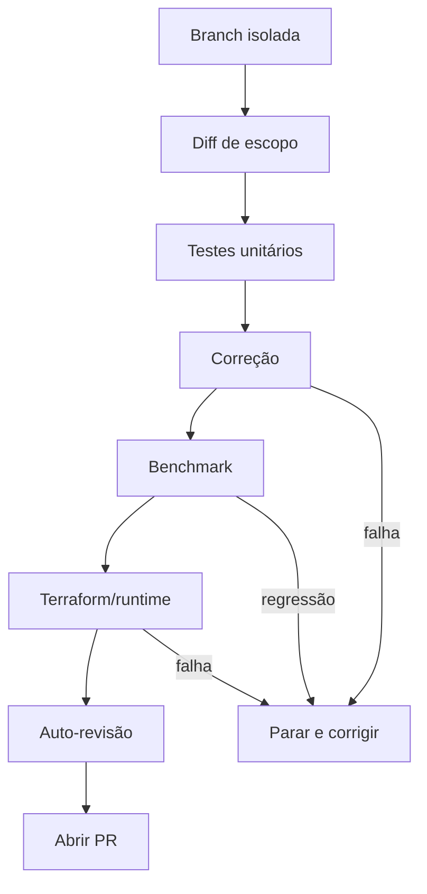

# Segurança de código e política de PR

## Proteção da linha estável

- `main` é somente leitura para o loop;
- branch sempre nasce de `origin/main` atualizado;
- force push é proibido;
- baseline é imutável;
- experimentos usam worktree ou branch temporária;
- dados de produção não são alterados pelo benchmark;
- artefatos ficam fora do caminho de produção.

## Escopo permitido

Uma PR de tuning pode conter:

- mudança de código da skill;
- configuração diretamente relacionada;
- benchmark;
- testes;
- documentação;
- métricas e decisão.

Não misturar refatoração ampla ou mudança funcional não relacionada.

## Gates antes da PR

## Regras de diff

- `git diff --stat` deve ser revisado;
- arquivos fora do escopo bloqueiam a PR;
- nenhuma alteração silenciosa em baseline;
- nenhum segredo ou dado sensível;
- nenhuma configuração sem hipótese;
- nenhum `catch` que esconda falha;
- nenhuma métrica ausente tratada como zero.

## Rollback

Toda PR deve informar:

- commit anterior;
- configuração anterior;
- comando ou passo de reversão;
- condição de rollback;
- impacto de rollback;
- validação pós-rollback.

## Merge

O loop não faz merge automaticamente. Ele pode preparar a PR e parar. Merge exige:

- CI verde;
- revisão humana;
- branch atualizada;
- conflitos resolvidos;
- evidências anexadas;
- decisão explícita.
